# IEEE Open Access Research Paper System & Provenance Workflow

## 1. Executive Summary & Strict Policy Compliance

The **IEEE Open Access Research Paper System** provides a 100% terms-compliant, local-first workflow for discovering, importing, and reading Open Access research papers published by IEEE without violating IEEE's published Terms of Use.

### Non-Negotiable Policy Boundary
- **IEEE Prohibits Robots & Automated Extraction**: IEEE Xplore terms explicitly forbid using any robot, spider, crawler, scraper, or intelligent agent to harvest content, bypass rate limits, or systematically download PDFs.
- **Zero Automated Requests to IEEE**: The desktop application **never** performs automated network requests, crawling, scraping, or preview extractions against `ieeexplore.ieee.org`.
- **Strict Anti-Crawling Enforcement**: The crawler engine automatically blocks any attempt to crawl `ieeexplore.ieee.org`, throwing a structured `ScraperError::RobotsDenied` error with a clear legal policy explanation.
- **Accurate Provenance**: IEEE papers imported manually are recorded with status `user_confirmed_open_access` and evidence `user_confirmation`. The application never falsely claims independent automated verification.

---

## 2. Multi-Mode Architecture

The application categorizes paper acquisition into three distinct architectural modes:

```mermaid
graph TD
    subgraph "Mode A — IEEE Manual Discovery & Import"
        A1[User visits IEEE Xplore in Browser] --> A2[User filters Open Access & downloads PDF]
        A2 --> A3[User imports local PDF into Desktop App]
        A3 --> A4[App checks %PDF- signature & calculates SHA-256]
        A4 --> A5[User confirms OA status & license]
        A5 --> A6[Stored as user_confirmed_open_access]
        A6 --> A7[Launch in Integrated PDF Reader]
    end

    subgraph "Mode B — Permitted Public Website Scrapers"
        B1[Permitted Repositories: bioRxiv, PLOS ONE, etc.] --> B2[Robots.txt & Rate Pacing Check]
        B2 --> B3[HTML Metadata Extraction]
        B3 --> B4[Permitted Direct OA PDF Download]
        B4 --> B5[Stored as verified_open_access]
    end

    subgraph "Mode C — Local Open Access File Import"
        C1[Generic Local PDF file on disk] --> C2[File signature & SHA-256 deduplication]
        C2 --> C3[User confirms OA license]
        C3 --> C4[Stored as user_confirmed_open_access]
    end
```



| Dimension | Mode A (IEEE Manual Import) | Mode B (Permitted HTML Scrapers) | Mode C (Local File Import) |
| :--- | :--- | :--- | :--- |
| **Discovery** | Manual user browsing on IEEE Xplore | Automated crawler engine | Local filesystem file chooser |
| **Network Traffic** | Zero app traffic to IEEE | Polite, rate-limited public HTTP | Zero external traffic |
| **PDF Retrieval** | User browser download | Streamed with SHA-256 hashing | Local file copy / register |
| **OA Status** | `user_confirmed_open_access` | `verified_open_access` | `user_confirmed_open_access` |
| **Evidence Type** | `user_confirmation` | `explicit_source_label` | `user_confirmation` |
| **Retrieval Method** | `ieee_manual_download_import` | `permitted_html_connector` | `local_file_import` |

---

## 3. Database Schema & Migration

Database Migration `0006_ieee_open_access_workflow.sql` adds provenance and access tracking columns to the `papers` table:

```sql
-- Migration 0006: IEEE Open Access & Strict Provenance Tracking
ALTER TABLE papers ADD COLUMN open_access_status TEXT NOT NULL DEFAULT 'pending_verification';
ALTER TABLE papers ADD COLUMN access_evidence_type TEXT NOT NULL DEFAULT 'unknown';
ALTER TABLE papers ADD COLUMN access_evidence_note TEXT;
ALTER TABLE papers ADD COLUMN license_name TEXT;
ALTER TABLE papers ADD COLUMN license_url TEXT;
ALTER TABLE papers ADD COLUMN source_name TEXT;
ALTER TABLE papers ADD COLUMN retrieval_method TEXT NOT NULL DEFAULT 'local_file_import';
ALTER TABLE papers ADD COLUMN access_confirmed_at TEXT;

CREATE INDEX IF NOT EXISTS idx_papers_oa_status ON papers(open_access_status);
CREATE INDEX IF NOT EXISTS idx_papers_retrieval_method ON papers(retrieval_method);
CREATE INDEX IF NOT EXISTS idx_papers_content_hash ON papers(content_hash);
CREATE INDEX IF NOT EXISTS idx_papers_clean_title ON papers(clean_title_key);
```

### Provenance Constants
- **Status values**: `verified_open_access`, `user_confirmed_open_access`, `pending_verification`, `not_open_access`, `access_denied`
- **Evidence values**: `user_confirmation`, `explicit_source_label`, `license_metadata`, `repository_policy`, `unknown`
- **Retrieval methods**: `ieee_manual_download_import`, `permitted_html_connector`, `local_file_import`

---

## 4. Backend Implementation Details

### File Integrity & Deduplication Pipeline
1. **Path Validation**: Rejects path traversal attempts (`..`, illegal characters).
2. **File Existence & Format**: Rejects non-existent files and non-`.pdf` extensions.
3. **Magic Byte Signature Check**: Inspects the first 1024 bytes to verify `%PDF-` header. Corrupted or non-PDF files return `AppError::InvalidInput`.
4. **SHA-256 Hash Calculation**: Computes cryptographic SHA-256 digest of the PDF file.
5. **Deduplication Check**: Queries database by `content_hash`. If a paper with the exact same hash exists, matches the existing paper and flags `is_duplicate = true` without redundant re-saving.
6. **Title / DOI Deduplication**: If DOI or clean title key matches an existing record, merges or updates existing provenance fields safely.

### Tauri Command Endpoints
- `import_ieee_paper(input: IeeeManualImportInput) -> Result<ImportPdfResult, CommandError>`
- `import_local_oa_pdf(input: LocalOaPdfImportInput) -> Result<ImportPdfResult, CommandError>`
- `get_open_access_stats() -> Result<OpenAccessStats, CommandError>`
- `list_open_access_papers(filter: Option<String>) -> Result<Vec<Paper>, CommandError>`

---

## 5. Frontend UI & Reader Integration

1. **Dedicated IEEE Open Access Hub (`IeeeOpenAccessView.tsx`)**:
   - Live KPI metric cards for Open Access inventory.
   - Interactive 4-step pipeline guide: Find IEEE Paper -> Confirm OA -> Download PDF -> Import & Read in App.
   - Filterable paper list with search and source filters.
   - Direct "Read PDF" launcher that opens the embedded PDF reader.
2. **Manual Import Modal**:
   - Form fields: File path, Title, Authors, Publication Year, Venue, DOI, Source URL, License, Target Collection, Notes.
   - Mandatory policy confirmation checkbox: prevents import unless the user explicitly acknowledges having verified Open Access status.
3. **Library Integration (`LibraryView.tsx`)**:
   - Filter dropdown with `All Access`, `Open Access Only`, and `IEEE OA Imports`.
   - Distinct badges (`IEEE OA`, `OA`) on paper list rows.
4. **Sidebar Navigation (`Sidebar.tsx`)**:
   - Dedicated "IEEE Open Access" navigation link with `ShieldCheck` icon.

---

## 6. Test Verification Matrix

All tests compile cleanly and pass with 100% success rate:

- **Rust Backend Suite**:
  - `ieee_workflow_tests.rs`: 4 tests (rejects non-PDF, validates `%PDF-` signature, provenance tracking, multi-source stats).
  - `security_and_robustness_tests.rs`: 7 tests.
  - `crawl_engine_tests.rs`: 6 tests.
  - `database_integration_tests.rs`: 5 tests.
  - `academic_search_tests.rs`: 3 tests.
  - `processing_pipeline_tests.rs`: 4 tests.
  - `performance_benchmarks.rs`: 1 test (1k & 10k records).
  - Unit tests in `lib.rs`: 50 tests.
  - **Total Rust Tests**: 75 passed; 0 failed.
- **Frontend Vitest Suite**:
  - `ieee-open-access.test.tsx`: 2 tests.
  - `academic-discovery.test.tsx`: 4 tests.
  - `crawl-engine.test.tsx`: 2 tests.
  - `processing-pipeline.test.tsx`: 3 tests.
  - `AppShell.test.tsx`: 6 tests.
  - `DiagnosticView.test.tsx`: 3 tests.
  - `desktop-api.test.ts`: 6 tests.
  - `domain-logic.test.ts`: 12 tests.
  - **Total Frontend Tests**: 38 passed; 0 failed across 8 test files.
- **TypeScript Typecheck**:
  - `npm run typecheck`: 0 errors.
- **Production Build**:
  - `npm run build`: built in 8.4s, 0 errors.
