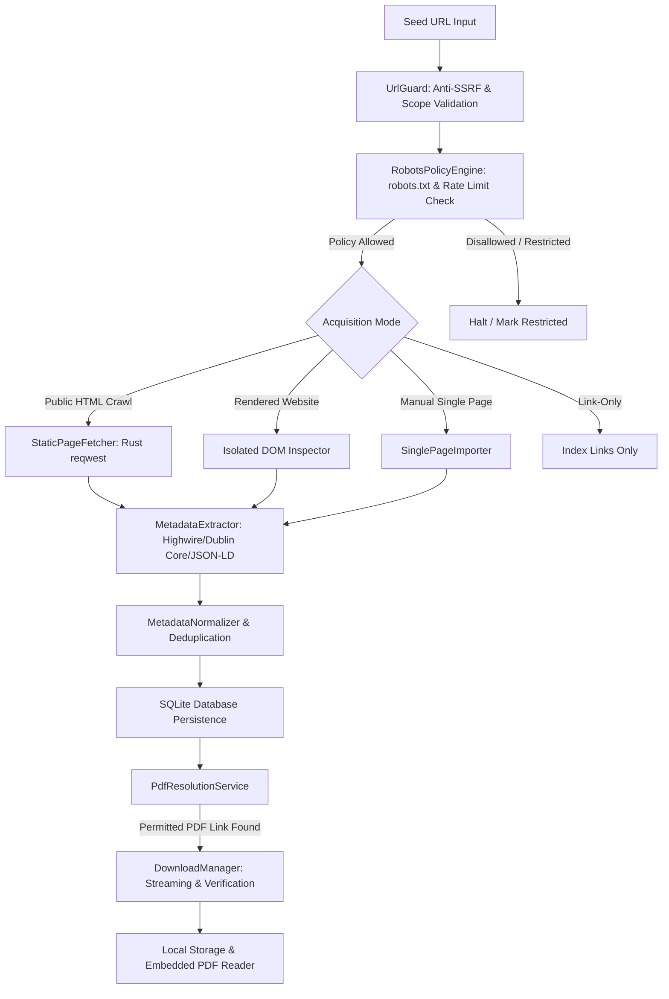

# Website-Driven Research Paper Scraper Architecture (No-API Specification)

## 1. Core Principle & Non-Negotiable "No-API" Definition

This application functions as a **local-first, desktop research paper workbench** that discovers, extracts, stores, and displays research literature by interacting exclusively with **permitted public web pages, normal hyperlinks, and visible document features**.

### What is Prohibited ("No-API")
1. **No official academic provider APIs**: Provider REST endpoints (e.g., OpenAlex API, Crossref REST API, Semantic Scholar API, Europe PMC REST API, etc.) are inactive in discovery mode.
2. **No undocumented/private hidden APIs**: The engine does NOT intercept network traffic to discover or call private JSON/REST/GraphQL/RPC endpoints.
3. **No reverse engineering of internal microservices**: Data must come from normal page HTML and rendered DOM, not from private background fetch routes.
4. **No third-party scraping APIs or cloud proxies**: No ZenRows, ScraperAPI, BrightData, or cloud browsers. All requests originate strictly from the user's local workstation.
5. **No CAPTCHA solving, anti-bot evasion, or browser fingerprint spoofing**: If a site blocks automation or presents challenges, automated crawling stops immediately with an honest, truthful status report.
6. **No paywall bypass or unauthorized access**: Paywalled documents remain as citation metadata with landing-page links.

### What is Permitted
- **Rust HTTP Public Page Retrieval**: Fetching public HTML pages with a transparent, honest User-Agent (`ResearchPaperScraper/0.1 (+https://github.com/local-first/research-paper-scraper)`).
- **Embedded Webpage Metadata Extraction**: Parsing Highwire Press tags (`citation_title`, `citation_author`, `citation_pdf_url`, `citation_doi`), Dublin Core (`DC.title`, `DC.creator`), Open Graph (`og:title`), and Schema.org JSON-LD structured data embedded directly inside the HTML markup. Embedded metadata is an intrinsic part of the public web page.
- **Visible Navigation & Hyperlink Traversal**: Following normal `<a href>` links, pagination controls, issue tables of contents, and article landing links.
- **Manual Current-Page Bibliographic Import**: Allowing the user to input a single article URL and extracting its visible metadata directly into the local SQLite database.
- **Permitted Public Full-Text PDF Retrieval**: Streaming publicly accessible PDFs directly to local disk with cryptographic SHA-256 verification, magic-byte `%PDF-` validation, and association with the parent paper record.
- **Integrated In-App Reading**: Offline reading of local verified PDFs via the sandboxed, bundled PDF.js viewer.

> **Tauri IPC Boundary**: Note that the internal Tauri command boundary connecting the React frontend to the local Rust backend is the application's internal desktop bridge, completely distinct from external third-party data APIs.

---

## 2. Acquisition Strategies

### Strategy A: Public Static HTML Crawl (Default Engine)
1. **URL Validation**: Tested against RFC 3986, scheme restrictions (`http`/`https` only), and private/loopback/cloud-metadata IP filtering.
2. **Robots.txt & Policy Check**: Fetches `/robots.txt`, identifies `User-agent: *` or specific rules, parses `Disallow:` patterns, and extracts recommended `Crawl-delay`.
3. **Polite Request Dispatch**: Executes sequential HTTP requests paced by the configured delay (minimum 1,000 ms by default).
4. **DOM Parsing**: Uses the `scraper` crate (HTML5 parser built on `html5ever`) without executing untrusted JavaScript.
5. **Metadata Cascade**:
   - Level 1: Highwire Press meta tags (`citation_*`)
   - Level 2: Dublin Core meta tags (`DC.*`)
   - Level 3: Schema.org JSON-LD scripts (`@type: ScholarlyArticle`)
   - Level 4: Custom CSS selectors defined in the profile
6. **Boundary Enforcement**: Tracks visited URLs in memory and SQLite; stops when maximum depth, page budget, or paper budget is reached.

### Strategy B: Rendered Website Mode (Sandboxed DOM)
- Designed for client-side JavaScript applications where initial HTML lacks metadata.
- Operates strictly on rendered user-visible DOM nodes without inspecting DevTools Network tabs or invoking internal endpoints.
- Isolated from privileged Tauri commands.

### Strategy C: Manual Single-Page Import
- Single-page bibliographic ingestion initiated by the user for an individual paper URL.
- Extracts citation metadata and associates full-text PDF if freely accessible.

### Strategy D: Link-Only Discovery
- Discovers and catalogs paper titles, authors, and landing URLs without queueing or downloading full-text PDF binaries.

---

## 3. Provenance and Metadata Integrity

Every discovered paper stores its extraction provenance:
- **`provenance_source`**: Exact source page URL where the paper was discovered.
- **`extraction_method`**: Specific tag/engine used (e.g. `highwire_press`, `dublin_core`, `json_ld`, `css_selector`).
- **`access_status`**: Document availability (`pdf_downloaded`, `pdf_link_found`, `metadata_only`, `restricted`).
- **`confidence_score`**: Explicit heuristic rating reflecting metadata completeness.
- **Non-Destructive Guarantee**: Incoming empty or missing values never overwrite existing verified bibliographic data in SQLite.
