# Scholarly Research Library Data Model & Relational Schema

## Overview

The Research Paper Scraper relational database model is designed for scholarly literature management, structured metadata indexing, multi-source ingestion, and local full-text search. The schema is implemented in SQLite 3 with strict foreign key constraints enabled.

---

## 1. Entity-Relationship Diagram

```mermaid
erDiagram
    PAPERS ||--o{ PAPER_AUTHORS : "has"
    AUTHORS ||--o{ PAPER_AUTHORS : "participates in"
    PAPERS ||--o{ COLLECTION_PAPERS : "organized in"
    COLLECTIONS ||--o{ COLLECTION_PAPERS : "contains"
    PAPERS ||--o{ PAPER_TAGS : "labeled with"
    TAGS ||--o{ PAPER_TAGS : "applies to"
    PAPERS ||--o{ PAPER_SOURCES : "retrieved from"
    SOURCES ||--o{ PAPER_SOURCES : "origin of"
    PAPERS ||--o{ NOTES : "annotated by"
    PAPERS ||..|| PAPERS_FTS : "indexed by"

    PAPERS {
        text id PK "UUID v4"
        text canonical_doi UK "Normalized DOI (10.xxxx/...)"
        text clean_title_key "Alphanumeric lower key"
        text title "Paper title"
        text abstract "Abstract markdown/text"
        text publication_date "YYYY-MM-DD"
        integer publication_year "e.g. 2024"
        text venue "Journal / Conference"
        text venue_type "journal, conference, preprint"
        text language "ISO 639-1 code (default 'en')"
        integer citation_count "Citation count"
        integer reference_count "Reference count"
        integer is_open_access "Boolean (0 or 1)"
        text license "License identifier (e.g. CC-BY-4.0)"
        text primary_landing_url "Publisher landing page"
        text pdf_url "Direct PDF URL"
        integer has_file "Boolean (0 or 1)"
        text local_pdf_path "Absolute path to local PDF"
        text content_hash "SHA-256 hash of PDF"
        text metadata_confidence "low, medium, high"
        integer is_saved "Boolean (0 or 1)"
        text created_at "ISO 8601 UTC timestamp"
        text updated_at "ISO 8601 UTC timestamp"
    }

    AUTHORS {
        text id PK "UUID v4"
        text full_name "Full display name"
        text family_name "Family / surname"
        text given_name "Given / first name"
        text orcid UK "ORCID iD (0000-0000-0000-0000)"
        text created_at "ISO 8601 UTC timestamp"
    }

    PAPER_AUTHORS {
        text paper_id PK, FK "References papers(id)"
        text author_id PK, FK "References authors(id)"
        integer author_order "0-indexed author order"
        text affiliation "Institutional affiliation"
        text role "author, editor, translator"
    }

    COLLECTIONS {
        text id PK "UUID v4"
        text parent_id FK "Self-referencing hierarchy"
        text name UK "Unique collection name"
        text description "Optional description"
        text color_hex "Hex accent color"
        text created_at "ISO 8601 UTC timestamp"
        text updated_at "ISO 8601 UTC timestamp"
    }

    COLLECTION_PAPERS {
        text collection_id PK, FK "References collections(id)"
        text paper_id PK, FK "References papers(id)"
        text added_at "ISO 8601 UTC timestamp"
        integer sort_order "Custom ordering"
    }

    TAGS {
        text id PK "UUID v4"
        text name UK "Unique tag name"
        text color_hex "Hex color tag"
        text created_at "ISO 8601 UTC timestamp"
    }

    PAPER_TAGS {
        text paper_id PK, FK "References papers(id)"
        text tag_id PK, FK "References tags(id)"
        text assigned_at "ISO 8601 UTC timestamp"
    }

    SOURCES {
        text id PK "e.g. openalex, arxiv, crossref"
        text name "Display name"
        text source_type "api, repository, structured_feed, commercial_linkout"
        text tier "tier_a, tier_b, tier_c"
        text base_url "Base API endpoint"
        text policy_url "Documentation/terms URL"
        integer rate_limit_rps "Max requests per second"
        integer concurrency_limit "Max concurrent requests"
        integer is_enabled "Boolean (0 or 1)"
        text created_at "ISO 8601 UTC timestamp"
        text updated_at "ISO 8601 UTC timestamp"
    }

    PAPER_SOURCES {
        text paper_id PK, FK "References papers(id)"
        text source_id PK, FK "References sources(id)"
        text source_record_id "Upstream ID"
        text raw_payload_json "Raw API response"
        text fetched_at "ISO 8601 UTC timestamp"
    }

    NOTES {
        text id PK "UUID v4"
        text paper_id FK "References papers(id)"
        text title "Note title"
        text content_markdown "Markdown content"
        text created_at "ISO 8601 UTC timestamp"
        text updated_at "ISO 8601 UTC timestamp"
    }

    APP_SETTINGS {
        text key PK "Setting name (e.g. theme_mode)"
        text value "JSON or scalar string value"
        text updated_at "ISO 8601 UTC timestamp"
    }
```

---

## 2. Normalization & Deduplication Strategy

In scholarly research, duplicates frequently arise because multiple academic APIs (such as OpenAlex, Crossref, and arXiv) index the same paper with varying capitalization, punctuation, and URL formats.

### A. DOI Normalization
- All incoming DOIs are processed through `normalize_doi`:
  - Strips URL schemes and prefixes: `https://doi.org/`, `http://doi.org/`, `doi:`.
  - Trims surrounding whitespace.
  - Converts the prefix and suffix to lowercase: `10.48550/arxiv.1706.03762`.
- A unique index on `canonical_doi` prevents saving the same paper twice under different DOI formats.

### B. Normalized Title Key (`clean_title_key`)
- For preprints or publications without a registered DOI, deduplication is achieved using `compute_clean_title_key`:
  - Converts title to lowercase.
  - Strips all non-alphanumeric characters, punctuation, and spaces (e.g. `"Attention Is All You Need!"` -> `"attentionisallyouneed"`).
- An indexed `clean_title_key` column allows instantaneous candidate lookup and warns users when attempting to import a duplicate paper.

---

## 3. Cascading Rules & Data Safety Contract

Relational integrity is guarded by explicit SQLite foreign key actions:

| Relationship | Action on Delete | Integrity Rationale |
|:---|:---|:---|
| **`collections` -> `collection_papers`** | `ON DELETE CASCADE` | Removing a collection deletes the join entries in `collection_papers`. **Papers in the library are NEVER deleted.** |
| **`papers` -> `collection_papers`** | `ON DELETE CASCADE` | Removing a paper removes its associations with collections. |
| **`papers` -> `paper_authors`** | `ON DELETE CASCADE` | Removing a paper cleans up join rows, while preserving author master records in `authors`. |
| **`papers` -> `paper_tags`** | `ON DELETE CASCADE` | Removing a paper cleans up join rows, while preserving tag master records in `tags`. |
| **`papers` -> `paper_sources`** | `ON DELETE CASCADE` | Removing a paper removes cached upstream payload metadata. |
| **`papers` -> `notes`** | `ON DELETE CASCADE` | Removing a paper cascades to delete attached research annotations. |

---

## 4. Full-Text Search Virtual Table (`papers_fts`)

Full-text queries utilize SQLite's native FTS5 engine:
- Virtual table: `papers_fts USING fts5(paper_id UNINDEXED, title, abstract, authors, venue, tokenize = 'unicode61 remove_diacritics 1')`
- Supports prefix matching (e.g. `comput*`), exact phrases (`"deep residual learning"`), and boolean combinations (`quantum AND algorithms`).
