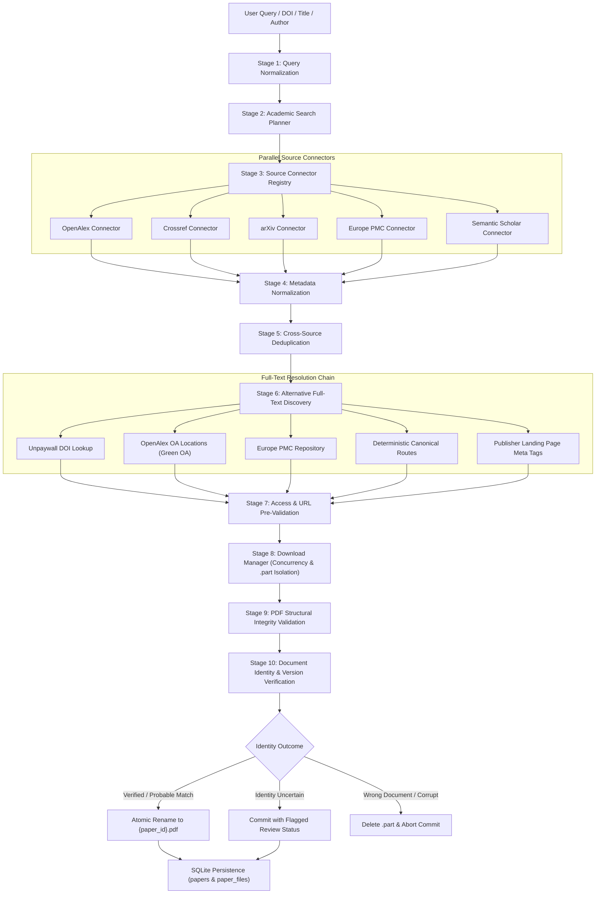

# Multi-Source Connector Architecture & Retrieval Pipeline

## 1. Architectural Philosophy

The Infinity Researcher retrieval pipeline cleanly separates scholarly paper discovery, metadata normalization, full-text availability detection, PDF stream verification, and document identity confirmation.

A discovery lookup for bibliographic metadata does not trigger unbounded PDF download attempts. Conversely, a paper remains completely discoverable and indexable in the research library even when no accessible open-access PDF is available.

---

## 2. End-to-End Retrieval Pipeline

---

## 3. Pipeline Stages & Responsibilities

### Stage 1: Query Normalization
- Extracts and strips prefixes from canonical DOIs (`https://doi.org/`, `http://dx.doi.org/`, `doi:`).
- Normalizes punctuation, curly quotation marks, multiple spaces, and Unicode diacritics.
- Detects arXiv identifiers (`arxiv:2301.00001` or `2301.00001v2`), PMIDs, and PMCIDs.
- Preserves the raw user query for explainability and diagnostics.

### Stage 2: Academic Search Planner
- Analyzes normalized query tokens and generates targeted provider query plans.
- If a canonical DOI is detected, queries stable identifier endpoints directly rather than performing slow, noisy full-text searches.
- Selects sources based on provider capabilities (e.g. arXiv for physics/CS preprints, Europe PMC for biomedicine).

### Stage 3: Source Connector Registry
- Manages thread-safe instances of `AcademicConnector` implementations.
- Enforces per-domain token-bucket rate limiters (`RateLimiter`) with jittered exponential backoff.
- Executes asynchronous requests with strict timeout bounds (6 seconds per provider).

### Stage 4: Metadata Normalization
- Converts disparate upstream JSON/XML structures into the unified `NormalizedWork` domain model.
- Normalizes authors into structured objects containing clean names, ORCID identifiers, and institutional affiliations.
- Assesses metadata completeness (`MetadataCompleteness`) scoring between 0 and 100 based on presence of DOI, abstract, authors, date, and venue.

### Stage 5: Cross-Source Deduplication
- Canonicalizes titles using alphanumeric-only lowercase tokens.
- Merges duplicate records across sources using DOI exact matching or title Jaccard similarity.
- Aggregates upstream provenance (`ProviderProvenance`) so users can inspect every source that contributed metadata.

### Stage 6: Alternative Full-Text Discovery
- When a primary publisher link requires subscription access, searches legal open-access locations.
- Queries Unpaywall, OpenAlex `oa_locations`, Europe PMC, and repository preprints.
- Classifies candidate version types (`published_version`, `accepted_manuscript`, `preprint`, `repository_version`).

### Stage 7: Access & URL Pre-Validation
- Validates URL structure and schemes (`https`, `http`).
- Enforces anti-SSRF policies blocking private networks (`127.0.0.1`, `10.0.0.0/8`, `192.168.0.0/16`, AWS/GCP metadata endpoints).
- Probes remote endpoints to inspect `Content-Type` headers and verify `%PDF-` signature in the first 1024 bytes.

### Stage 8: Download Manager Orchestration
- Regulates active concurrent network transfers (bounded by concurrency semaphore).
- Streams bytes directly to `.tmp_{job_id}.part` disk files.
- Provides real-time speed calculation (`speed_bps`), progress percentages, and cooperative cancellation.

### Stage 9: PDF Structural Integrity Validation
- Validates that the downloaded payload is >= 1024 bytes.
- Parses document structure with `lopdf::Document`.
- Confirms document is not password-protected or encrypted.
- Extracts page count and text streams.

### Stage 10: Document Identity & Version Verification
- Reconciles extracted PDF text and Document Info metadata against the requested publication.
- Checks exact DOI presence in document body.
- Computes token similarity between PDF header text and expected title.
- Confirms author surname overlap.
- Rejects wrong documents and commits verified files atomically.

