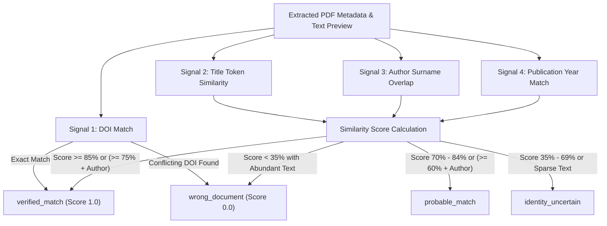

# Deep Document Identity Verification

## 1. The Critical Need for Identity Verification

Merely verifying that a file is a valid PDF does not guarantee it is the paper requested by the researcher. Academic repositories, publisher mirrors, and content delivery networks frequently return:
- Journal issue covers, editorial prefaces, and table of contents.
- Corrigenda, errata, or retraction notices.
- Supplementary spreadsheets or figures exported as PDFs.
- Completely unrelated papers due to broken or shifted redirects.

Infinity Researcher solves this with **Document Identity Verification**, reconciling the internal contents of the downloaded PDF against the requested bibliographic record before committing the file to the library.

---

## 2. Evidence Signals & Matching Logic

`PdfProcessor::reconcile_identity` extracts text from the document (up to 50 pages) and analyzes multiple independent evidence signals:

### Signal 1: DOI Verification
- Searches document text for DOI pattern `10.\d{4,9}/[-._;()/:A-Za-z0-9]+`.
- If extracted DOI exactly matches expected DOI: immediate 100% confidence match.
- If extracted DOI differs definitively from expected DOI (e.g. `10.1109/CVPR.2016.90` vs `10.48550/arXiv.1706.03762`): categorized as `wrong_document`.

### Signal 2: Title Token Similarity
- Normalizes target and document titles by removing stop words and non-alphanumeric punctuation.
- Calculates blended Jaccard token similarity (40%) and target coverage overlap (60%):
  $$\text{Score} = 0.4 \times \frac{|A \cap B|}{|A \cup B|} + 0.6 \times \frac{|A \cap B|}{|A|}$$
- If title similarity exceeds 0.85 (85%): high-confidence title match.

### Signal 3: Author Overlap
- Splits author names into surnames (minimum length 3 characters).
- Checks whether expected author surnames appear within the first 2,000 characters of the document text or `/Author` metadata dictionary.
- Boosts confidence when combined with moderate title similarity.

---

## 3. Verification Categorization Taxonomy

| Status Category | Match Confidence | Reconciled? | Action Taken by Download Manager |
| :--- | :--- | :--- | :--- |
| `verified_match` | $\ge 85\%$ or DOI match | Yes (`true`) | Commits file to `{paper_id}.pdf`. Marks paper verified in library. |
| `probable_match` | $70\% - 84\%$ | Yes (`true`) | Commits file to `{paper_id}.pdf`. Marks probable match. |
| `identity_uncertain` | $35\% - 69\%$ or scanned | No (`false`) | Commits file with `identity_uncertain` warning flag. Preserved for user review without false verified claim. |
| `wrong_document` | $< 35\%$ or conflicting DOI | No (`false`) | **Rejects and deletes `.part` file.** Aborts commit. Alerts user with descriptive mismatch reason. |
| `invalid_pdf` | Structural error | No (`false`) | **Rejects and deletes `.part` file.** Aborts commit. |
| `encrypted_pdf` | Password locked | No (`false`) | **Rejects and deletes `.part` file.** Aborts commit. |
| `verification_failed` | Processing error | No (`false`) | **Rejects and deletes `.part` file.** Aborts commit. |

