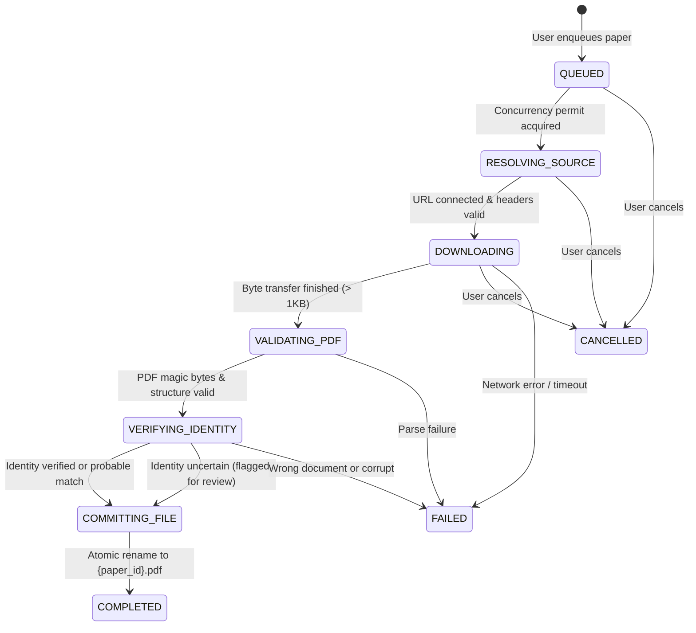

# Download Manager State Machine & Safe File Lifecycle

## 1. Lifecycle State Machine

The Rust `DownloadManager` orchestrates the complete acquisition, validation, verification, and file commitment lifecycle:

---

## 2. Safe File Lifecycle & Concurrency Guarantees

### 2.1 Bounded Concurrency
- Controlled by an `Arc<Semaphore>` initialized to 3 concurrent downloads.
- Prevents desktop bandwidth saturation and upstream IP rate-limiting.

### 2.2 Disk Isolation (`.tmp_{id}.part`)
- Downloads are streamed in chunks (typically 8KB–64KB) directly to a temporary file:
  `{storage_dir}/.tmp_{job_id}.part`
- The file is never visible to the embedded PDF viewer or research library while downloading.

### 2.3 Atomic Finalization
- Only after both structural verification and identity reconciliation pass, `fs::rename` moves the temporary file to its permanent destination:
  `{storage_dir}/{paper_id}.pdf`
- Under Windows and POSIX filesystems, `fs::rename` within the same volume is atomic, preventing partial file visibility.

### 2.4 Cleanup of Orphaned Part Files
- If the application crashes or is forcefully terminated, uncompleted `.part` files remain on disk.
- `DownloadManager::clean_orphaned_downloads` scans the storage directory, identifies `.part` and `.tmp_` files not associated with active jobs, and deletes them.
- Permanent `{paper_id}.pdf` files are **never** touched during cleanup.

### 2.5 Restart Recovery
- On application boot, `PdfWorkspaceRepository::recover_interrupted_jobs` queries `download_jobs` for jobs stuck in `downloading`, `queued`, `resolving`, `validating`, or `verifying_identity`.
- Marks them as `status = "failed"` with `error_category = "interrupted"` and `stage_message = "Interrupted by application restart"`.
- Users can click **Retry** in the download manager to resume transfer safely.

