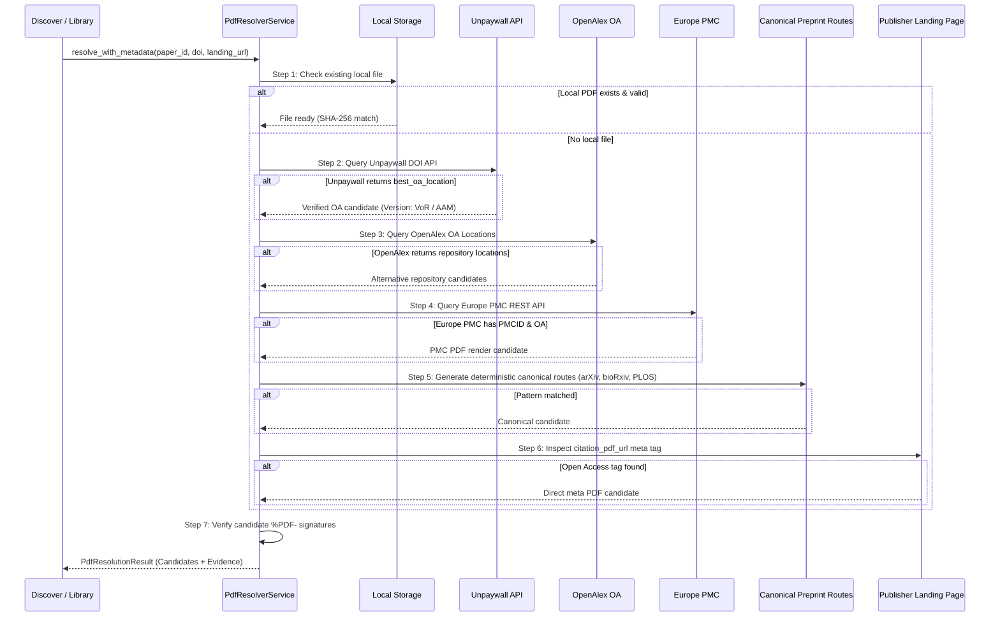

# Alternative Full-Text Discovery & Lawful Open-Access Resolution

## 1. Principles of Lawful Retrieval

Infinity Researcher prioritizes legal and ethical scholarly retrieval. When an academic paper appears locked behind a publisher's paywall:
1. The system **never** attempts to circumvent publisher authentication, bypass CAPTCHAs, or exploit unauthorized session tokens.
2. The system **never** queries or retrieves content from shadow libraries or copyright-infringing repositories.
3. The system executes an **Alternative Full-Text Discovery Workflow** designed to locate legitimate author manuscripts, preprint copies, and institutional repository deposits permitted under open-access mandates and publisher self-archiving policies (Green Open Access).

---

## 2. Multi-Tier Resolution Sequence

When a user requests full-text PDF retrieval for a paper:

---

## 3. Disciplinary Repository Integration

### 3.1 arXiv Preprints
- Matches DOIs with prefix `10.48550/arXiv.` or URLs containing `arxiv.org/abs/{id}`.
- Generates canonical direct link: `https://arxiv.org/pdf/{id}.pdf`.
- Tagged as `version_type: "preprint"`.

### 3.2 bioRxiv & medRxiv (Cold Spring Harbor Laboratory)
- Matches DOIs with prefix `10.1101/`.
- Generates canonical full-text link: `https://www.biorxiv.org/content/{doi}.full.pdf`.
- Tagged as `version_type: "preprint"`.

### 3.3 PubMed Central (PMC)
- Resolves PMCIDs (`PMC1234567`) via Europe PMC REST API.
- Generates repository PDF link: `https://europepmc.org/backend/ptpmcrender.fcgi?accid={pmcid}&blobtype=pdf`.
- Tagged as `version_type: "accepted_manuscript"`.

### 3.4 OpenAlex Green OA Locations
- Parses `open_access.oa_locations` for institutional repository URLs (`zenodo.org`, `eprints.*`, university digital repositories).
- Preserves the repository source display name and license in candidate evidence notes.
- Tagged as `version_type: "repository_version"` or `version_type: "accepted_manuscript"`.

---

## 4. Explaining Paywalled Papers to Users

When all checked open-access sources indicate that no legitimate free copy exists:
- The UI transitions status to **Publisher Access Required**.
- The paper card provides a direct link to the publisher's official landing page (`https://doi.org/{doi}`).
- Explains that institutional login or library interlibrary loan (ILL) may be required.
- Prevents false-positive downloads and avoids cluttering user storage with error pages.

