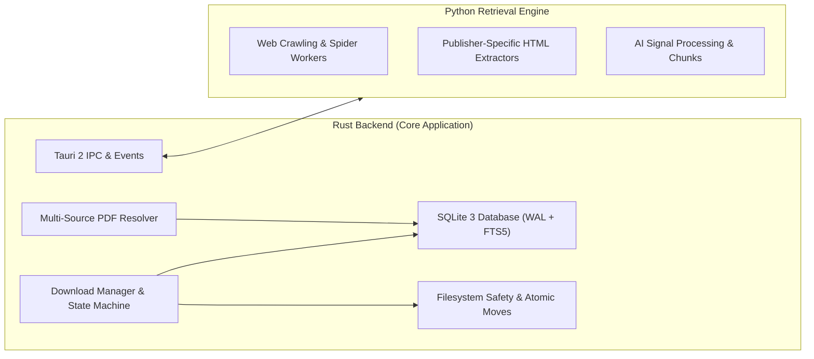

# Rust Backend & Python Engine Contract

## 1. Division of Responsibilities

Infinity Researcher maintains a clean separation of concerns between Rust and Python:



### Rust Responsibilities
- **Task Orchestration**: Bounded concurrency semaphores, cancellation watch channels, timeouts.
- **Tauri IPC**: Typed commands (`invoke`) and streaming UI events (`emit`).
- **File Integrity & Safety**: Atomic `.part` file operations, `%PDF-` binary validation, directory security.
- **Database Coordination**: Connection pooling, SQLite migrations, foreign keys, and transactions.
- **Application Lifecycle**: Graceful shutdown, crash recovery, and updater verification.

### Python Engine Responsibilities
- **Source-Specific Web Scrapers**: Specialized spiders for publishers with dynamic HTML layouts (e.g. Scrapy engine in `python-engine/src/paper_scraper/spiders`).
- **HTML Extraction**: Headless scraping pipelines, item loaders, and DOM parsing.
- **AI Signal Extraction**: Natural language signal analysis, heuristic sentence segmentation, and embedding extraction.

---

## 2. IPC Request & Response Contract

When Rust dispatches scraping tasks to the Python subprocess, standard JSON payloads are exchanged over stdio or local IPC:

### Request Envelope
```json
{
  "request_id": "req-9b1deb4d-3b7d-4bad-9bdd-2b0d7b3dcb6d",
  "command": "search",
  "params": {
    "query": "Quantum Machine Learning",
    "sources": ["arxiv", "biorxiv", "plos"],
    "limit": 25,
    "year_start": 2022,
    "year_end": 2026
  }
}
```

### Response Envelope
```json
{
  "request_id": "req-9b1deb4d-3b7d-4bad-9bdd-2b0d7b3dcb6d",
  "status": "success",
  "results": [
    {
      "title": "Quantum algorithms for deep learning",
      "authors": ["Alice Smith", "Bob Jones"],
      "doi": "10.48550/arXiv.2301.00001",
      "landing_url": "https://arxiv.org/abs/2301.00001",
      "pdf_url": "https://arxiv.org/pdf/2301.00001.pdf",
      "version_type": "preprint",
      "is_open_access": true,
      "source_name": "arXiv"
    }
  ],
  "error": null
}
```

Every request carries a unique UUID `request_id`. If the Python subprocess exits unexpectedly or times out, the Rust orchestrator cleanly releases concurrency permits and notifies the UI with a descriptive failure message rather than hanging indefinitely.

