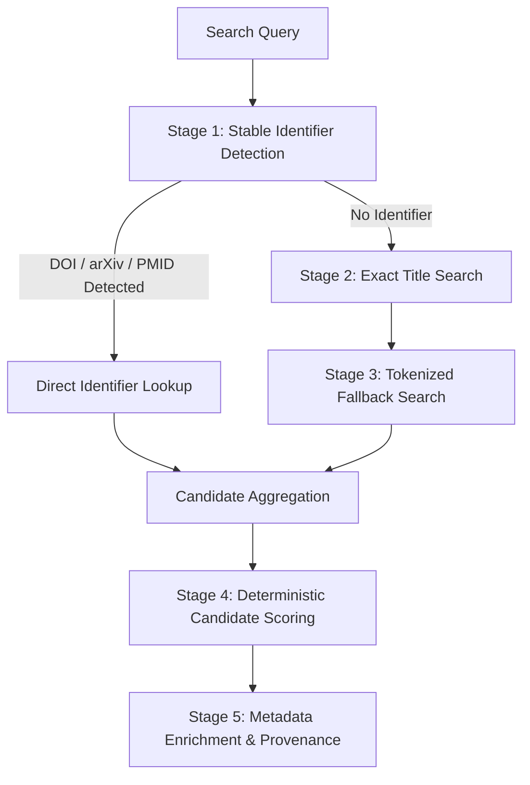

# Search and Candidate Ranking Algorithms

## 1. Overview

The Infinity Researcher search algorithm uses a staged retrieval strategy that balances precision and recall. It avoids sending identical repeated queries to upstream scholarly providers and prioritizes stable identifiers when available.

---

## 2. Staged Retrieval Workflow

### Stage 1: Stable Identifier Detection
- **DOI Pattern Match**: `10.\d{4,9}/[-._;()/:A-Za-z0-9]+`
- **arXiv Pattern Match**: `arxiv:\d{4}\.\d{4,5}(v\d+)?` or old-style `arxiv:[a-z\-]+/\d{7}`
- **PMID / PMCID Pattern Match**: `pmid:\d+` or `PMC\d+`

When an identifier is detected, the planner immediately targets providers with native DOI/ID lookup support (Crossref, OpenAlex, arXiv, Europe PMC). Broad full-text keyword searches are skipped.

### Stage 2: Exact Title Search
When no stable identifier is present, the query planner executes exact title searches using quotes or provider-specific title fields (`title.search:"..."` for OpenAlex, `query.bibliographic` for Crossref).

### Stage 3: Fallback Title & Keyword Search
If exact matching returns zero results or fewer than the requested page size:
1. Strips non-alphanumeric punctuation and standardizes Unicode spaces.
2. Filters out common stop words (`the`, `and`, `for`, `with`, `study`, `towards`).
3. Appends author surname or publication year if specified in filter parameters.
4. Fans out to secondary discovery providers.

### Stage 4: Deterministic Candidate Scoring
Candidate works are ranked deterministically using explainable signals:

| Signal | Weight | Description |
| :--- | :--- | :--- |
| **Exact DOI Match** | 50 pts | Canonical DOI exactly matches requested paper. |
| **Exact Title Match** | 30 pts | Clean title token string matches candidate exactly. |
| **Title Token Jaccard Similarity** | Up to 20 pts | Blended Jaccard and target overlap similarity. |
| **Author Surname Overlap** | 10 pts | At least one primary author surname matches. |
| **Publication Year Match** | 5 pts | Published within +/- 1 year of target publication. |
| **Venue / Journal Match** | 5 pts | Journal or conference container title matches. |

### Stage 5: Metadata Enrichment & Provenance Tracking
When multiple sources return records for the same scholarly work:
1. **Title**: The title with greater completeness and proper casing is retained.
2. **Abstract**: Longer, well-formatted abstracts are preferred over truncated snippets.
3. **Citation Count**: The highest verified citation count is tracked.
4. **Provenance**: Every contributing provider (`openalex`, `crossref`, `semantic_scholar`, `arxiv`, `europe_pmc`) is appended to the `provenance` array with its upstream record ID and landing URL.

