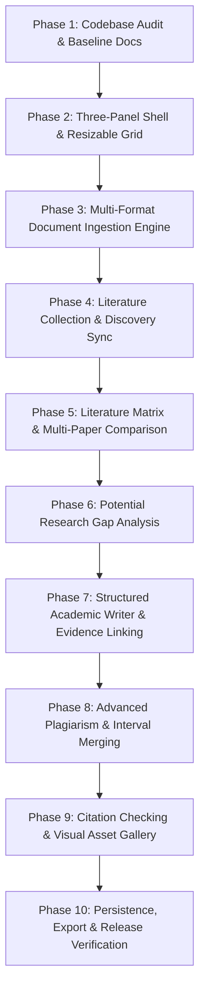

# Implementation Plan: Infinity Researcher Three-Panel Literature Workspace

**Document Version:** 1.0.0  
**Target Milestone:** Production Release  
**Execution Strategy:** Incremental, Phase-by-Phase Implementation with Continuous Automated Verification  

---

## 1. Roadmap Overview



---

## 2. Phase-by-Phase Work Breakdown

### Phase 1: Codebase Audit & Baseline Documentation (COMPLETED)
- **Objective:** Audit existing frontend routes, Rust backend services, Python processing engine, database migrations, and similarity tools to identify reusable components and establish architectural plans.
- **Deliverables:**
  - `docs/literature-workspace/codebase-audit.md`
  - `docs/literature-workspace/architecture.md`
  - `docs/literature-workspace/implementation-plan.md`
- **Verification:** Completed and validated against codebase.

---

### Phase 2: Three-Panel Interface & Navigation Architecture
- **Objective:** Build the core three-panel container layout with independent resizing, collapsing, and a shared selection bus.
- **Tasks:**
  - Create `src/features/literature-workspace/LiteratureWorkspaceView.tsx`.
  - Implement resizable splitters with mouse drag and touch event handlers.
  - Add collapse/expand toggle controls for Panel 1 (left) and Panel 3 (right).
  - Persist panel widths to `localStorage` (`panel1Width`, `panel3Width`).
  - Create `ProjectWorkspaceContext.tsx` providing a shared state bus across all 3 panels.
  - Register route in `AppShell.tsx` and sidebar navigation in `Sidebar.tsx`.
- **Acceptance Criteria:**
  - Users can resize Panel 1 and Panel 3 smoothly without visual glitching.
  - Collapsing either side panel allows Panel 2 to expand flexibly.
  - Tab switching in Panel 2 preserves selected paper, writing draft, and matrix state.

---

### Phase 3: Multi-Format Document Ingestion Engine
- **Objective:** Ingest research papers across PDF, DOCX, LaTeX, TXT, and Markdown, creating structural representations with visible processing states.
- **Tasks:**
  - Extend ingestion pipeline supporting drag-and-drop and directory import.
  - Compute canonical SHA-256 hash for exact duplicate detection.
  - Integrate Rust `lopdf` extraction with Python `extract_document_file` fallback.
  - Detect rasterized/scanned PDFs and flag with explicit `OCR Required` status.
  - Store extraction states in `paper_files` and `processing_jobs` tables:
    `Queued` -> `Extracting` -> `Extracted` / `OCR Required` / `Failed`.
  - Provide actionable error messages and 1-click retry for failed jobs.
- **Acceptance Criteria:**
  - Original document files remain immutable on disk.
  - Page counts, title, abstract, and section offsets are indexed reliably.
  - Duplicate uploads are recognized and reported without duplicate storage.

---

### Phase 4: Literature Collection & Online Academic Discovery
- **Objective:** Unify local project collections with multi-source online paper discovery inside Panel 1.
- **Tasks:**
  - Implement Panel 1 dual mode: **My Collection** (project library) and **Discover Papers** (online query).
  - Connect online search to existing Rust and Python streaming engines across arXiv, bioRxiv, medRxiv, PubMed, PMC, PLOS, Nature, IEEE.
  - Display search results with relevance scores, open access chips, and `Add to Project` action.
  - Support collection filtering (by year, author, keyword, extraction state) and tag management.
  - Connect paper selection in Panel 1 to notify Panel 2 and Panel 3 over `ProjectWorkspaceContext`.
- **Acceptance Criteria:**
  - Searching streams results incrementally without UI blocking.
  - Clicking `Add to Project` imports paper metadata and queues full-text extraction.
  - Selecting a paper in Panel 1 immediately populates Paper Details in Panel 3.

---

### Phase 5: Literature Matrix & Multi-Paper Comparison Engine
- **Objective:** Transform collected papers into a structured literature survey and comparative analysis matrix.
- **Tasks:**
  - Integrate existing `ReviewMatrixView` components into Panel 2 Tab 1 (`Literature Survey`).
  - Build customizable columns: Objective, Methodology, Datasets, Metrics, Results, Limitations, Future Directions.
  - For each cell, extract or link verbatim supporting text with exact page numbers.
  - Implement Tab 2 (`Literature Comparison`): side-by-side contrast of 2 to 6 selected papers.
  - Explicitly identify non-comparable empirical evaluations when experimental conditions differ.
  - Provide inline editing, verification badges (`Verified by Researcher`, `AI Extracted`), and CSV export.
- **Acceptance Criteria:**
  - Selecting any matrix cell immediately renders its verbatim supporting excerpt and page in Panel 3.
  - Researchers can edit or verify extracted values without losing original attribution.

---

### Phase 6: Potential Research Gap Analysis Engine
- **Objective:** Analyze collected literature to identify and synthesize candidate research gaps with supporting citations.
- **Tasks:**
  - Create Panel 2 Tab 3 (`Research Gap Analysis`).
  - Aggregate reported limitations, underexplored datasets, and conflicting findings across project papers.
  - Synthesize candidate gap categories:
    1. Unresolved Methodological Limitations
    2. Missing Benchmark Evaluations & Real-World Deployments
    3. Conflicting Empirical Claims between Architectures
    4. Underexplored Domain Applications
  - Display supporting papers, evidence excerpts, and candidate research questions for each gap.
  - Include mandatory epistemic disclaimer: results are candidate gaps based on the local collection.
- **Acceptance Criteria:**
  - Each suggested gap traces back to specific paper limitations or discrepancies.
  - Zero fabricated gaps or unwarranted claims of universal research absence.

---

### Phase 7: Structured Academic Paper Writing Workspace & Evidence Linking
- **Objective:** Provide a section-based scholarly manuscript editor whose claims link directly to source evidence.
- **Tasks:**
  - Implement Panel 2 Tab 4 (`Research Paper Writer`).
  - Configurable sections: Title, Abstract, Introduction, Related Work, Problem Formulation, Methodology, Experiments, Discussion, Limitations, Conclusion, References.
  - Integrate `tokenPreservationGuard.ts` to protect equations, quantities, citations, and numbers.
  - Interactive sentence selection: clicking a claim in the manuscript queries project evidence and highlights the supporting passage in Panel 3.
  - Claim support indicator in Panel 3:
    `Directly Supports`, `Contextual / Related`, `Contradictory`, `Insufficient Evidence`.
  - Maintain revision history and undo/redo stacks with SQLite persistence.
- **Acceptance Criteria:**
  - Claim selection seamlessly triggers Panel 3 evidence inspection.
  - Revisions never overwrite drafts without user approval.

---

### Phase 8: Advanced Plagiarism & Similarity Analysis
- **Objective:** Compare manuscript drafts against project papers and reference literature with interval merging.
- **Tasks:**
  - Embed similarity scanner into Panel 3 (`Plagiarism & Similarity Review`).
  - Run Winnowing 4-gram matching with positional mapping against project papers.
  - Implement interval merging to prevent double-counting overlapping candidate matches.
  - Classify matches: Exact Match, Near Match, Paraphrase Candidate, Quoted Passage, Bibliography Entry.
  - Provide review action state per match: `Acknowledge`, `Properly Quoted`, `Citation Attached`, `False Positive`.
  - Highlight corresponding match spans in Panel 2 writing editor.
- **Acceptance Criteria:**
  - Matched percentage accurately reflects unique non-overlapping word coverage.
  - Side-by-side passage comparison allows instant verification of suspected overlaps.

---

### Phase 9: Citation Auditing & Visual Asset Gallery
- **Objective:** Provide citation verification and extracted figures/tables inspection in Panel 2 & Panel 3.
- **Tasks:**
  - Embed `citationEngine.ts` into Panel 3 for instant in-text vs. reference cross-checking.
  - Flag orphan in-text citations, uncited bibliography entries, and malformed DOIs.
  - Implement Panel 2 Tab 6 (`Figures & Tables Gallery`): browse diagrams, charts, and tables extracted from project papers.
  - Display visual assets with page numbers, captions, and copyright/permissions notices.
  - Add 1-click `Open PDF at Page` to open the embedded PDF viewer at the exact figure or citation location.
- **Acceptance Criteria:**
  - Citation audits run live against manuscript text and display actionable warnings.
  - Extracted figures retain attribution to the originating publication.

---

### Phase 10: Persistence, Export & Release Verification
- **Objective:** Wire end-to-end database persistence, report exports, privacy guarantees, and run the complete test suite.
- **Tasks:**
  - Verify SQLite transactions for projects, papers, matrix extractions, revisions, and audits.
  - Implement exports: Literature Matrix (CSV), Research Gap Report (Markdown/JSON), Paper Manuscript (Markdown/DOCX), Citation Audit (PDF/JSON).
  - Verify strict local-only execution mode and remote provider consent gates.
  - Run complete automated test suite (`cargo test`, `npx vitest run`, `npm run build`).
  - Document user guide and release notes.
- **Acceptance Criteria:**
  - 100% of unit and integration tests pass.
  - Production build succeeds with 0 errors.

---

## 3. Reusable Assets & Components Mapping

| Proposed Component | Existing Reusable Module | Location |
|---|---|---|
| **Panel 1: Online Discovery** | `DiscoverView` search streams & filters | `src/features/discover/DiscoverView.tsx` |
| **Panel 1: Document Upload** | `PaperImportModal` & `AddPapersModal` | `src/features/discover/PaperImportModal.tsx` |
| **Panel 2: Literature Matrix** | `ReviewMatrixView` & matrix services | `src/features/review-matrix/ReviewMatrixView.tsx` |
| **Panel 2: Paper Writer** | `AcademicWritingWorkspaceView` & diffs | `src/features/writing-workspace/` |
| **Panel 2: Token Guard** | `tokenPreservationGuard.ts` | `src/features/writing-workspace/tokenPreservationGuard.ts` |
| **Panel 3: PDF Viewer** | `EmbeddedPdfViewer.tsx` | `src/components/pdf-viewer/EmbeddedPdfViewer.tsx` |
| **Panel 3: Evidence Drawer** | `EvidenceDrawer.tsx` | `src/features/review-matrix/EvidenceDrawer.tsx` |
| **Panel 3: Citation Checker** | `CitationCheckerWorkspaceView` & engine | `src/features/citation-checker/` |
| **Panel 3: Similarity Engine** | `AiToolWorkspaceView` Winnowing scanner | `src/features/ai-tools/AiToolWorkspaceView.tsx` |
| **Database Migrations** | 11 Rusqlite migrations (52 tables) | `src-tauri/migrations/` |

---

## 4. Verification & Testing Commands

```bash
# 1. Rust Native Compilation & Migration Tests
cargo check --manifest-path src-tauri/Cargo.toml -j 1
cargo test --manifest-path src-tauri/Cargo.toml --lib database::migrations::tests -j 1

# 2. Frontend Typechecking
npx tsc --noEmit

# 3. Unit & Integration Test Suites
npx vitest run src/test/phase9-backend-integration.test.tsx
npx vitest run

# 4. Production Application Build
npm run build
```

