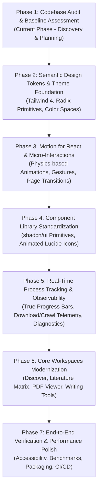

# Infinity Researcher — Complete UI/UX Modernization Program

Welcome to the modernization specification and architectural roadmap for **Infinity Researcher**, an AI-powered local-first scholarly desktop application built on **Tauri 2**, **Rust**, **React 19**, **TypeScript**, **Tailwind CSS 4**, and **Python**.

---

## 1. Modernization Master Vision

The objective of the modernization program is to evolve Infinity Researcher into a fluid, responsive, accessible, and visually stunning academic intelligence workspace without disrupting:
1. The custom **Rust-native backend engine** (over 100 Tauri IPC commands, spider crawling, and download orchestration).
2. The **Python research discovery engine** (Scrapy-based crawling, open-access repository adapters, and candidate resolution).
3. The **SQLite local database** (12 migrations, zero cloud dependencies, full schema integrity).
4. The **12-state embedded PDF reader** with page indexing, text extraction, and offline validation.
5. The **Local Authentication System** (Argon2id password hashing, OS keyring session persistence, inactivity auto-lock).
6. Multi-model **local and cloud AI providers** (Ollama, LM Studio, Groq, Anthropic, Gemini, OpenAI) with grounded section-level citations.

---

## 2. Modernization Phases Roadmap

---

## 3. Phase 1 Audit Deliverables Index

Every deliverable below has been created with empirical evidence, code inspections, and executed tests across the Infinity Researcher codebase:

| Document | Description |
| :--- | :--- |
| [**`phase-1-final-report.md`**](./phase-1-final-report.md) | Comprehensive executive audit report, baseline check results, and Phase 2 transition decision. |
| [**`phase-1-route-inventory.md`**](./phase-1-route-inventory.md) | Complete inventory of all 24 page views, modals, drawers, and secondary screens. |
| [**`phase-1-component-inventory.md`**](./phase-1-component-inventory.md) | Audit of all shared UI primitives, page-specific components, and refactoring priorities. |
| [**`phase-1-dependency-audit.md`**](./phase-1-dependency-audit.md) | Package manifests (`package.json`, `Cargo.toml`, `pyproject.toml`), version constraints, and Motion/shadcn compatibility. |
| [**`phase-1-design-system-audit.md`**](./phase-1-design-system-audit.md) | CSS variables, Tailwind 4 theme tokens, color spaces, spacing conventions, and dark mode. |
| [**`phase-1-animation-audit.md`**](./phase-1-animation-audit.md) | Current GSAP and CSS animations inventory, layout shifts, and Motion for React transition plan. |
| [**`phase-1-icon-audit.md`**](./phase-1-icon-audit.md) | Icon inventory across all screens, standardization around Lucide, and animated icon opportunities. |
| [**`phase-1-frontend-architecture.md`**](./phase-1-frontend-architecture.md) | React 19 architecture, Context API, state persistence, error boundaries, and hooks analysis. |
| [**`phase-1-rust-tauri-audit.md`**](./phase-1-rust-tauri-audit.md) | Tauri 2 architecture, 100+ commands, event streaming, permissions, and background task management. |
| [**`phase-1-python-engine-audit.md`**](./phase-1-python-engine-audit.md) | Python scraping engine, dual-mode execution (PyInstaller binary vs module), Scrapy spiders, and IPC. |
| [**`phase-1-database-audit.md`**](./phase-1-database-audit.md) | SQLite database schema, 12 migrations, index optimization, and data persistence guarantees. |
| [**`phase-1-pdf-audit.md`**](./phase-1-pdf-audit.md) | Embedded PDF viewer (`pdfjs-dist`), 12-state document processing lifecycle, and search/highlighting. |
| [**`phase-1-ai-audit.md`**](./phase-1-ai-audit.md) | AI provider catalog, task routing, section-level RAG chunking, hardware telemetry, and chat history. |
| [**`phase-1-process-tracking-audit.md`**](./phase-1-process-tracking-audit.md) | Task coverage matrix, real-time download and crawl progress, streaming search, and telemetry. |
| [**`phase-1-authentication-audit.md`**](./phase-1-authentication-audit.md) | Local offline authentication, Argon2id hashing, OS keyring session persistence, and app lock. |
| [**`phase-1-accessibility-audit.md`**](./phase-1-accessibility-audit.md) | WCAG 2.1 AA evaluation, keyboard navigation, focus indicators, ARIA attributes, and reduced motion. |
| [**`phase-1-window-layout-audit.md`**](./phase-1-window-layout-audit.md) | Desktop window behavior, frameless window controls, multi-pane splitters, and responsive breakpoints. |
| [**`phase-1-performance-audit.md`**](./phase-1-performance-audit.md) | Frontend bundle sizes, rendering bottlenecks, memory leaks, and large document scaling. |
| [**`phase-1-security-audit.md`**](./phase-1-security-audit.md) | Tauri capabilities, CSP configuration, credential masking, path traversal prevention, and input sanitization. |
| [**`phase-1-feature-preservation-matrix.md`**](./phase-1-feature-preservation-matrix.md) | Master feature preservation registry covering all features, backend dependencies, and regression suites. |
| [**`phase-1-modernization-backlog.md`**](./phase-1-modernization-backlog.md) | Prioritized backlog of technical debt, component consolidations, and UI enhancements (P0 to P3). |
| [**`phase-1-dependency-map.md`**](./phase-1-dependency-map.md) | Sequential implementation dependencies between tokens, components, animations, and screens. |
| [**`phase-1-readiness-checklist.md`**](./phase-1-readiness-checklist.md) | Final verification criteria confirming full readiness for Phase 2. |

---

## 4. Mandatory Audit Rules Followed

1. **Zero Destructive Changes**: No working components, features, or backend routines were deleted or mocked.
2. **Hard Baseline Data**: All build, lint, and test commands were executed and recorded verbatim without concealment.
3. **Preservation of Existing Data**: User databases, credentials, migrations, and preferences remain strictly untouched.
4. **Offline First**: All capabilities operate without mandatory cloud accounts, telemetry, or remote telemetry beacons.

