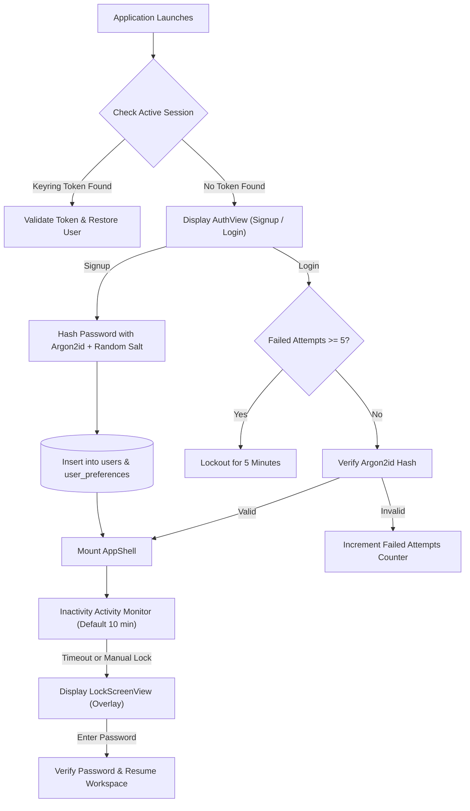

# Phase 1: Authentication and Application-Lock Audit

This audit evaluates the local authentication system, Argon2id password security, session persistence via OS keyring, login throttling, and application lock in **Infinity Researcher**.

---

## 1. Local Authentication Architecture (`src-tauri/src/services/auth_service.rs`)

Infinity Researcher implements a strictly offline, privacy-first local authentication and vault system:

---

## 2. Security Implementations & Specifications

1. **Password Hashing (Argon2id)**:
   - Utilizes the `argon2` crate (`0.5`) with the industry-standard **Argon2id** hybrid algorithm.
   - Generates cryptographically secure 128-bit salts per account using `rand::rngs::OsRng`.
   - Protects against GPU-accelerated dictionary attacks and side-channel timing attacks.
2. **Login Throttling & Brute-Force Defense**:
   - `AuthService` tracks failed attempts per User ID / Email in an in-memory `RwLock<HashMap<String, FailedLoginTracker>>`.
   - Exceeding 5 consecutive failed attempts triggers an automatic 5-minute lockout (`LOCKOUT_DURATION_SECS = 300`).
3. **Session Persistence via OS Keyring**:
   - When the user selects "Remember Me", the session token is securely stored in the native operating system vault (Windows Credential Manager) via the `keyring: 3` crate.
   - Eliminates plaintext tokens on disk or in browser storage.
4. **Application Lock & Inactivity Timeout**:
   - Inactivity detection monitors user interactions (`pointerdown`, `keydown`, `wheel`).
   - If no activity occurs within the configured timeout (default: 10 minutes; configurable in Settings), the application transitions into `isLocked = true`.
   - `LockScreenView` renders a full-screen blurred backdrop obscuring research papers, notes, and manuscripts until unlocked with the user's password.
   - Background tasks (PDF downloads, crawls) continue running safely in the background while locked.

---

## 3. UI/UX Modernization Targets (Phase 4)

1. **Fluid Auth Mode Transition**:
   - Replace instant conditional rendering between Login and Signup forms with a smooth sliding Motion card transition.
2. **Password Reveal Micro-Interaction**:
   - Add an animated slash transition on the eye toggle button.
3. **Lock Screen Entrance**:
   - Apply a soft backdrop-filter blur ramp (`blur(0px) -> blur(16px)`) when auto-lock triggers.

