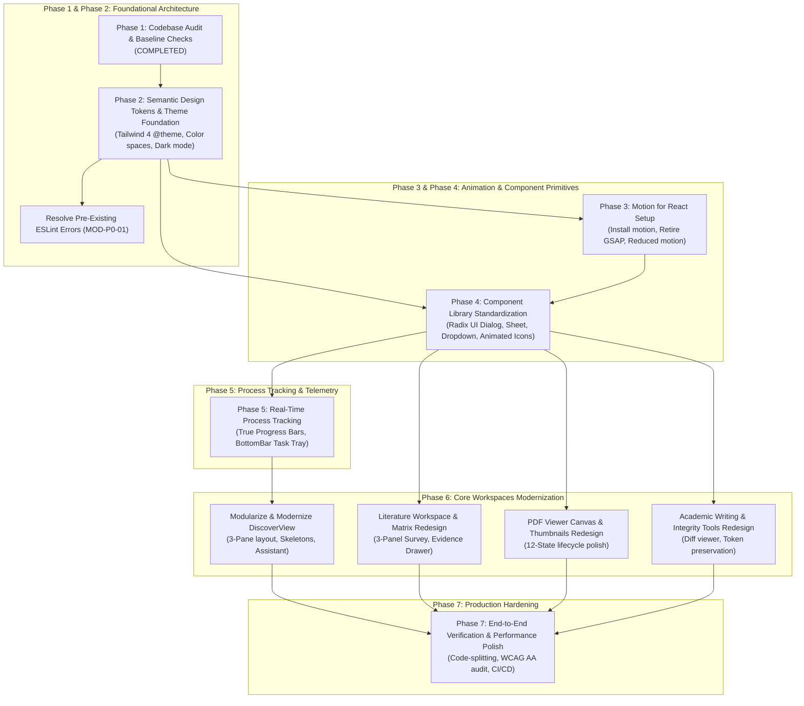

# Phase 1: Implementation Dependency Map

This map outlines the sequential requirements and prerequisite dependencies governing the modernization of **Infinity Researcher**.

---

## 1. Master Dependency Flowchart

---

## 2. Critical Dependency Rules

1. **Tokens Before Components**:
   - Semantic color tokens (`bg-background`, `bg-card`, `border-border`, `text-primary`) must be established in `src/styles/index.css` before rewriting or restyling individual UI components. Attempting to restyle components without unified tokens results in duplicated hex codes.
2. **ESLint Resolution Before Large Refactorings**:
   - `MOD-P0-01` (resolving the 37 ESLint errors in writing and citation utilities) must be completed during Phase 2. This ensures that CI/CD and pre-commit hooks can reliably catch new syntax or type regressions.
3. **Motion Before Page Transitions**:
   - `motion` must be installed and tested in isolation (Phase 3) before removing `gsap` or attempting complex page transitions in `AppShell.tsx`.
4. **Primitives Before Workspaces**:
   - Accessible `<Dialog>`, `<Sheet>`, and `<ResizablePanelGroup>` primitives must be finalized in Phase 4 before deconstructing monolithic workspaces (`DiscoverView`, `ReviewMatrixView`, `LiteratureWorkspaceView`) in Phase 6.
5. **Continuous Regression Testing**:
   - After each phase, all **221 Vitest tests**, **109 Pytest tests**, and `cargo check` must be executed to verify zero degradation of existing functionality.

---

## 3. Parallelization Opportunities

Once Phase 2 (Design Tokens) and Phase 3 (Motion Infrastructure) are established, the following tracks can proceed independently:
- **Track A (Observability)**: Phase 5 Real-Time Process Tracking & Task Tray.
- **Track B (Document Reader)**: Embedded PDF Viewer canvas improvements.
- **Track C (Academic Tools)**: Academic Writing Workspace and Citation Checker polish.

