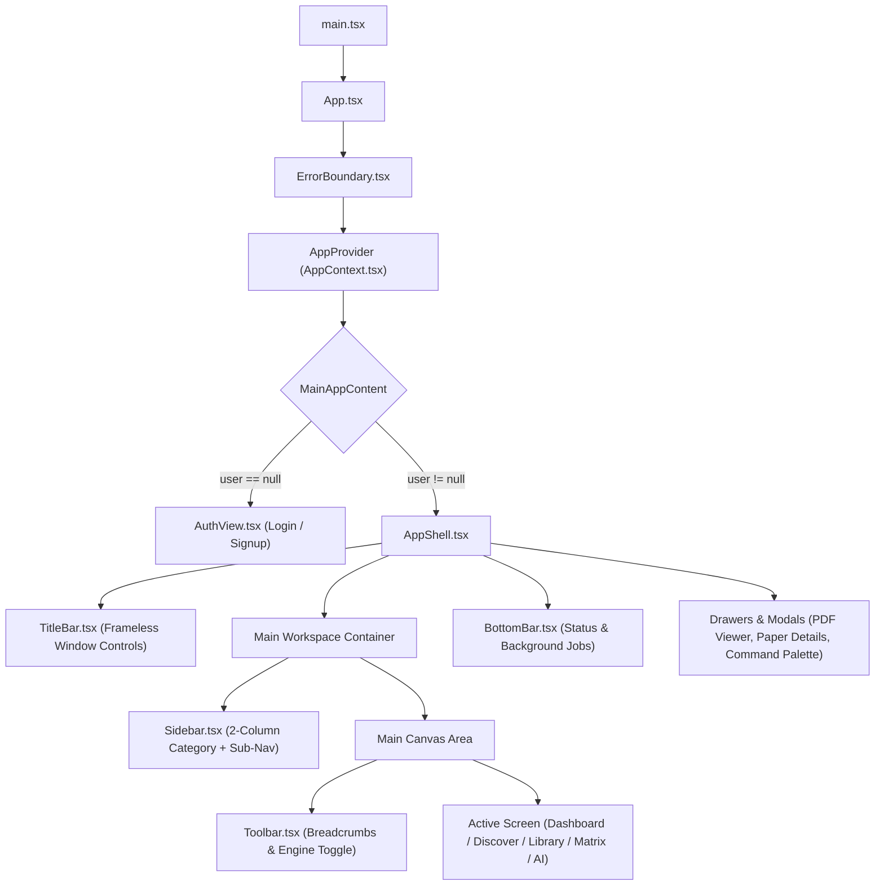

# Phase 1: Frontend Architecture Audit

This audit evaluates the React 19 application structure, state management patterns, IPC wrappers, component lifecycle, and architectural refactoring targets in **Infinity Researcher**.

---

## 1. Application Lifecycle and Component Tree

---

## 2. State Management Architecture

### Context API (`src/context/AppContext.tsx`):
- Acts as the central state hub for:
  - `user`: Current authenticated local user account.
  - `isLocked`: Application lock state.
  - `activeSection`: Active workspace navigation identifier.
  - `papers`: User's saved research library collection.
  - `collections`: Folder and research project collections.
  - `jobs`: Background PDF downloads and crawl tasks.
  - `readingPaper`: Active paper mounted in the embedded PDF viewer.
  - `selectedPaperId`: Selected paper for the slide-over detail drawer.
  - `isAboutModalOpen`, `isOnboardingOpen`, `isFeedbackCenterOpen`.

### State Persistence Strategy:
1. **Persistent Mounted Workspaces**:
   - `DiscoverView` uses a keep-alive pattern via `hasVisitedDiscover`. When navigating to other sections, it is hidden with CSS `hidden` rather than unmounted. This prevents loss of in-flight scraping queries, source progress chips, and reader position.
2. **Local Storage Keys**:
   - `infinity_discover_workspace_layout_v2`: Persists three-pane width split ratios.
   - `infinity_sidebar_v3_secondary_collapsed`: Remembers sidebar state.
   - `infinity_theme`: Persists dark/light mode preference.
3. **OS Keyring Integration**:
   - Stores session authentication tokens in the native Windows Credential Manager (`keyring` crate) when "Remember Me" is selected.

---

## 3. Tauri Desktop IPC Architecture (`src/lib/desktop-api/`)

The application isolates all Tauri IPC invocations behind a clean, typed TypeScript API layer:
- **`src/lib/tauri-bridge.ts`**: Provides `isTauri()` detection, mock fallback data for browser-based unit tests, and safe error mapping (`ERR_RUNTIME_UNAVAILABLE`).
- **`src/lib/desktop-api/index.ts`**: Re-exports strongly typed async methods:
  - `startWebsiteSearchStream(query, onEvent)`
  - `listPapers()`, `createPaper()`, `toggleSavePaper()`
  - `enqueuePdfDownload()`, `listPdfDownloadJobs()`
  - `generateAiResponse()`, `indexPaperForRag()`
  - `authSignup()`, `authLogin()`, `authLock()`

---

## 4. Architectural Debt & Refactoring Targets

1. **Large Monolithic Files**:
   - `src/features/discover/DiscoverView.tsx` is **~3,900 lines of code**. It handles search input, source selector, crawler profiles, results list, paper details, PDF reader iframe, and diagnostics modal in one single file.
   - **Recommendation**: Split `DiscoverView` into focused modular subcomponents:
     - `DiscoverHeader.tsx` (Search input & engine toggle)
     - `DiscoverSourceChips.tsx` (Live source status badges)
     - `DiscoverResultsList.tsx` (Virtual list with skeleton fallback)
     - `DiscoverDetailPanel.tsx` (Paper reader & action toolbar)
2. **Custom Window Drag Handling**:
   - The frameless window title bar uses `data-tauri-drag-region` and custom Rust commands (`window_minimize`, `window_toggle_maximize`, `window_close`). This works well but requires window state synchronization on maximize/restore events.
3. **Typed Local Storage Helper**:
   - Multiple files call `localStorage.getItem` and `localStorage.setItem` directly within `try/catch` blocks. These should be consolidated into a typed `createStorage` utility with schema validation.

