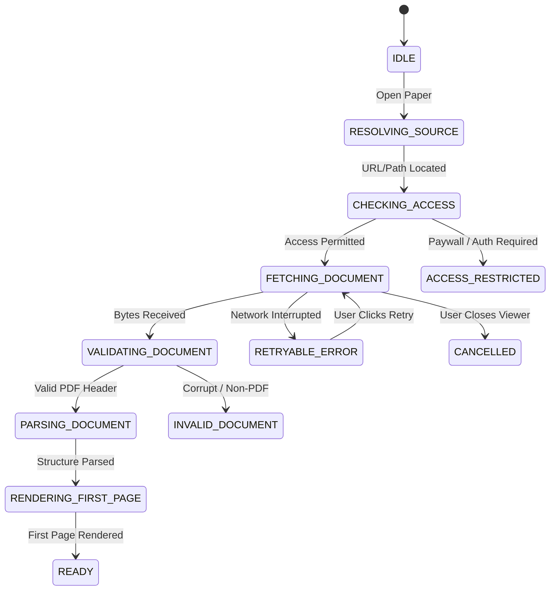

# Phase 1: PDF Reader and Document Processing Audit

This audit evaluates the PDF viewer implementation, rendering lifecycle, text extraction, search capabilities, and document state persistence in **Infinity Researcher**.

---

## 1. PDF Viewer Architecture (`src/components/pdf-viewer/EmbeddedPdfViewer.tsx`)

- **Rendering Engine**: **`pdfjs-dist` (version `6.4.299`)**.
- **Worker Configuration**: Local Vite-bundled ES module worker (`pdfjs-dist/build/pdf.worker.min.mjs?url`), avoiding external CDN dependencies and ensuring 100% offline capability.
- **Rendering Target**: High-DPI HTML5 `<canvas>` with device pixel ratio (DPR) compensation for crisp academic typography, mathematical formulas, and sub-pixel glyph clarity.

---

## 2. 12-State Explicit Process Lifecycle

`EmbeddedPdfViewer` manages document acquisition and rendering through a state machine:

### State Definitions:
1. `IDLE`: Viewer initialized, waiting for document source.
2. `RESOLVING_SOURCE`: Querying database or DOI resolver for file location.
3. `CHECKING_ACCESS`: Verifying open-access status and publisher headers.
4. `FETCHING_DOCUMENT`: Streaming PDF binary over IPC or HTTP.
5. `VALIDATING_DOCUMENT`: Checking `%PDF-` magic bytes and file size threshold.
6. `PARSING_DOCUMENT`: Initializing PDF.js document structure and fonts.
7. `RENDERING_FIRST_PAGE`: Drawing canvas glyphs for initial viewport.
8. `READY`: Document fully interactive with page navigation, zoom, and search.
9. `RETRYABLE_ERROR`: Transient network or I/O failure with retry button.
10. `ACCESS_RESTRICTED`: Publisher paywall or institutional login required.
11. `INVALID_DOCUMENT`: Malformed or corrupted PDF binary.
12. `CANCELLED`: User dismissed viewer during retrieval.

---

## 3. Interactive Features & Document Utilities

- **Zoom Engine**: Scalable from 50% to 300% with `ZoomIn`, `ZoomOut`, and `Fit to Width` shortcuts.
- **Full-Text In-Document Search**:
  - Extracts text layer across all pages.
  - Matches queries with case-insensitive search.
  - Provides `matchIndex` counter, next/previous buttons, and visual focus jumping.
- **Reader State Persistence**:
  - Invokes `save_reader_state` to store `last_page`, `zoom_level`, and `scroll_position` in SQLite.
  - Automatically restores exact reading location when the researcher reopens the paper.
- **Offline Save Action**:
  - One-click `Save Offline` button downloads remote preprints into the permanent local library.

---

## 4. Modernization Targets (Phase 6)

1. **Thumbnail Strip**: Introduce an expandable left sidebar showing visual page thumbnail previews.
2. **Text Highlighting & Annotations**: Add an accessible floating context menu when the user selects text to "Save as Note" or "Send to Evidence Copilot".
3. **Smooth Page Transitions**: Apply Motion for React slide physics when flipping pages.

