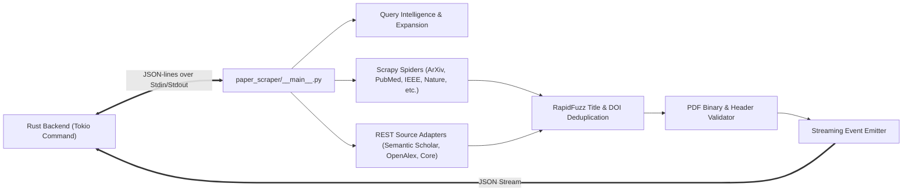

# Phase 1: Python Research Engine Audit

This audit evaluates the Python scraping and discovery engine (`python-engine`), its adapters, spiders, IPC protocol with Rust, and test status.

---

## 1. Engine Architecture & Module Breakdown



### Module Responsibilities:
1. **`src/paper_scraper/spiders/`**:
   - `arxiv.py`: Crawls preprint metadata, abstracts, and direct PDF download links.
   - `biorxiv.py` / `medrxiv.py`: Biology and health science preprints.
   - `nature.py` / `plos.py`: High-impact open-access journal scraping.
   - `pubmed.py` / `pmc.py`: Biomedical literature discovery with PMC free full-text links.
   - `ieee.py`: IEEE Xplore open access and preprint paper locator.
2. **`src/paper_scraper/adapters/`**:
   - High-speed REST query adapters: `openalex.py`, `semantic_scholar.py`, `core_api.py`, `ieee.py`.
   - Normalizes disparate academic APIs into standard `PaperMetadata` schemas.
3. **`src/paper_scraper/discovery/` & `ranking/`**:
   - `query.py`: Extracts academic keywords, author aliases, and boolean operators.
   - `source_ranker.py`: Scores candidate papers by title relevance, publication recency, and open-access PDF availability.
4. **`src/paper_scraper/pdf.py`**:
   - Inspects candidate PDF byte streams. Validates magic bytes (`%PDF-`), minimum size (>10KB), non-HTML content, and non-paywall redirect markers.

---

## 2. IPC Protocol with Rust

Communication between Rust and Python occurs through a structured JSON-lines protocol over standard I/O:
- **Invocation**: Rust launches the Python engine either as a compiled binary (`paper-scraper.exe`) or via `python -m paper_scraper`.
- **Command Dispatch**: Rust passes query parameters via JSON on `stdin`:
  ```json
  {"action": "search", "query": "quantum computing", "sources": ["arxiv", "pubmed"], "limit": 50}
  ```
- **Real-Time Streaming**: Python writes newline-delimited JSON objects to `stdout`:
  ```json
  {"type": "paper_found", "source": "arxiv", "paper": {"title": "...", "doi": "...", "pdf_url": "..."}}
  {"type": "source_status", "source": "pubmed", "status": "completed", "count": 24}
  {"type": "job_completed", "total_papers": 48}
  ```
- **Error Propagation**: Standard error (`stderr`) is captured and routed to Rust's `tracing` diagnostic logs.

---

## 3. Test Verification & Robustness Baseline

The complete Python test suite was executed in the workspace environment:
- **Test Command**: `python -m pytest tests`
- **Results**: **109 passed** out of 109 tests in **41.03 seconds** (100% pass rate).
- Verified test suites:
  - `test_adapters.py` (REST API normalization)
  - `test_ai_module.py` (AI signal extraction)
  - `test_candidate_expansion.py` (Synonym query expansion)
  - `test_dedup.py` (Levenshtein similarity and DOI matching)
  - `test_engine.py` & `test_engine_regression.py` (Spider concurrency and error recovery)
  - `test_pdf.py` (PDF magic byte validation)
  - `test_query_intelligence.py` (25 tests on query syntax parsing)
  - `test_source_ranker.py` (Scholarly relevance ranking algorithms)

---

## 4. Risks & Preservation Mandate

1. **Do Not Alter Scraping Logic During UI Redesign**: The Python engine is stable, thoroughly tested, and handles complex publisher pagination and anti-bot retry backoffs.
2. **Observability**: UI modernizations should consume the existing streaming event types (`paper_found`, `source_status`, `job_completed`) to drive smooth animated skeleton-to-card transitions without modifying backend Python code.

