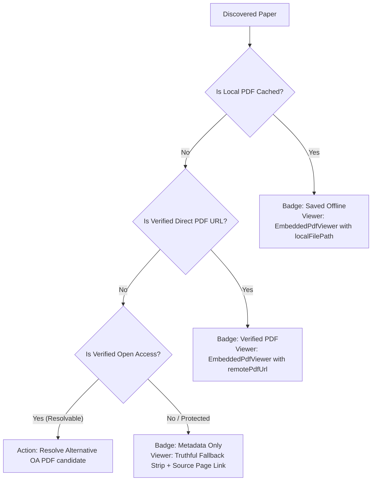

# Phase 11: PDF Availability & Retrieval Integration

## 1. Truthful Document Availability Model

Academic search engines often confound users by labeling web landing pages or paywalled abstract summaries as "PDFs". In Infinity Researcher, document availability is strictly validated across three mutually exclusive tiers:

---

## 2. Integrated PDF Viewer & Distraction-Free Reading

When a paper has either a local file binary or a verified remote PDF stream URL:
1. **In-Situ Center Pane Reading**:
   - The center pane automatically mounts `EmbeddedPdfViewer`, rendering the document canvas directly without launching external browser windows.
   - Supports page zooming, page jumping, text search, and visual highlights.
2. **Distraction-Free Focus Mode**:
   - Clicking the Maximize button in the header toolbar (`isDistractionFree`) collapses both the Left Search Pane and Right Details Pane simultaneously.
   - The PDF viewer expands to occupy 100% of the research viewport.
   - Re-clicking or expanding any sidebar smoothly restores the 3-pane layout.
3. **Workspace Handoff**:
   - The Right Pane Details tab provides a dedicated `"Read in Workspace"` action button.
   - Clicking it dispatches `setReadingPaper({ id, title, sourceUrl })` and navigates to `"literature_workspace"`.

---

## 3. Truthful Metadata-Only Fallback & Protected Portals

For papers from sources with strict anti-bot measures (such as IEEE Xplore, restricted journals, or metadata-only indices):
1. **Zero Fake PDF Streams**: Infinity Researcher never feeds an HTML abstract page to a PDF canvas.
2. **Honest Explanatory Fallback**:
   - Displays a clean explanatory card indicating why a direct unauthenticated stream is unavailable (e.g. *"IEEE Xplore protects full texts with web security challenges. In accordance with IEEE terms of service, search or download the Open Access paper through the official site, then link or import it below without duplicate copies."*).
3. **Actionable Workflows**:
   - `Open Source Article Page`: Direct outbound link opening the official article portal in the user's default browser.
   - `Import or Link Downloaded PDF`: Opens `PaperImportModal` allowing one-click file attachment or DOI import.
   - `Resolve OA Alternative`: Dispatches `resolvePaperPdf(paperId)` to search unpaywall and repository mirrors for open-access PDF copies.
   - `Fetch Open Access Papers Only for this Topic`: Re-executes the search query restricted to verified Open Access repositories.

