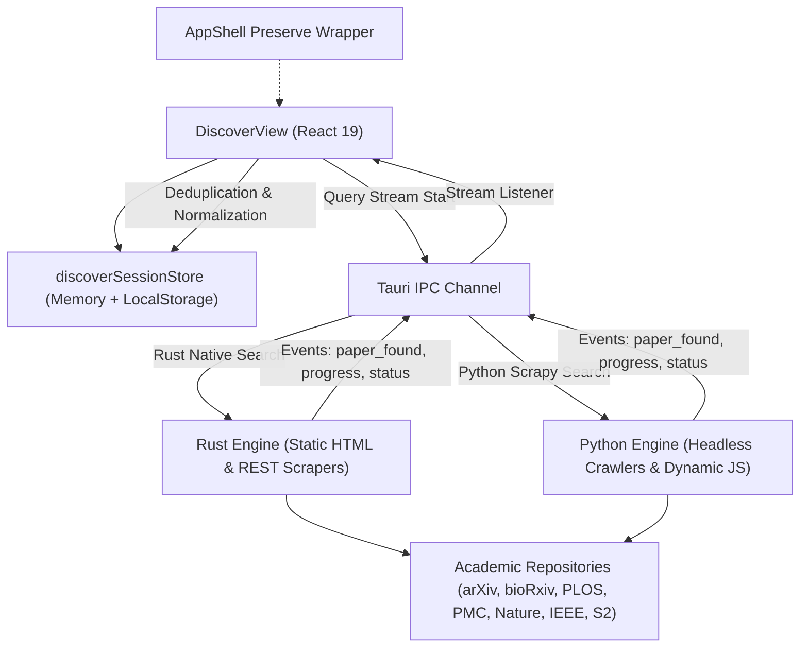

# Phase 11: Academic Search Architecture & Discovery Workspace

## 1. Architectural Overview

The Discover Papers workspace in Infinity Researcher is engineered for high-performance academic research exploration. It connects the frontend user interface with dual research execution engines (Rust Native and Python Headless Crawler) via asynchronous streaming IPC.

---

## 2. Multi-Engine Search Routing

Infinity Researcher supports two complementary scraping and retrieval engines:

1. **Rust Native Engine (`scrapingEngine === "rust"`)**:
   - Executes fast static HTML queries and REST requests directly via Rust's `reqwest` and `scraper` crates.
   - Built-in `robots.txt` compliance checking with polite domain-specific delays (e.g., 3s delay for arXiv, 2s delay for PLOS/bioRxiv).
   - Low memory overhead, instant startup, and zero external runtime dependencies.
2. **Python Crawler Engine (`scrapingEngine === "python"`)**:
   - Executes Scrapy spiders with headless Playwright support for complex or JavaScript-rendered academic portals.
   - Features anti-SSRF IP blocking, private network CIDR filtering, and query intelligence expansion.
   - Ideal for sources requiring dynamic challenge solving or deep recursive pagination.

---

## 3. Asynchronous Streaming Protocol

Search is executed asynchronously to deliver immediate incremental results to researchers:

1. **Session Tagging & Isolation**:
   - Each search invocation generates a unique timestamped session identifier: `search_${Date.now()}_${Math.random().toString(36).substring(2, 7)}`.
   - Streaming events verify `event.session_id === currentSearchSessionRef.current`. Events from cancelled or previous queries are discarded automatically.
2. **Stream Event Types**:
   - `source_started`: Marks an academic source as actively searching.
   - `source_progress`: Telemetry event with page crawl count and preliminary paper counts.
   - `paper_found`: Discovered paper payload; triggers deduplication, metadata enrichment, and incremental insertion into visible papers.
   - `paper_updated`: Upgrades an already found paper with resolved full-text DOI or abstract.
   - `source_completed`: Signals that a specific repository has completed querying with total papers found.
   - `source_failed`: Records source-specific errors without interrupting other concurrent sources.
   - `search_completed`: Concludes the multi-source search session.

---

## 4. Query Validation & Lifecycle Handling

- **Empty Query Prevention**: Submissions are trimmed and validated. Empty inputs trigger an informative warning toast without launching network requests.
- **Keyboard Submission**: Full support for pressing `Enter` inside the search input or clicking the prominent `Search` button.
- **Cancellation**: Users can cancel an in-flight search at any time via the `Cancel` button. This cancels the active stream listener and invokes `cancelWebsiteSearch` or `cancelPythonSearch` on the backend.
- **Retry Failed Sources**: If specific sources encounter network timeouts or rate limits, the `handleRetryFailedSources()` action retries only the affected sources without clearing already discovered results.

