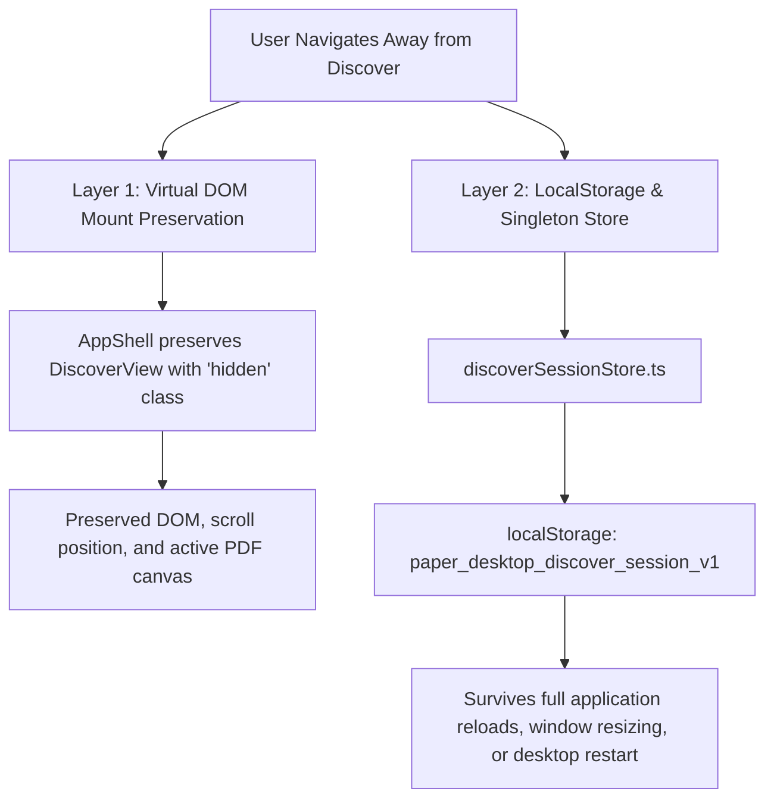

# Phase 11: State Persistence & Cross-View Session Management

## 1. Problem Statement

A critical problem in complex single-page desktop applications is state loss when navigating between views. In older architectures:
- Typing a search query and navigating to the Research Library or PDF Reader would destroy the search results on return.
- Scroll position within long lists would reset to top (0,0).
- Selected papers, active filters, and in-progress AI chat contexts would be lost.

Phase 11 implements a two-layer persistence architecture that guarantees zero state resets across navigation.

---

## 2. Dual-Layer Persistence Architecture



---

## 3. Layer 1: Virtual DOM Preservation (`AppShell.tsx`)

In `src/components/layout/AppShell.tsx`:
```tsx
{hasVisitedDiscover && (
  <div
    key="discover-preserved-pane"
    className={`h-full w-full flex-1 flex flex-col overflow-hidden ${
      activeSection === "discover" ? "" : "hidden"
    }`}
  >
    <DiscoverView />
  </div>
)}
```
- `<DiscoverView />` remains mounted in the React component tree once visited.
- When inactive, it is hidden using CSS (`className="hidden"`), preventing unmounting.
- Active PDF scroll offsets, reader zooms, and selected paper cards persist without any re-render cycle.

---

## 4. Layer 2: Reactive Singleton Session Store (`discoverSessionStore.ts`)

For scenarios where the component does remount (e.g. application restarts, session resets):
1. **Module Singleton (`memoryState`)**: In-memory JavaScript object maintaining immediate synchronous access to queries, discovered papers, filters, pane widths, and chat histories.
2. **Persistent Web Storage**: Serialized to `localStorage` under `paper_desktop_discover_session_v1`.
3. **Reactive Subscribers**: Components subscribe via `discoverSessionStore.subscribe(listener)`, triggering reactive updates when external triggers (such as the Global Command Palette) dispatch new searches.

---

## 5. Global Search Handoff Synchronization

When users trigger a global search from the Command Palette (`Ctrl+K`) or Dashboard:
1. `AppContext.executeGlobalSearch(query)` sets `globalSearchQuery = query` and navigates to `"discover"`.
2. DiscoverView's reactive synchronization effect detects the new query:
   ```typescript
   useEffect(() => {
     if (globalSearchQuery && globalSearchQuery.trim() !== "" && globalSearchQuery !== submittedQuery) {
       setSearchQuery(globalSearchQuery);
       void handleExecuteSearch(globalSearchQuery);
     }
   }, [globalSearchQuery]);
   ```
3. The query is immediately populated, searched, and streaming results are displayed to the user without any manual re-typing.

