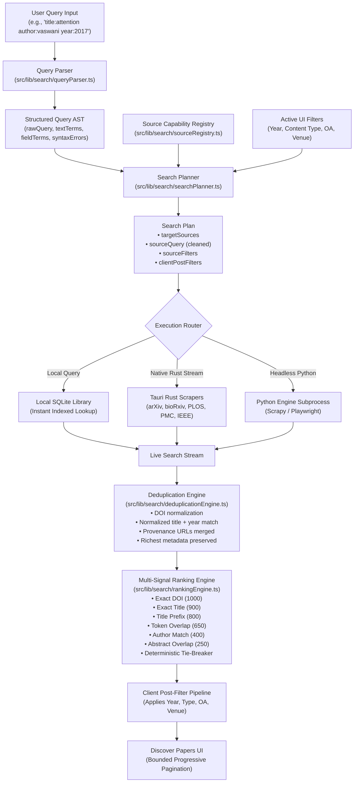

# Phase 12: Advanced Search and Filter Engine — Pre-Implementation Audit & Baseline Analysis

## 1. Executive Summary

As part of **Phase 12 — Advanced Search and Filter Engine**, an exhaustive audit was conducted across Infinity Researcher's search subsystems, query processing pipelines, academic source connectors, ranking logic, deduplication mechanics, and state management.

Infinity Researcher is a high-performance desktop academic research workbench built on:
- **Frontend**: React 19, TypeScript, Tailwind CSS v4, Lucide icons, Vitest.
- **Desktop Runtime**: Tauri 2, Rust native scraping & IPC subsystems (`src-tauri/`).
- **Python Research Subprocess**: Scrapy, Playwright, BeautifulSoup, and FastAPI/Pydantic models (`python-engine/`).
- **Local Storage**: SQLite database for saved papers, collections, notes, and local full-text search.

Phase 11 modernized the Discover Papers interface (three-pane responsive workspace, truth-in-advertising PDF tags, accessible cards, and resilient session caching). Phase 12 modernizes the **underlying search engine**: structured query syntax parsing, source capability gating, a multi-signal deterministic ranking engine, safe cross-source deduplication, and a coordinated search planner.

---

## 2. Comprehensive Subsystem Audit

| Subsystem / Component | Path / Location | Current Role & Technology | Audit Findings & Phase 12 Relevance |
| :--- | :--- | :--- | :--- |
| **Discover Papers View** | `src/features/discover/DiscoverView.tsx` | Main three-pane research discovery workspace | Search input passes raw string directly to scraping streams. Filter drawer applies post-hoc client filters. Lacks structured query syntax parsing, interactive field chips, and search-planning intelligence. |
| **Discover Session Store** | `src/features/discover/discoverSessionStore.ts` | In-memory singleton & `localStorage` cache | Persists search query, results, source status, and filter preferences. Needs to safely preserve parsed structured queries, active field chips, and execution plans without race conditions. |
| **Global Search Hook & Ranking** | `src/lib/search/useUnifiedSearch.ts`, `rankingEngine.ts` | Unified search for `Ctrl+K` command palette | Computes baseline string matching (DOI, exact title, prefix, keywords) for desktop navigation. Needs to be generalized into a unified academic paper multi-signal ranking engine. |
| **Rust Query Search Subsystem** | `src-tauri/src/scrapers/query_search.rs` | Tauri IPC streaming handler for native scrapers | Dispatches queries concurrently to registered source adapters. Accepts `WebsiteSearchQuery { query, sources, year_start, year_end, author, ... }`. Does not parse structured query strings entered by users in `query`. |
| **Rust Source Adapters** | `src-tauri/src/scrapers/adapters/` | Static HTML & API adapters for arXiv, bioRxiv, medRxiv, PLOS, Nature, PMC, IEEE | Each source adapter has different query parameters, field support, and pagination mechanisms. No formal capability contract existed on the client side to prevent invalid field dispatch. |
| **Rust Deduplication & Scoring** | `src-tauri/src/scrapers/dedup.rs` | Rust deduplication & relevance scoring | Functions `normalize_doi`, `normalize_title`, `compute_relevance_score`, and `deduplicate_and_rank_results`. Employs DOI normalization and title matching. |
| **Python Scraper & Query Intelligence** | `python-engine/src/paper_scraper/discovery/query.py`, `identity.py` | QueryIntelligence, identity extraction, and candidate expansion | Robust extraction of DOIs and arXiv IDs in Python. Operates when scraping engine is set to Python; needs alignment with frontend client planner. |
| **SQLite Research Library** | `src-tauri/src/db/` & `src/context/AppContext.tsx` | Local paper library & metadata storage | Full SQLite persistence for saved papers, collections, and reading progress. Fast indexed lookups by DOI, title, and author. |

---

## 3. Analysis of Pre-Implementation Deficits & Bottlenecks

### 3.1. Raw Query Passing Without Structured Parsing
- **Problem**: When a researcher typed `author:"Bengio" title:"deep learning" year:2020..2024` into Discover Papers or Global Search, the entire raw string was passed as `query: "author:\"Bengio\" title:\"deep learning\" year:2020..2024"` to backend scrapers.
- **Impact**: Upstream academic search endpoints (such as bioRxiv HTML search or Nature search) treat the entire string verbatim, failing to locate papers or returning zero results because the backend does not understand unquoted syntax tokens.
- **Solution**: Implement a modular, battle-tested `queryParser.ts` on the client that parses free text, quoted phrases, and key-value fields (`title:`, `author:`, `year:`, `doi:`, `source:`, `type:`, `open_access:`, `venue:`), extracts year ranges (`2020..2024`, `>=2020`), and generates a strongly-typed Abstract Syntax Tree (`StructuredQuery`).

### 3.2. Lack of Source Capability Awareness & Query Planning
- **Problem**: Academic sources vary widely in capability:
  - arXiv natively supports boolean and field prefixes (`au:`, `ti:`), year filters, and offset pagination.
  - bioRxiv/medRxiv only accept basic text queries and page numbers, without native year range parameters.
  - Nature Scientific Reports accepts basic keywords and page offsets.
  - PLOS supports journal-level filtering and search terms.
- **Impact**: Discarding source capabilities causes wasted HTTP requests, scrapers failing with 400 Bad Request, or researchers receiving unfiltered results without notification.
- **Solution**: Implement an **Academic Source Capability Registry** (`sourceRegistry.ts`) and a **Search Planner** (`searchPlanner.ts`). The search planner divides filters into:
  1. *Source-delegated parameters*: sent directly to sources that support them.
  2. *Client post-filters*: executed automatically in memory for sources that return broad results.
  3. *Excluded sources*: sources excluded when a query explicitly targets a specific provider (`source:arxiv`) or requires an unsupported capability.

### 3.3. Disconnected & Shallow Search Ranking
- **Problem**: When results arrived in Discover, sorting by "Best Match" relied on either the raw source order or a single unweighted `relevance_score` float. Command Palette search had its own heuristic, while Discover had another.
- **Impact**: A paper with an exact DOI match or exact title match could be positioned below a paper that merely mentioned the keyword five times in an abstract.
- **Solution**: Build an explainable, multi-signal paper ranking engine (`rankingEngine.ts` extended) that assigns deterministic weights:
  - Exact DOI match: 1000
  - Exact title match: 900
  - Title prefix match: 800
  - Title token overlap: up to 650
  - Author match: 400
  - Abstract token overlap: up to 250
  - Venue match: 150
  - Recency bonus: up to 30
  - Citation bonus: up to 40
  - Open access & PDF availability bonuses: 15 each
  - Strict deterministic tie-breakers (Score → Year → ID).

### 3.4. Deduplication During Live Streaming
- **Problem**: When papers stream in from multiple sources (e.g., arXiv and PMC both returning the same paper), naive UI lists could momentarily duplicate or flash cards, or lose provenance URLs when merging.
- **Solution**: Create a dedicated client deduplication engine (`deduplicationEngine.ts`) that standardizes canonical DOIs and normalized titles, non-destructively merges metadata (retaining richest abstract, direct PDF URLs, all source tags, and highest citation counts), and provides clean provenance tracking.

---

## 4. Phase 12 Architecture Blueprint

---

## 5. Security and Data Privacy Commitments
1. **Parameterized Execution**: Structured query expressions are never evaluated as JavaScript (`eval`) or raw SQL strings. All database queries use SQLite parameter bindings.
2. **SSRF & URL Safety**: URLs retrieved from external scrapers are strictly validated against domain allowlists before any fetch or download operation.
3. **Zero Data Leakage**: User notes, local tags, and private library papers are never transmitted to external scraping APIs when performing remote searches. External searches receive only sanitized query terms.

---

## 6. Audit Conclusion & Next Steps
The codebase provides strong Rust and Python scraping primitives and an intuitive three-pane UI, but lacked a formal client-side query language, capability registry, intelligent planner, and multi-signal ranking engine.

Implementation proceeds with:
1. `src/lib/search/advancedSearchTypes.ts`
2. `src/lib/search/queryParser.ts`
3. `src/lib/search/sourceRegistry.ts`
4. `src/lib/search/searchPlanner.ts`
5. `src/lib/search/deduplicationEngine.ts`
6. Extension of `src/lib/search/rankingEngine.ts`
7. Integration with `DiscoverView.tsx` & `discoverSessionStore.ts`
8. Test suite `src/test/phase12-advanced-search.test.tsx`
9. Delivery of all 12 modernization documentation reports.

