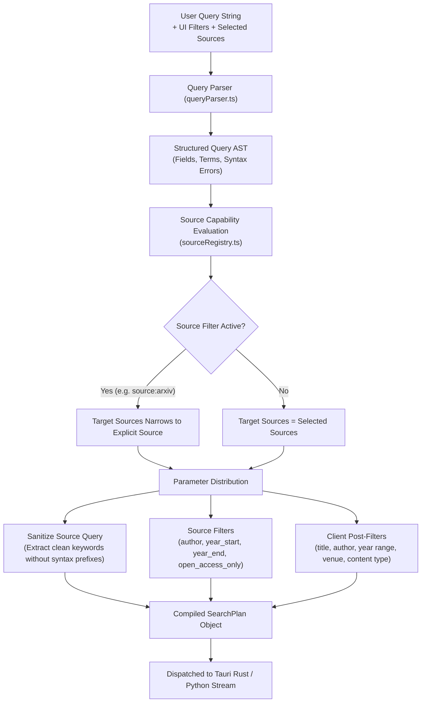

# Phase 12: Search Planning & Query Routing Engine

## 1. Overview

The **Search Planner** (`src/lib/search/searchPlanner.ts`) coordinates user search intent, academic source capabilities, and filter parameters into an optimized, executable `SearchPlan`.

Rather than broadcasting raw, unparsed queries to external endpoints, the planner translates structured expressions into sanitized keyword strings for remote scrapers while preserving fine-grained constraints for client-side post-filtering.

---

## 2. Planning Lifecycle

---

## 3. Query Sanitization & Translation

External academic search forms cannot process arbitrary field expressions such as `author:"Bengio" title:"deep learning"`. Transmitting raw syntax leads to zero results or scrape failures.

The planner constructs a sanitized `sourceQuery`:
1. Extracts title terms, DOI, and unstructured keyword tokens into a contiguous search phrase.
2. If only an author was supplied (e.g., `author:"Vaswani"`), sets the cleaned query to `"Vaswani"` or delegates to the native `author` parameter.
3. Maps year ranges to numeric `year_start` and `year_end` boundaries.
4. Leaves raw field prefixes out of the remote search request.

---

## 4. Parameter Distribution Matrix

| Parameter / Field | Source Native Support | Planner Action |
| :--- | :--- | :--- |
| **Clean Keywords** | All Sources | Transmitted as `query` parameter to scraping streams. |
| **Start / End Year** | arXiv, PLOS, PMC, IEEE | Transmitted as `year_start` / `year_end` in `WebsiteSearchQuery`. |
| **Start / End Year** | bioRxiv, medRxiv, Nature | Omitted from remote request; evaluated by `satisfiesClientPostFilters`. |
| **Author** | arXiv, PLOS, PMC, IEEE | Transmitted as `author` in `WebsiteSearchQuery`. |
| **Author** | bioRxiv, medRxiv, Nature | Omitted from remote request; evaluated by `satisfiesClientPostFilters`. |
| **Open Access Only** | Supported Sources | Transmitted as `open_access_only: true`; verified on incoming results. |
| **Canonical DOI** | All Sources | Prioritized as direct lookup or identifier match. |
| **Venue / Journal** | All Sources | Verified via client post-filter against returned publisher metadata. |

---

## 5. Session Isolation & Concurrency Safety

1. **Unique Session Identifiers**:
   - Each search execution generates a unique `session_id` (`search_${Date.now()}_...`).
   - Active streams check `event.session_id === currentSearchSessionRef.current`. Stale events from cancelled or prior searches are discarded immediately.
2. **Cancellation Signal**:
   - Starting a new search automatically triggers `cancelWebsiteSearch` / `cancelPythonSearch` on the previous active session, freeing background worker threads and network sockets.
3. **Partial Source Resilience**:
   - If one academic repository experiences a timeout or rate-limit error, results from other concurrent sources remain visible and fully interactive.

