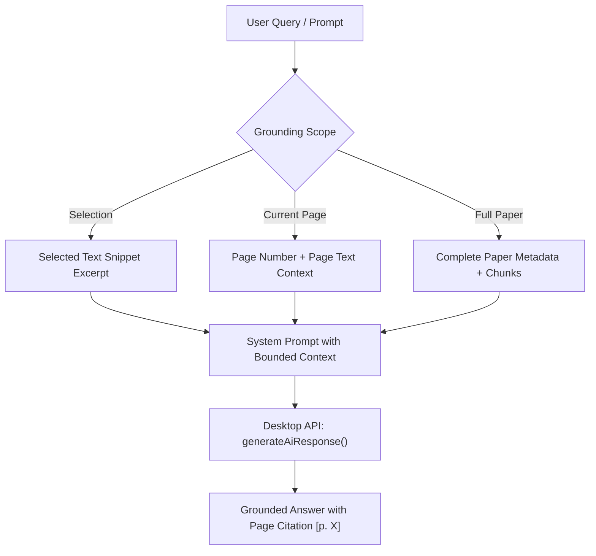

# Phase 13: Grounded AI Research Assistant Integration

## 1. Overview

Scholarly papers frequently contain dense mathematical formulas, domain-specific acronyms, and compressed methodologies. Phase 13 embeds a dedicated, grounded AI Copilot directly within the reading workspace (`PdfRightPanel.tsx`).

---

## 2. Grounding Scope Model

To avoid hallucinations and maintain verifiable academic rigor, the assistant allows researchers to toggle explicit context scopes:

1. **Selection Scope**: Activated automatically whenever text is highlighted on the canvas text layer. Answers are grounded exclusively on the exact quote or equation selected.
2. **Current Page Scope**: Grounded within the claims, figures, and definitions on the currently viewed page.
3. **Full Document Scope**: Synthesizes across all sections of the paper for macro-level questions.

---

## 3. Quick Prompt Accelerators

Pre-configured prompt buttons allow scholars to extract immediate insights without typing:
- **Beginner Explanation (ELI5)**: Explains the active page in plain, accessible language without dense technical jargon.
- **Summarize Page**: Summarizes the primary claims, theorems, and evidence presented on the active page.
- **Methodology Analysis**: Explains the technical formulations, algorithms, baseline comparisons, and controls.
- **Critical Limitations**: Audits potential confounders, untested assumptions, and boundary limitations on the page.

---

## 4. Citation Linking and Page Jumps

Assistant messages that reference specific pages include interactive page badges (e.g. `[p. 4]`). Clicking the badge instantly jumps the PDF reader to that page, allowing the researcher to verify claims directly against the primary literature.

