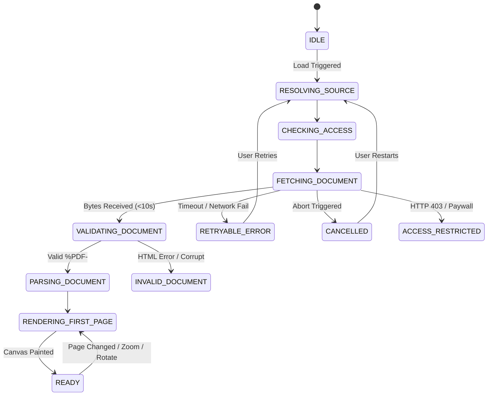

# Phase 13: PDF Rendering Lifecycle & State Machine Report

## 1. Executive Summary

Document retrieval and rendering in academic desktop applications must handle intermittent network connections, publisher paywalls, non-standard content negotiation, and large multi-megabyte payloads without freezing the UI or reporting misleading statuses. Phase 13 standardizes the PDF lifecycle into an explicit 12-state Finite State Machine (FSM).

---

## 2. The 12-State Finite State Machine

### 2.1 State Specifications

| State | Purpose | User Feedback | Recovery Options |
|---|---|---|---|
| `IDLE` | Initial uninitialized state. | None. | Automatic transition. |
| `RESOLVING_SOURCE` | Checks whether source is local SQLite storage, download cache, or remote repository. | Status chip: "Resolving document source..." | Cancel |
| `CHECKING_ACCESS` | Verifies publisher rate-limits and permissions. | Status chip: "Verifying access permissions..." | Cancel |
| `FETCHING_DOCUMENT` | Streams raw binary payload with strict 10s anti-timeout guard. | Status chip + spinner + cancel button. | Cancel Retrieval |
| `VALIDATING_DOCUMENT` | Checks binary signature (`%PDF-`) and scans for HTML landing page headers. | Status chip: "Verifying document signature..." | Cancel |
| `PARSING_DOCUMENT` | `pdfjsLib.getDocument()` parses PDF trailer and catalog. | Status chip: "Parsing document structure..." | Cancel |
| `RENDERING_FIRST_PAGE` | Initializes viewport, scale, and begins canvas render. | Status chip: "Rendering page canvas..." | Cancel |
| `READY` | Document loaded, text layer active, multi-panel workspace interactive. | Full interactive reading workspace. | Zoom, Nav, Search, Panels |
| `RETRYABLE_ERROR` | Connection dropped, network timeout (>10s), or gateway reset. | Warning banner with specific error explanation. | Retry Streaming, Open in Browser, Import Local |
| `ACCESS_RESTRICTED` | Publisher paywall (e.g. IEEE Xplore, ScienceDirect) or anti-bot challenge. | Shield alert banner explaining institutional restriction. | Open Official Page, Import Local, Resolve OA |
| `INVALID_DOCUMENT` | Publisher returned HTML portal or login form rather than binary PDF. | File warning banner: "Non-PDF Response". | Open Source Webpage, Import Local, Re-resolve |
| `CANCELLED` | User clicked Cancel Retrieval or switched papers mid-stream. | Clean cancellation card: "Retrieval Cancelled". | Restart Retrieval |

---

## 3. Strict Concurrency & Task Cancellation

To prevent race conditions, memory leaks, and phantom canvas updates:
1. **AbortController**: Each load cycle instantiates a fresh `AbortController`. If a new paper is selected or the component unmounts, `abortControllerRef.current.abort()` instantly terminates in-flight network requests.
2. **RenderTask Cancellation**: `pdfjs` page render returns a `RenderTask`. If the user rapidly navigates pages or adjusts zoom, any in-progress `renderTask.cancel()` is called immediately before spawning a new render, preventing `RenderingCancelledException` crashes.
3. **Local Worker Isolation**: The web worker is bundled directly via Vite (`pdfjs-dist/build/pdf.worker.min.mjs?url`), preventing CORS issues or CDN downtime.

