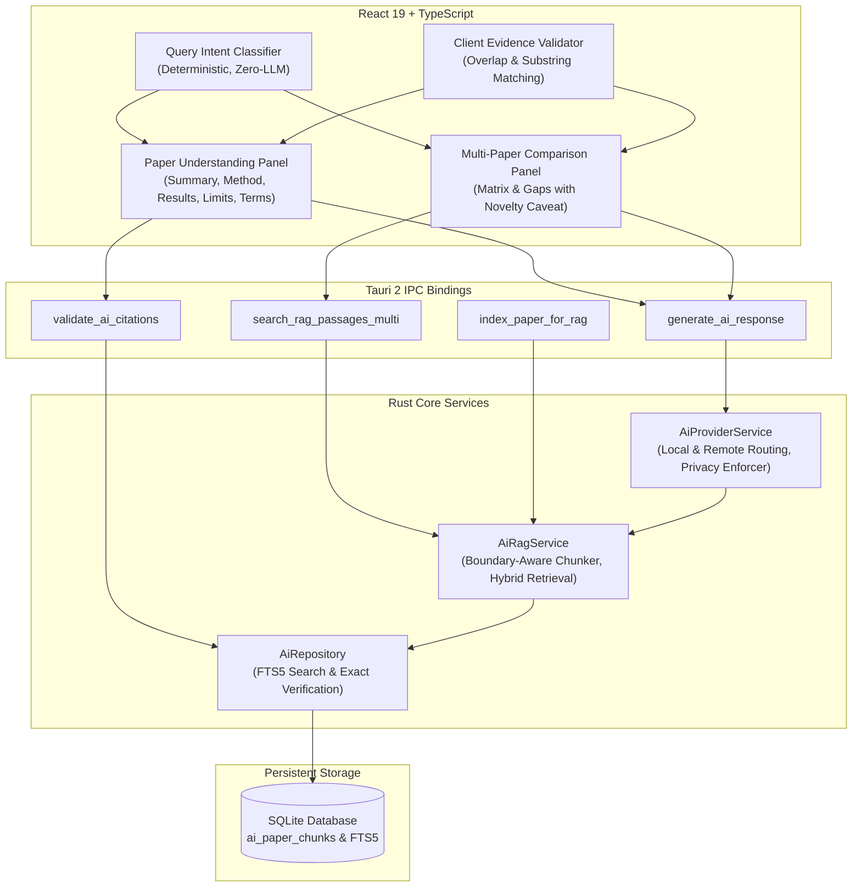

# Phase 14 AI Assistant Architecture

## 1. System Overview

Phase 14 delivers a reliable, paper-grounded AI Research Assistant and Paper Understanding Engine for **Infinity Researcher**. The system is built to transform dense academic manuscripts into structured, verifiable knowledge without hallucinations, cross-paper contamination, or unverified claims.

The architecture integrates across all core layers of the desktop application:
- **Tauri 2 & Rust Backend**: Coordinates local and remote AI provider communication, sqlite persistence, FTS5 passage retrieval, and cryptographic citation verification.
- **React 19 & TypeScript Frontend**: Delivers the interactive Paper Understanding Panel, Multi-Paper Comparison Matrix, and zero-overhead Query Intent Classifier.
- **SQLite Database**: Houses `ai_paper_chunks`, `ai_chunks_fts` (FTS5 full-text index with sync triggers), `ai_providers`, `ai_provider_task_routes`, `ai_chat_sessions`, and `ai_settings`.
- **Python Scraping & Processing Engine**: Powers deep document extraction and academic candidate discovery.

---

## 2. Core Architectural Principles

### 2.1 Deterministic Intent Routing
Every user interaction passes through `classifyResearchQuery()` before or during submission. By classifying intents deterministically via token and regex pattern sets (e.g., `summarize_paper`, `explain_methodology`, `extract_limitations`, `compare_papers`), the system provides instant UI feedback, selects optimal prompts and context bounds, and eliminates unnecessary LLM classification roundtrips.

### 2.2 Dual-Layer Evidence Verification
Citations are never treated as mere decorative text. Every citation undergoes verification:
1. **Client-Side Text Overlap & Substring Match**: `evidenceValidator.ts` compares the extracted snippet against candidate chunk contents, verifying exact substring inclusion or high token containment (>= 55%).
2. **Backend Native Verification**: `validate_ai_citations` in Rust cross-references the cited chunk ID, target paper ID, and full-text index to produce a certified `VerifiedEvidenceItem` with confidence rating and verification method.

### 2.3 Strict Multi-Paper Isolation
When performing comparative analysis across multiple manuscripts:
- Context excerpts from Paper A are never mixed into Paper B's slot.
- Prompts explicitly demand isolated JSON keys indexed by canonical paper IDs.
- Evidence badges are segregated per paper, preventing cross-attribution errors.

### 2.4 Bounded Novelty & Collection Scope
Research gap analysis strictly bounds its conclusions to the examined set of papers. The system automatically attaches the mandatory `NOVELTY_DISCLAIMER` to all gap analysis outputs, acknowledging that Infinity Researcher does not search the entire global literature in real time.

