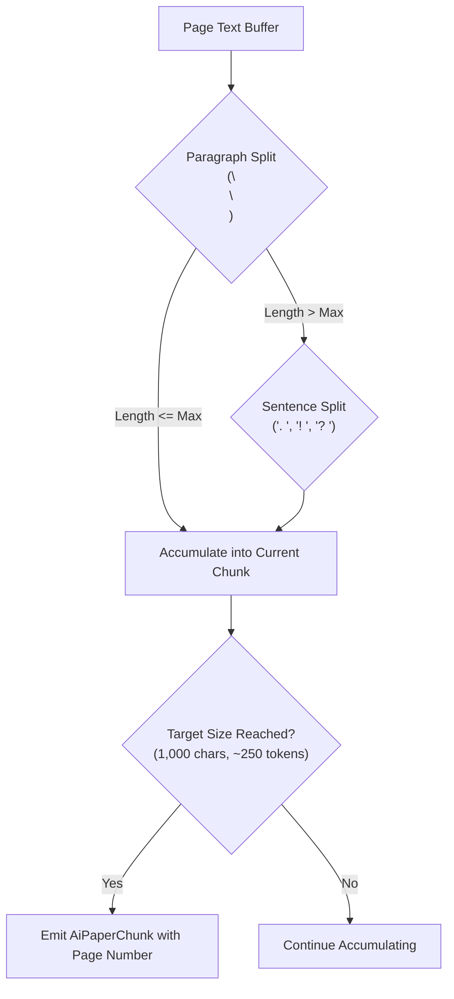

# Phase 14 Chunking and Retrieval Architecture

## 1. Boundary-Aware Semantic Chunking

Naive fixed-length text chunking frequently bisects equations, citations, or sentences mid-thought, destroying semantic coherence and corrupting citation anchors.

In Phase 14, `AiRagService::chunk_text` was overhauled with boundary-aware paragraph and sentence detection:



### 1.1 Chunk Specifications
- **Target Size**: ~1,000 characters (~250 tokens).
- **Overlap**: ~150 characters (~35 tokens) preserving inter-chunk context.
- **Natural Boundaries**: Splits occur strictly on paragraph breaks (`\n\n`) or sentence ends (`. `, `! `, `? `).
- **Metadata Tagging**: Each chunk carries `paper_id`, `chunk_index`, `page_number`, `section_heading`, and `token_count`.

---

## 2. Hybrid Retrieval Engine

Infinity Researcher employs a dual-strategy retrieval architecture:

### 2.1 SQLite FTS5 BM25 Search
- Chunks are indexed in virtual table `ai_chunks_fts` via automated insert/update/delete SQLite triggers.
- Multi-term queries leverage BM25 ranking.
- BM25 score inversion: SQLite BM25 returns lower/negative values for closer matches; `AiRepository` normalizes these into a `[0.0, 1.0]` confidence score:
  $$\text{score} = \min\left(1.0, \frac{1.0}{1.0 + |\text{rank}|}\right)$$

### 2.2 Multi-Paper Scoped Retrieval
- For cross-paper comparative workflows, `search_rag_passages_multi` retrieves top-matching passages constrained to a specific list of paper IDs:
  ```sql
  SELECT c.id, c.paper_id, p.title, c.page_number, c.section_heading, c.content_text, rank
  FROM ai_chunks_fts
  JOIN ai_paper_chunks c ON c.rowid = ai_chunks_fts.rowid
  JOIN papers p ON p.id = c.paper_id
  WHERE ai_chunks_fts MATCH ?1 AND c.paper_id IN (?2, ?3, ...)
  ORDER BY rank
  LIMIT ?N;
  ```

---

## 3. Retrieval Scopes

Users and automated routines can select among three explicit retrieval scopes:
1. **This Paper (`paper`)**: Strict isolation to the currently active manuscript.
2. **Multi-Paper (`multi_paper`)**: Scoped to user-selected subsets for comparison or gap analysis.
3. **Full Library (`library`)**: Broad synthesis across all indexed papers in SQLite.
4. **No Context (`none`)**: Direct model query without RAG retrieval.

