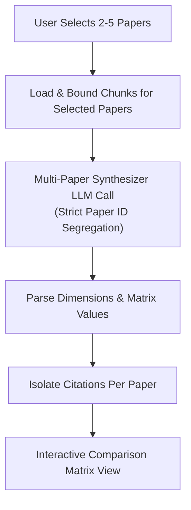

# Phase 14 Multi-Paper Comparison & Gap Analysis

## 1. Multi-Paper Comparative Synthesis

When researchers review a literature cluster, comparing papers manually is time-consuming and error-prone. The Multi-Paper Comparison Panel synthesizes insights across 2 to 5 selected papers simultaneously.

### 1.1 Comparative Matrix Architecture

### 1.2 Isolation of Evidence
To prevent cross-attribution (e.g., claiming Paper A's results were produced by Paper B):
- Prompts format each paper with its unique ID and title.
- JSON schemas require separate `paper_values` keyed by paper ID.
- Evidence snippets are validated against only that specific paper's chunks before rendering.

---

## 2. Research Gap Analysis with Novelty Caveats

### 2.1 Gap Identification Framework
The engine detects:
1. **Unaddressed Methodologies**: Algorithmic architectures not explored by the selected cluster.
2. **Dataset Scarcity & Domain Shift**: Narrow benchmark distributions leaving out-of-distribution robustness unproven.
3. **Conflicting Findings**: Contradictory empirical outcomes between competing approaches.
4. **Scalability Gaps**: Uncharacterized latency, memory, or hardware bottlenecks.
5. **Untested Assumptions**: Foundational premises accepted without empirical verification.

### 2.2 Mandatory Novelty Disclaimer
Because no desktop application searches all global scientific literature in real time, claiming absolute global novelty is dishonest. Infinity Researcher enforces the prominent display of the following disclaimer on all gap analysis reports:

> **Notice: Collection Scope & Absolute Novelty Disclaimer**  
> "Identified research gaps are strictly relative to the selected collection of papers. Infinity Researcher does not search the entire global literature in real time and cannot certify absolute global novelty. Prior unselected or newly published work may already address these gaps."

Every individual gap card also includes an explicit **Scope Boundary** (e.g., *"Within the scope of the 3 examined papers..."*) and a concrete **Potential Investigation Protocol**.

