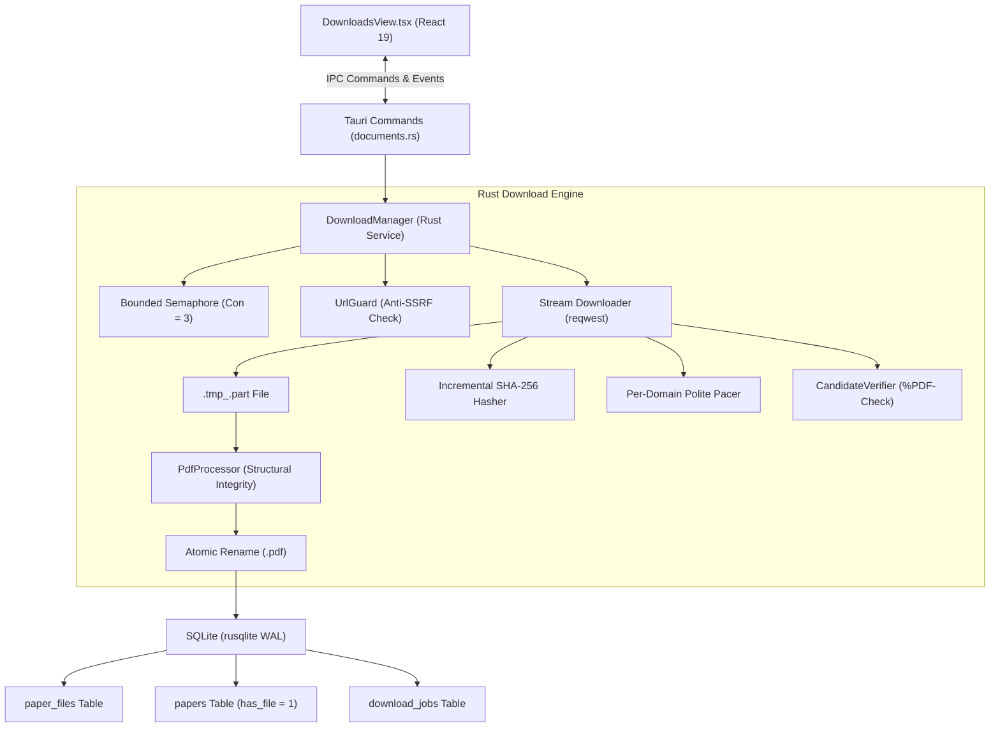

# Phase 16: Download Architecture Report

## 1. Architectural Overview

The Download Management and PDF Acquisition Engine in **Infinity Researcher** orchestrates the safe, bounded, and atomic acquisition of academic papers from supported scholarly providers (arXiv, bioRxiv, medRxiv, PubMed Central, IEEE Open Access, CrossRef, Unpaywall).

The architecture coordinates three major subsystems:
1. **Rust Native Backend (`src-tauri`)**:
   - Manages asynchronous download workers (`tokio::spawn`), bounded concurrency semaphores, cancellation channels (`tokio::sync::watch`), Anti-SSRF URL validation, streaming network I/O, SHA-256 calculation, and transactional persistence in SQLite.
2. **Python Scraping & Retrieval Engine (`python-engine`)**:
   - Executes domain-specific web crawling, robots.txt compliance, anti-bot navigation, and initial open-access availability probing.
3. **React 19 & TypeScript Frontend (`src/features/downloads/DownloadsView.tsx`)**:
   - Provides a real-time reactive interface displaying active transfer throughput, queue depths, live stage indicators, safe dissociation actions, and storage maintenance controls.

---

## 2. Component Structure

### 2.1 DownloadManager Service (`src-tauri/src/services/download_manager.rs`)
- **Bounded Concurrency**: Uses an internal `Arc<tokio::sync::Semaphore>` initialized to bounded limit (default: 3 concurrent workers).
- **Per-Domain Polite Pacing**: Enforces minimum request intervals per academic host:
  - `arxiv.org`: 1000 ms
  - `biorxiv.org` / `medrxiv.org`: 1000 ms
  - `ieeexplore.ieee.org`: 1000 ms
  - `crossref.org` / `unpaywall.org`: 600 ms
  - Other scholarly domains: 400 ms
- **Cancellation Senders**: Maintains an `Arc<RwLock<HashMap<String, watch::Sender<bool>>>>` map for immediate cooperative cancellation.
- **Throttled IPC Progress Emission**: Streams updates to the Tauri event bus (`paper:download_progress`) every ~256 KB or at least 300ms to eliminate UI thread saturation.

### 2.2 Storage Layout & Safe Dissociation
- All finalized papers are saved as canonical files in the user application storage directory:
  `storage/papers/<paper_id>.pdf`.
- Temporary downloads write to hidden part files:
  `storage/papers/.tmp_<job_id>.part`.
- **Safe Dissociation**: Removing a download task from the queue history list (`deletePdfDownloadJob` or `clearCompletedPdfDownloads`) only purges records from SQLite `download_jobs`. It **never** touches `paper_files` or `<paper_id>.pdf`.

---

## 3. Database Schema v14 Integration

Schema version 14 (`0014_download_manager_modernization.sql`) enriches `download_jobs`:
- `speed_bps INTEGER NOT NULL DEFAULT 0`: Measured transfer throughput.
- `started_at TEXT`: RFC 3339 timestamp of network connection.
- `completed_at TEXT`: RFC 3339 timestamp of validation or error.
- `error_category TEXT`: Structured diagnostic classification (`anti_ssrf`, `html_paywall`, `corrupt_pdf`, `size_limit`, `storage`, `network`, `cancelled`).

