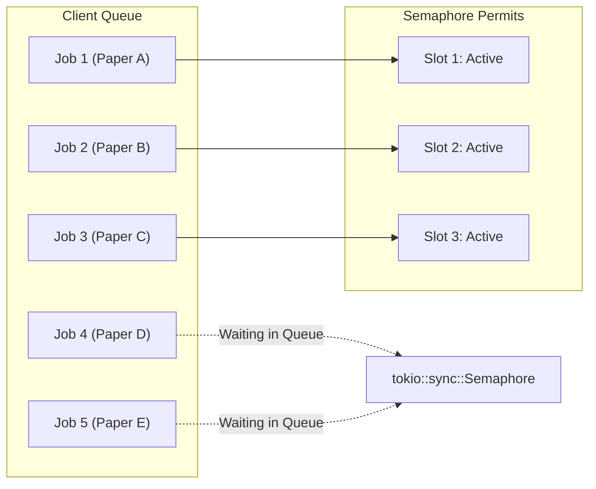

# Phase 16: Queue and Concurrency Management Report

## 1. Concurrency Boundaries

Network bandwidth and academic server rate limits require strict queue governance. The **DownloadManager** enforces:
- **Default Concurrency**: 3 concurrent active transfers.
- **Queue Bounds**: FIFO processing with cooperative cancellation.
- **Resource Protection**: Ensures desktop CPU and disk I/O are not starved during bulk paper acquisitions.

---

## 2. Active Deduplication

When a user or batch action requests a download:
1. **Local Library Verification**: Checks `papers.has_file` and verifies that the canonical file `<storage_dir>/<paper_id>.pdf` exists on disk. If already present, skips network acquisition.
2. **Active Job Deduplication**: Checks `download_jobs` for active records (`status IN ('queued', 'resolving', 'downloading', 'validating')`) matching `paper_id`. If one is active, returns the existing job rather than creating redundant network transfers.

---

## 3. Per-Domain Rate Pacing

Scholarly repositories have strict automated retrieval policies. To ensure compliance and prevent 429 Too Many Requests or IP blocks, `DownloadManager` tracks the last request timestamp per hostname:
- `arxiv.org`: 1000 ms polite interval
- `biorxiv.org` / `medrxiv.org`: 1000 ms interval
- `ieeexplore.ieee.org`: 1000 ms interval
- `crossref.org` / `unpaywall.org`: 600 ms interval
- Default fallback: 400 ms

When multiple papers from the same domain are enqueued simultaneously, workers sleep for the remaining duration before issuing HTTP requests.

