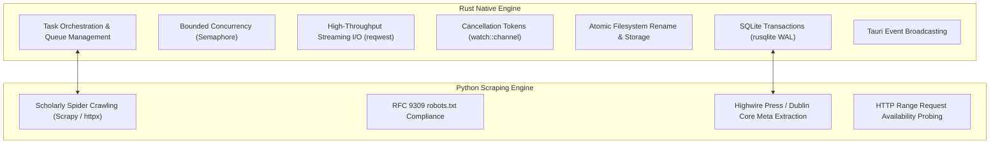

# Phase 16: Rust and Python Engine Coordination Report

## 1. Division of Responsibilities

Infinity Researcher coordinates tasks between Rust and Python based on their architectural strengths:

---

## 2. Coordination Interfaces

1. **Direct Academic PDF Acquisition**:
   - Managed natively in **Rust** for maximum throughput, low memory footprint, zero-copy streaming, and native OS file locking.
2. **Scholarly Website Crawling**:
   - Executed in **Python** (`paper_scraper` engine) where Scrapy spiders, HTML DOM parsing, and CSS/XPath metadata extraction provide deep flexibility.
   - Crawl jobs write discovered papers to `crawl_job_papers` in SQLite.
3. **Unified Frontend**:
   - `DownloadsView.tsx` provides tabs for both workflows:
     - **PDF Acquisition Queue**: Direct native transfers with live throughput.
     - **Website Crawlers & Scrapers**: Background scholarly web spidering and bulk paper discovery.

