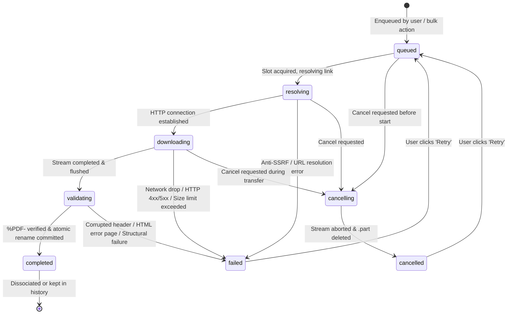

# Phase 16: Download Task State Machine Report

## 1. State Machine Definition

To provide predictable UX and resilient lifecycle tracking, all PDF download tasks move through an explicit finite state machine.

---

## 2. State Invariants & Behavior

| State | Permitted Transitions | Backend Actions | UI Presentation |
|---|---|---|---|
| `queued` | `resolving`, `cancelling` | Job inserted in `download_jobs`. Awaiting permit from `Semaphore`. | Gray clock badge; progress at 0%. |
| `resolving` | `downloading`, `failed`, `cancelling` | Resolves direct PDF stream (e.g. IEEE OA redirect) and domain rate limit. | Blue badge with spinning indicator; stage message: "Resolving connection...". |
| `downloading` | `validating`, `failed`, `cancelling` | Streams network chunks into `.tmp_<id>.part`. Increments bytes, hashes SHA-256, computes `speed_bps`. | Blue badge with bounce icon; real-time progress bar and speed (e.g. "1.2 MB/s"). |
| `validating` | `completed`, `failed` | Inspects first 1024 bytes for `%PDF-`, checks minimum size, runs `PdfProcessor`. | Amber badge; stage message: "Verifying PDF structure...". |
| `completed` | Terminal (can retry) | Atomic rename to `<paper_id>.pdf`. Registers `paper_files`. Updates `papers (has_file=1)`. | Green badge; "Read PDF" action button; 100% progress. |
| `cancelling` | `cancelled` | Closes network stream, deletes incomplete `.part` file. | Gray badge; stage message: "Cancelling...". |
| `cancelled` | Terminal (can retry) | Cleaned up. Stored with `error_category = 'cancelled'`. | Neutral outline badge; "Retry" button. |
| `failed` | Terminal (can retry) | Temporary file deleted. Records `error_message` and `error_category`. | Red badge; error banner with taxonomy reason; "Retry" button. |

---

## 3. Truthful Progress Reporting

1. **Zero Fabrication**: Transfer progress reports strictly actual bytes downloaded over `Content-Length`. If `Content-Length` is missing, progress is reported as streaming/indeterminate.
2. **Speed Calculation**: Computed as `(delta_bytes) / (delta_seconds)` sampled every 300ms. If network stalls, speed falls to 0 B/s.
3. **No Premature 100%**: A download only transitions to 100% and `completed` once magic bytes validation, structural parsing, and atomic rename succeed.

