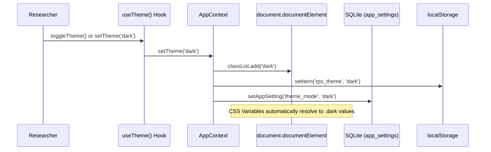

# Phase 2 — Theme Architecture Specification
**Project:** Infinity Researcher  
**Phase:** 2 of 30 — Design System Foundation  
**File Reference:** [`src/hooks/useTheme.ts`](file:///d:/Paper/src/hooks/useTheme.ts) & [`src/context/AppContext.tsx`](file:///d:/Paper/src/context/AppContext.tsx)  

---

## 1. Theme Architecture Overview

Infinity Researcher supports three theme modes:
1. **Light Mode (`light`):** High contrast white canvas with cool slate borders for brightly lit work environments.
2. **Dark Mode (`dark`):** Scholarly deep slate (`#070b12` background, `#0b101b` surface) minimizing eye strain during late-night research sessions.
3. **System Preference Mode (`system`):** Automatically synchronizes with OS preference via the window `matchMedia('(prefers-color-scheme: dark)')` API.

---

## 2. Persistence & Synchronization Flow



---

## 3. The `useTheme` Custom Hook

Located at [`src/hooks/useTheme.ts`](file:///d:/Paper/src/hooks/useTheme.ts), this hook provides a type-safe interface for any component:

```typescript
export interface UseThemeReturn {
  theme: ThemeMode;               // "light" | "dark" | "system"
  setTheme: (theme: ThemeMode) => void;
  resolvedTheme: "light" | "dark"; // Resolved against OS preference
  isDark: boolean;                // Convenient boolean flag
  toggleTheme: () => void;        // Toggles light <-> dark
}
```

### Key Guarantees
- **No FOUC:** Theme class is initialized on `<html class="dark">` before React hydration.
- **Offline Persistence:** Settings are stored in both SQLite `app_settings` (for persistent desktop parity) and `localStorage` (for instant zero-latency boot).
- **Multi-Window Sync:** Tauri window events and media query listeners update resolved theme immediately when host system preference shifts.

