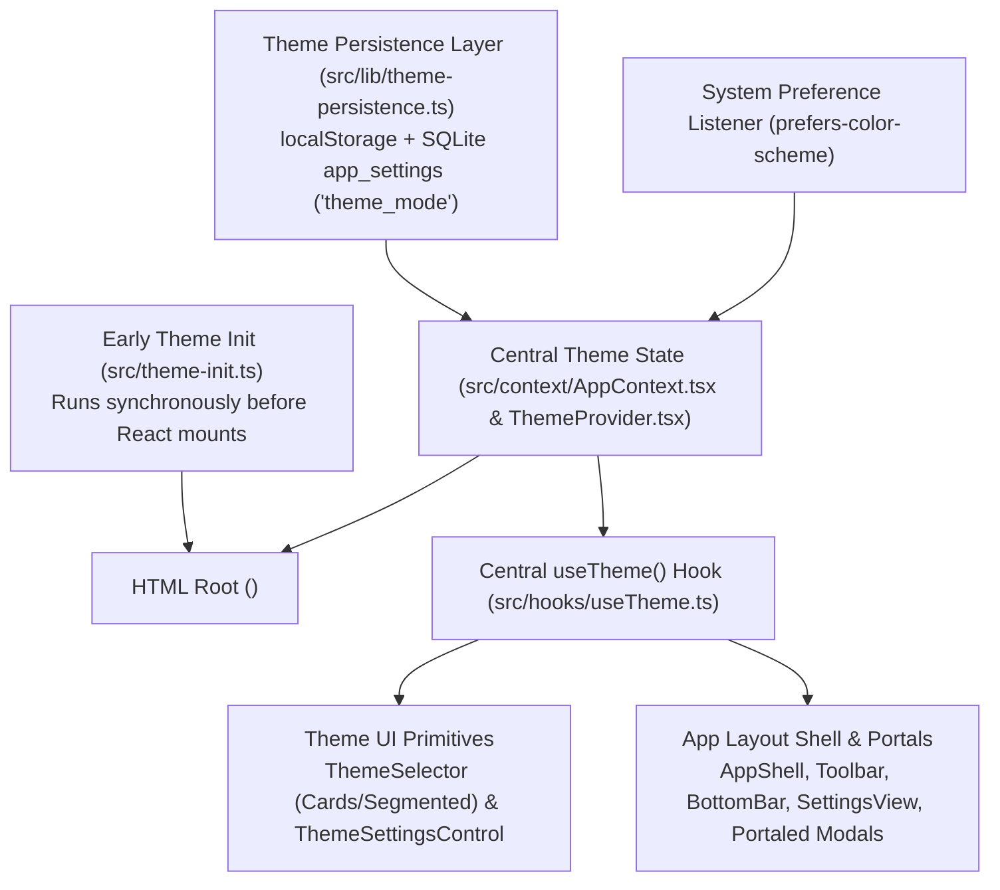

# Phase 3 — Complete Theme System Implementation Specification
**Project:** Infinity Researcher  
**Phase:** 3 of 30 — Complete Theme System Implementation  
**Status:** Complete & Validated  
**Stack:** Tauri 2 + Rust + React 19 + TypeScript + Tailwind CSS v4 + SQLite  

---

## 1. Executive Summary

Phase 3 implements a centralized, persistent, application-wide theme system for Infinity Researcher. It establishes a single source of truth across all application layers, seamlessly handling **Light**, **Dark**, and dynamic **System** preference modes with zero startup visual flashing (FOUC).

The implementation strictly preserves all existing functionality: backend Tauri commands, SQLite schema, PDF processing, local authentication, and all 24 existing academic research views.

---

## 2. Centralized Theme Architecture

### Core Architecture Components:
1. **Type Definitions ([`src/types/theme.ts`](file:///d:/Paper/src/types/theme.ts)):**
   - `ThemePreference`: `"light" | "dark" | "system"`
   - `ResolvedTheme`: `"light" | "dark"`
   - `ThemeContextValue`: Type-safe interface exposing `theme`, `preference`, `resolvedTheme`, `isDark`, `setTheme`, `toggleTheme`, `isInitialized`.
2. **Persistence Engine ([`src/lib/theme-persistence.ts`](file:///d:/Paper/src/lib/theme-persistence.ts)):**
   - Synchronous read/write from `localStorage` (`rps_theme`) for zero-latency boot.
   - Asynchronous synchronization with SQLite `app_settings` table (`theme_mode`) via Tauri IPC.
   - Document applicator updating `classList` (`dark` / `light`), `data-theme`, and `colorScheme`.
3. **Anti-FOUC Early Initializer ([`src/theme-init.ts`](file:///d:/Paper/src/theme-init.ts)):**
   - Runs synchronously upon script evaluation before React hydrates. Resolves preference and sets root classes to completely eliminate theme flashing on startup.
4. **Context & State Management ([`src/context/AppContext.tsx`](file:///d:/Paper/src/context/AppContext.tsx) & [`src/components/theme/ThemeProvider.tsx`](file:///d:/Paper/src/components/theme/ThemeProvider.tsx)):**
   - Unified reactive state with automatic event listener cleanup for OS preference shifts.
5. **Universal Hook ([`src/hooks/useTheme.ts`](file:///d:/Paper/src/hooks/useTheme.ts) & [`src/hooks/use-theme.ts`](file:///d:/Paper/src/hooks/use-theme.ts)):**
   - Dual-mode hook resolving from `ThemeContext` or `AppContext`.
6. **Accessible UI Controls ([`src/components/theme/ThemeSelector.tsx`](file:///d:/Paper/src/components/theme/ThemeSelector.tsx) & [`src/components/theme/ThemeSettingsControl.tsx`](file:///d:/Paper/src/components/theme/ThemeSettingsControl.tsx)):**
   - Segmented toggle for `Toolbar` and full 3-card control with Lucide icons for `SettingsView`.

---

## 3. Theme Mode Specifications

### 3.1 Light Mode
- Canvas background: `#f8fafc` (`slate-50`)
- Surface / Cards: `#ffffff`
- Text: `#0f172a` (`slate-900`) with `#64748b` (`slate-500`) metadata
- Primary Accent: `#4f46e5` (`indigo-600`)
- PDF workspace: Renders pure white PDF pages with dark text, keeping native PDF canvas unaltered while framing in light controls.

### 3.2 Dark Mode
- Canvas background: `#070b12` (deep midnight navy void)
- Surface / Cards: `#0e1524` (elevated dark slate)
- Text: `#f8fafc` (`slate-50`) with `#94a3b8` (`slate-400`) metadata
- Primary Accent: `#6366f1` (`indigo-500`)
- Status Badges: Adjusted opacity backgrounds (`rgba(..., 0.12)`) maintaining WCAG AA contrast.

### 3.3 System Mode
- Queries `window.matchMedia("(prefers-color-scheme: dark)")`.
- Updates `resolvedTheme` and `document.documentElement` dynamically when OS preference toggles.
- Preserves user preference as `"system"` rather than overwriting with `"light"` or `"dark"`.

