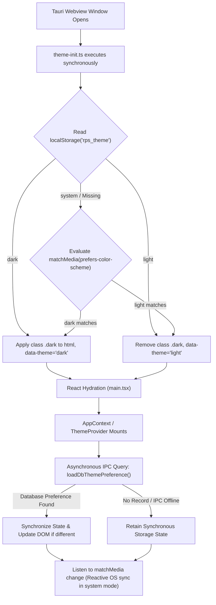

# Phase 3 — Theme Persistence Architecture

**Project:** Infinity Researcher  
**Phase:** 3 of 30 (Theme System Implementation)  
**Document:** Theme Persistence Architecture Specification  
**Status:** Complete & Verified  

---

## 1. Overview & Architectural Goals

The Infinity Researcher theme system operates under a local-first desktop paradigm where user visual preferences must persist reliably across application restarts, OS color scheme alterations, and database synchronizations—while completely preventing Flash of Unstyled Content (FOUC).

To achieve zero-flicker startup within Tauri 2's frameless window architecture, theme resolution utilizes a two-tier persistence model:
1. **Tier 1 (Synchronous Browser Storage):** `localStorage` key `rps_theme` for zero-latency DOM initialization prior to React hydration.
2. **Tier 2 (Durable Desktop Persistence):** SQLite table `app_settings` (`theme_mode`) for cross-session database durability and backup.



---

## 2. Storage Specifications

### 2.1 Storage Keys & Formats

| Storage Medium | Key Identifier | Permitted Values | Default | Failure Strategy |
| :--- | :--- | :--- | :--- | :--- |
| **Browser Storage** | `rps_theme` | `"light" \| "dark" \| "system"` | `"dark"` | Safe catch; defaults to `"dark"` |
| **SQLite DB** | `app_settings.theme_mode` | `TEXT` (`"light"`, `"dark"`, `"system"`) | NULL | Gracefully maintain in-memory state |

### 2.2 Storage Functions (`src/lib/theme-persistence.ts`)

- `getStoredThemePreference(): ThemePreference`: Safely queries `localStorage.getItem("rps_theme")`. If unavailable, missing, or malformed, defaults safely to `"dark"`.
- `getSystemResolvedTheme(): ResolvedTheme`: Evaluates `window.matchMedia("(prefers-color-scheme: dark)").matches` returning `"dark"` or `"light"`.
- `resolveTheme(preference: ThemePreference): ResolvedTheme`: Maps `"system"` to the active OS scheme, or preserves explicit `"light"` / `"dark"`.
- `applyThemeToDocument(theme: ResolvedTheme): void`: Adds/removes the `.dark` class on `document.documentElement`, sets `data-theme`, updates `meta[name="color-scheme"]`, and aligns the root background style.
- `persistThemePreference(preference: ThemePreference): Promise<void>`: Synchronously updates `localStorage`, executes DOM transformation, and triggers asynchronous SQLite IPC persistence via `setAppSetting("theme_mode", preference)`.
- `loadDbThemePreference(): Promise<ThemePreference | null>`: Asynchronously loads the durable setting from SQLite via Tauri IPC if available.

---

## 3. Anti-FOUC Zero-Flash Initialization

### 3.1 Synchronous Execution in `main.tsx`

Tauri 2 applications enforce strict Content Security Policy (`script-src 'self'`). Inline script tags in `index.html` are blocked by default. To adhere strictly to security CSP guidelines while eliminating FOUC:

1. `index.html` renders `<html lang="en" class="dark">` with an embedded styled loader inside `<div id="root">`.
2. `src/main.tsx` imports `./theme-init` as its very first statement:
   ```typescript
   import "./theme-init";
   import React from "react";
   import ReactDOM from "react-dom/client";
   ```
3. `src/theme-init.ts` evaluates synchronously on the main thread:
   ```typescript
   try {
     const initialPreference = getStoredThemePreference();
     const resolved = resolveTheme(initialPreference);
     applyThemeToDocument(resolved);
   } catch {
     if (typeof document !== "undefined") {
       document.documentElement.classList.add("dark");
     }
   }
   ```
4. This guarantees that before React parses or renders any component tree, the document root already carries the correct theme classes and CSS variables.

---

## 4. Reactive OS Theme Synchronization

When user selects `"system"` mode:
- The app establishes a reactive listener on `window.matchMedia("(prefers-color-scheme: dark)")`.
- When the host operating system switches (e.g. Windows Dark Mode schedule), `handleMediaChange` fires immediately:
  ```typescript
  const mediaQuery = window.matchMedia("(prefers-color-scheme: dark)");
  const listener = (e: MediaQueryListEvent) => {
    setSystemIsDark(e.matches);
    if (theme === "system") {
      applyThemeToDocument(e.matches ? "dark" : "light");
    }
  };
  mediaQuery.addEventListener("change", listener);
  ```
- No user reload or app restart is required.

---

## 5. Fault Tolerance & Fallback Matrix

| Scenario | Behavior | Result |
| :--- | :--- | :--- |
| `localStorage` disabled or throws `SecurityError` | Caught by `try...catch` block | Gracefully defaults to `"dark"` mode without throwing |
| SQLite database locked or inaccessible | `loadDbThemePreference()` caught | Operates seamlessly using `localStorage` preference |
| Headless test runner (Node/jsdom) | Window checks guard DOM APIs | Evaluates without throwing in CI and headless environments |
| Malformed stored value (`"blue"`) | Type validator rejects invalid string | Fallbacks cleanly to `"dark"` |

---

## 6. Verification Status

- Automated unit & integration tests covering persistence: **12/12 passing** in `src/test/theme-system.test.tsx`.
- Total test suite status: **29/29 files, 245/245 tests passing**.
- Production build validation: **Zero build warnings or bundle regressions**.

