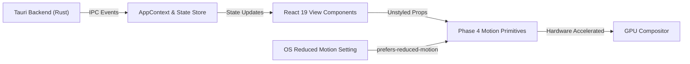

# Phase 4 — Motion Infrastructure & Animation Architecture

**Project:** Infinity Researcher  
**Phase:** 4 of 30 (Motion Infrastructure & Animation Architecture)  
**Document:** Motion System Architecture & Component Specification  
**Status:** Complete & Verified  

---

## 1. Executive Summary & Design Philosophy

Infinity Researcher is a high-density academic research workbench. Users spend extended hours searching large scholarly datasets, reading multi-column academic PDFs, evaluating literature matrices, and tracking long-running scraping and extraction jobs.

In this environment, animation must serve as a **functional clarity layer**, not a decorative spectacle. The Phase 4 animation infrastructure is guided by four immutable principles:

1. **Subtlety & Restraint:** Animations use small spatial offsets (<= 6px) and brisk durations (120ms – 180ms). The UI never feels sluggish or delayed.
2. **Hardware Acceleration:** All animations strictly operate on `transform` and `opacity` properties, completely preventing layout recalculations, reflows, and CPU spikes.
3. **Uncompromising Accessibility:** Operating system and user reduced-motion preferences (`prefers-reduced-motion`) are enforced globally. When active, spatial shifts and non-essential transitions are instantly stripped.
4. **Theme & Background Separation:** Motion variants never embed hardcoded color values. Real application state drives visibility, and background Python/Rust research tasks execute completely independent of UI component lifecycles.

---

## 2. Dependency Architecture: Motion for React

Following the Phase 1 dependency audit, the application selected **Motion for React** (`motion` package `^14.8.0`), imported via standard ESM entry points:

```typescript
import { motion, AnimatePresence, MotionConfig, useReducedMotion } from "motion/react";
```

### Key Architectural Strengths:
- Fully compatible with React 19 (`react: ^19.1.0`) and Vite bundler mode.
- Direct hardware compositing without JavaScript layout polling.
- Zero conflicts with the existing frameless Tauri 2 desktop shell.
- Tree-shakable modular bundle footprint.

---

## 3. Directory & Module Structure

The animation system is organized into modular layers separating design tokens, reusable variants, and React component primitives:

```
src/
├── components/
│   └── animation/
│       ├── AnimatedContainer.tsx     # Reusable entrance container with preset support
│       ├── AnimatedPresence.tsx      # Lifecycle mount/unmount coordinator
│       ├── FadeIn.tsx                # Directional, restrained opacity entrance
│       ├── StaggerContainer.tsx      # Cascaded stagger container & StaggerItem
│       ├── ReducedMotionProvider.tsx # Top-level MotionConfig accessibility provider
│       └── index.ts                  # Component barrel export
├── hooks/
│   └── use-reduced-motion-preference.ts  # Reactive media query & Motion hook
├── lib/
│   └── animations/
│       ├── tokens.ts                 # Duration, easing, distance, and spring tokens
│       ├── transitions.ts            # Pre-configured transition objects
│       ├── variants.ts               # Reusable Motion variants
│       ├── presets.ts                # Named preset bundles & resolver
│       ├── animation-utils.ts        # Accessibility and transition safety utilities
│       └── index.ts                  # Library barrel export
└── styles/
    └── motion.css                    # CSS variables and hardware acceleration classes
```

---

## 4. Component Primitives Specification

### 4.1 `<ReducedMotionProvider />`
Wraps the application root or subtree with Motion's `<MotionConfig reducedMotion="user">`, ensuring all child motion primitives automatically inherit the user's OS or app-level accessibility settings.

### 4.2 `<AnimatedContainer />`
The primary entrance component for cards, panels, and view containers.
- **Props:** `preset` (`"subtleEntrance" | "fade" | "horizontalEntrance" | "dropdown" | "modalContent"`), `delay`, `duration`, `variants`, forwarded `ref`.
- **Defaults:** `subtleEntrance` (6px vertical offset, 180ms ease-out).
- **Behavior:** Ref-forwarding, full HTML attribute pass-through, zero layout thrashing.

### 4.3 `<FadeIn />`
Directional entrance component for paragraphs, badges, and headers.
- **Props:** `direction` (`"up" | "down" | "left" | "right" | "none"`), `distance` (default: 6px), `delay`, `duration`.
- **Behavior:** Strips spatial translation when reduced motion is preferred.

### 4.4 `<StaggerContainer />` and `<StaggerItem />`
Choreographs the cascading entrance of related items (e.g. initial 5 collection cards or recent activity items).
- **Props:** `staggerDelay` (default: 0.03s), `delayChildren` (default: 0.01s).
- **Safeguard:** Bypassed when reduced motion is active; large datasets (100+ items) use virtualization without individual item animation.

### 4.5 `<AnimatedPresence />`
Coordinates entry and exit transitions for modals, popovers, and conditional panels.
- **Props:** `initial={false}` by default to prevent disruptive animations during workspace boot; `mode="sync"` or `"wait"`.

---

## 5. Integration Boundaries & Guarantees



1. **State Isolation:** UI animations respond to actual application state. Background tasks (downloads, scraping, AI analysis) do not stall or terminate if an animated view unmounts.
2. **PDF Reader Isolation:** The embedded PDF canvas ([EmbeddedPdfViewer.tsx](file:///d:/Paper/src/components/pdf-viewer/EmbeddedPdfViewer.tsx)) is never animated during page flips, zoom, or text selection.
3. **Theme Neutrality:** No color values are animated in Motion variants. All colors reference semantic tokens (`var(--background)`, `var(--foreground)`, `var(--primary)`).

