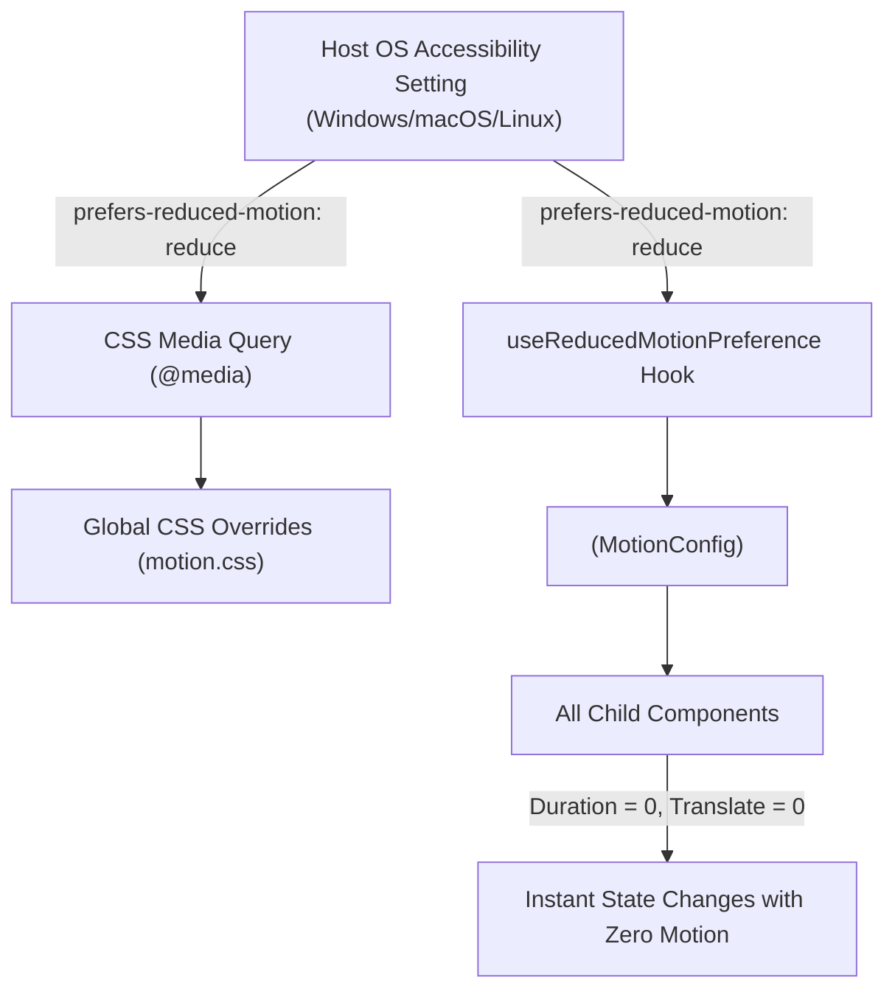

# Phase 4 — Reduced Motion & Accessibility Architecture

**Project:** Infinity Researcher  
**Phase:** 4 of 30 (Motion Infrastructure & Animation Architecture)  
**Document:** Reduced Motion Standards, OS Synchronization, and WCAG Compliance  
**Status:** Complete & Verified  

---

## 1. Accessibility Mandate & Objectives

Motion sensitivity, vestibular disorders, and visual fatigue are primary considerations when building desktop software for intensive research. Under **WCAG 2.1 Success Criterion 2.3.3 (Animation from Interactions)**, users must be able to disable non-essential motion without losing functional information or feedback.

Phase 4 establishes an integrated, reactive reduced-motion architecture that:
1. Automatically detects and respects the host operating system's reduced-motion setting.
2. Strips all spatial movement, scaling, and parallax shifts.
3. Collapses animation durations to `0s` without breaking React lifecycle or unmount logic.
4. Preserves functional status indicators, progress bars, and modal stacking context.

---

## 2. Detection & Synchronization Architecture

Reduced-motion handling operates across three synchronized layers:



### 2.1 CSS Layer (`src/styles/motion.css`)

When the OS requests reduced motion, CSS variables collapse instantly:

```css
@media (prefers-reduced-motion: reduce) {
  :root {
    --motion-duration-fast: 0ms;
    --motion-duration-normal: 0ms;
    --motion-duration-moderate: 0ms;
    --motion-duration-slow: 0ms;
  }

  *,
  *::before,
  *::after {
    animation-duration: 0.01ms !important;
    animation-iteration-count: 1 !important;
    transition-duration: 0.01ms !important;
    scroll-behavior: auto !important;
  }
}
```

### 2.2 React Hook Layer (`src/hooks/use-reduced-motion-preference.ts`)

The hook blends Motion for React's native `useReducedMotion()` with a persistent `MediaQueryList` event listener:

```typescript
export function useReducedMotionPreference(): boolean {
  const motionReduced = useReducedMotion();
  const [osReduced, setOsReduced] = useState<boolean>(() => isReducedMotionPreferred());

  useEffect(() => {
    if (typeof window === "undefined" || !window.matchMedia) return;
    try {
      const mediaQuery = window.matchMedia("(prefers-reduced-motion: reduce)");
      setOsReduced(mediaQuery.matches);
      const listener = (e: MediaQueryListEvent) => setOsReduced(e.matches);
      mediaQuery.addEventListener("change", listener);
      return () => mediaQuery.removeEventListener("change", listener);
    } catch {
      // Graceful fallback for non-browser/test runtimes
    }
  }, []);

  return Boolean(motionReduced || osReduced);
}
```

### 2.3 Provider Layer (`src/components/animation/ReducedMotionProvider.tsx`)

Mounted at the root of `src/app/App.tsx`, `<ReducedMotionProvider>` instructs Motion's internal layout and transition engines to bypass motion calculations:

```tsx
<MotionConfig reducedMotion={isReduced ? "always" : "user"}>
  {children}
</MotionConfig>
```

---

## 3. Reduced-Motion Substitution Matrix

| Animation Element | Standard Behavior | Reduced-Motion Behavior | Rationale |
| :--- | :--- | :--- | :--- |
| **Card / Panel Entrance** | `y: 6px -> 0`, `opacity: 0 -> 1` (180ms) | `opacity: 0 -> 1` (0ms instant) | Eliminates vertical motion while preserving mount lifecycle |
| **Drawer / Sidebar** | `x: -6px -> 0` (180ms) | `x: 0`, instant mount | Avoids peripheral sliding distraction |
| **Dropdown / Menu** | `scale: 0.98 -> 1`, `y: -4px -> 0` (120ms) | `scale: 1`, `y: 0`, instant display | Preserves immediate keyboard menu interaction |
| **Modal Dialog** | `scale: 0.98 -> 1`, `y: 12px -> 0` (240ms) | `scale: 1`, `y: 0`, instant display | Eliminates zoom/flying dialogs |
| **Staggered Children** | 30ms cascade per item | All items render simultaneously (0ms delay) | Eliminates repetitive visual wave patterns |
| **Progress Indicators** | Continuous indeterminate pulse | Constant determinate bar or static spinner | Preserves task tracking without nausea-inducing loops |

---

## 4. Verification & Automated Test Coverage

The reduced-motion infrastructure was verified via automated testing in `src/test/animation-infrastructure.test.tsx`:

- `ensures reduced motion variants remove all spatial translation and scaling` — **PASS**
- `substitutes reducedMotion preset when prefersReducedMotion is true` — **PASS**
- `ensures safeTransition strips durations when reduced motion is preferred` — **PASS**
- `ensures safeVariants substitutes reduced variants when requested` — **PASS**
- `renders ReducedMotionProvider and configures policy without throwing` — **PASS**

