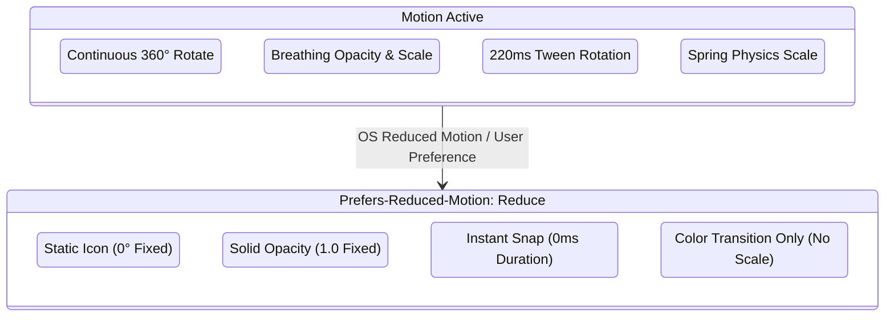

# Phase 6 — Icon Animation Patterns

**Project:** Infinity Researcher  
**Phase:** 6 of 30 — Animated Icon System Modernization  
**Engine:** Motion for React (`motion` ^14.8.0)  

---

## 1. Principles of Purposeful Icon Motion

1. **Informative, Never Distracting**: Motion exists to communicate state changes, confirm user intent, or indicate async activity. Icons must never bounce or spin perpetually without an active underlying background task.
2. **GPU-Accelerated Transforms Only**: All icon animations operate strictly on `transform` (`rotate`, `scale`, `x`) and `opacity`. No layout recalculations (width, height, margin) are animated.
3. **Strict Reduced-Motion Zeroing**: When `useReducedMotionPreference()` reports `true` (from Windows OS settings or app configuration), infinite repeats and spring physics are completely bypassed. Transitions drop to `duration: 0` for instant state flips.
4. **Task State Synchronization**: Animations such as `spin` and `pulse` accept `isAnimating?: boolean`. If a network stream fails or finishes, the rotation immediately halts and rests at `0deg`.

---

## 2. Standard Pattern Catalog

| Pattern | Preset Name | Trigger | Physics / Timing | Academic Research Use Case |
| :--- | :--- | :--- | :--- | :--- |
| **Active Sync / Loading** | `spin` | Controlled (`isAnimating`) | Linear 360° loop (1.1s duration). Stops cleanly on finish. | SQLite indexing, database sync, PDF document downloading. |
| **AI Processing Heartbeat** | `pulse` | Controlled (`isAnimating`) | Opacity `[1.0 -> 0.45 -> 1.0]`, subtle scale `[1.0 -> 0.96 -> 1.0]`, easeInOut (1.6s). | AI Hub streaming response, RAG embedding calculation. |
| **Interactive Hover** | `hover-scale` | `whileHover` | Spring (stiffness: 400, damping: 25), scale to 1.15. | Toolbar actions, quick copy buttons, paper card actions. |
| **Rotational Tilt** | `hover-rotate` | `whileHover` | Spring, rotate 12°. | Settings cog hover, refresh trigger hover. |
| **Tactile Tap / Press** | `tap-bounce` | `whileTap` | Snappy easeOut (0.18s), scale to 0.88. | Bookmark toggle, PDF download enqueue button. |
| **Success Confirmation** | `success-check` | Enter / State change | Scale spring `[0.7 -> 1.0]`, opacity `[0 -> 1]`. | Citation copied to clipboard, paper added to collection. |
| **Error Feedback** | `error-shake` | Controlled (`isAnimating`) | Horizontal micro-oscillation `[-2px, +2px, -2px, +2px, 0]`. | Invalid search syntax, failed API key verification. |
| **Disclosure Toggle** | `expand-chevron` | Controlled (`isExpanded`) | Smooth easeInOut (0.22s), rotate 0° -> 180° (or 90°). | Sidebar collapse, metadata drawer accordion, filter chips. |

---

## 3. Reduced Motion Degradation Matrix

