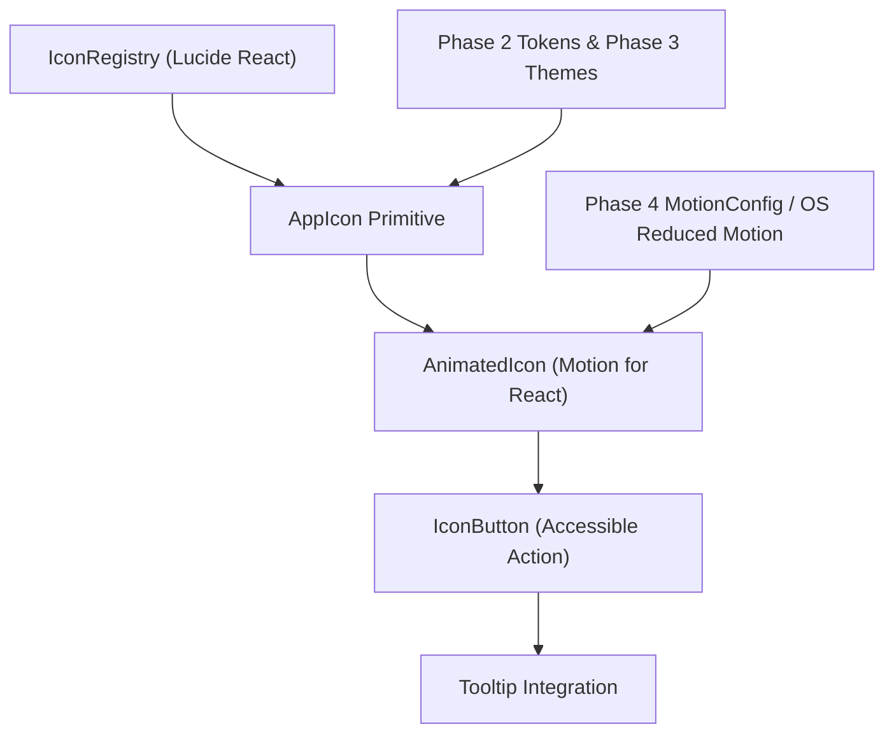

# Phase 6 — Icon System Architecture

**Project:** Infinity Researcher  
**Phase:** 6 of 30 — Animated Icon System Modernization  
**Architecture Layer:** Presentation & Interaction  

---

## 1. Directory Structure

The icon architecture is located under `src/components/icons/` and re-exported through `src/components/ui/index.ts`:

```
src/components/icons/
├── iconTypes.ts         # TypeScript definitions for sizes, animations, and component props
├── iconConfig.ts        # Pixel tokens, stroke width resolution, and animation timing
├── AppIcon.tsx          # Foundational stroke icon primitive with automated WCAG semantics
├── AnimatedIcon.tsx     # Motion for React wrapper for restrained micro-interactions
├── IconButton.tsx       # Accessible icon-only button with tooltip integration
├── IconRegistry.ts      # Semantic domain dictionary for academic research workflows
└── index.ts             # Clean public barrel exports
```

---

## 2. Component Hierarchy & Composition



---

## 3. Core Component Responsibilities

### 3.1 `AppIcon`
- Enforces semantic sizing tokens (`xs` through `2xl`) while allowing custom numeric overrides.
- Dynamically assigns stroke width (`2.0` standard, `1.75` for large, `1.5` for display).
- Enforces accessibility: if `aria-label` or `title` is supplied, sets `role="img"`; otherwise sets `aria-hidden="true"`.
- Prevents flex shrinkage via `shrink-0`.

### 3.2 `AnimatedIcon`
- Implements restrained micro-interactions powered by Motion for React (`motion.span`).
- Integrates `useReducedMotionPreference()`: automatically strips rotational, scale, and oscillating animations when reduced-motion is requested.
- Preserves layout stability: animates GPU-accelerated `transform` and `opacity` properties only.
- Supports controlled task synchronization via `isAnimating` boolean.

### 3.3 `IconButton`
- Enforces WCAG 2.1 AA accessible naming by requiring `aria-label: string`.
- Standardizes touch/click dimensions: `xs` (24px), `sm` (28px), `md` (36px), `lg` (40px), `xl` (48px).
- Incorporates `<Tooltip>` seamlessly when `tooltip` prop is provided.
- Handles async loading states (`isLoading` renders spinning `Loader2`, sets `aria-busy="true"`, and disables clicks).
- Synchronizes disclosure state (`isExpanded`) with both `aria-expanded` and chevron rotation.

### 3.4 `IconRegistry`
- Provides strongly typed, standardized symbol mappings across 8 research domains:
  - `navigation`: discover, library, workspace, assistant, settings
  - `discovery`: search, filter, source, openAccess
  - `library`: paper, book, collection, bookmark
  - `pdfViewer`: zoomIn, zoomOut, rotate, fitScreen, download
  - `tasks`: download, refresh, loading, success, warning
  - `aiTools`: sparkles, bot, cpu, send, pen, detector
  - `security`: lock, unlock, shield, eye, eyeOff, logout
  - `window`: minimize, maximize, restore, close

