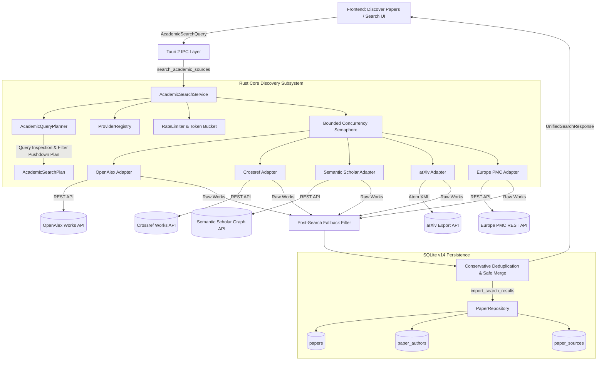

# Phase 17 — System Architecture & Retrieval Reliability

**System**: Infinity Researcher  
**Phase**: Phase 17 — Academic Source Connector Framework and Research Retrieval Reliability  
**Target Environment**: Tauri 2 + Rust + SQLite v14 + React 19 + TypeScript + Tailwind CSS v4 + Python Scraper Engine  

---

## 1. High-Level Architectural Vision

Infinity Researcher operates as a local-first scholarly desktop environment. Scholarly discovery and document acquisition rely on a unified, high-reliability academic connector framework capable of querying disparate upstream scholarly APIs and repositories concurrently without mutual interference, cascading failures, or metadata corruption.

Prior to Phase 17, source retrieval was split across heterogeneous Rust HTTP adapters and Python scraping spiders with divergent metadata models, ad-hoc deduplication, and minimal capability awareness. Phase 17 unifies these subsystems into an integrated architecture characterized by:
1. **Centralized Source Registry & Capability Declarations**: Authoritative tracking of all connectors, supported filter parameters, auth models, and rate limits.
2. **Capability-Aware Query Planning**: Intelligent query analysis and filter pushdown, combined with deterministic client-side post-filtering when upstream providers lack native filter support.
3. **Canonical Normalization & Conservative Deduplication**: Multi-tier deduplication based on normalized DOIs, provider-specific records, and clean title keys with author surname overlap.
4. **Isolated Per-Connector Execution & Resilient Concurrency**: Bounded concurrency semaphores, non-blocking per-connector failure handling, and non-destructive metadata merging.
5. **Observability & Proactive Health Diagnostics**: Lightweight, non-intrusive probe health checks with latency telemetry and dynamic rate-limit status.

---

## 2. Component Hierarchy & Data Flow

---

## 3. Subsystem Breakdown

### 3.1 Academic Search Service (`src-tauri/src/academic_sources/search_service.rs`)
The `AcademicSearchService` coordinates concurrent multi-provider queries. Key architectural enhancements in Phase 17:
- **Bounded Concurrency**: Uses an `Arc<Semaphore>` initialized to 5 concurrent provider execution slots to prevent OS socket exhaustion and mitigate burst-induced IP bans.
- **Isolated Per-Connector Tasks**: Each provider executes inside an isolated `tokio::spawn` task. A timeout, HTTP 429, HTTP 403, or deserialization error in one connector never aborts adjacent providers.
- **Post-Search Fallback Filtering**: Employs `AcademicQueryPlanner::filter_post_search` to enforce year bounds and open-access criteria on results returned by providers that lack native server-side support.

### 3.2 Academic Query Planner (`src-tauri/src/academic_sources/query_planner.rs`)
The query planner acts as an analytical compiler for user search queries:
- **Identifier Detection**: Identifies whether the search query is a canonical DOI (`10.xxxx/...`), an arXiv ID (`YYMM.NNNNN`), or free-text keywords using `MetadataNormalizer`.
- **Capability Compatibility Checks**: Compares requested filters (`year_start`, `year_end`, `open_access_only`) against each provider's `ProviderCapabilities`.
- **Warning Generation**: Generates explicit warnings (e.g. arXiv year range pushdown warnings) rather than silently ignoring user filter requests.

### 3.3 Conservative Deduplication & Safe Merging
Deduplication enforces a strict three-tier hierarchy:
1. **Tier 1 (Exact Canonical DOI)**: Matches normalized DOIs stripped of URL prefixes, resolver schemes, and trailing punctuation.
2. **Tier 2 (Provider Record Match)**: Matches identical provider ID and upstream record ID.
3. **Tier 3 (Clean Title Key + Year Compatibility + Author Overlap)**: Matches clean title keys (minimum 10 alphanumeric characters), publication years within +/- 1 year, and requires at least one matching author surname (minimum 3 characters). Titles with completely disjoint authors are preserved as distinct papers.
- **Safe Field Merging**: Existing rich fields (abstracts, venues, open-access PDFs, publication dates) are never overwritten by empty fields. Distinct provenance records are accumulated in the `provenance` vector.

### 3.4 Provider Health Diagnostics (`src-tauri/src/academic_sources/types.rs`)
Connectors declare a `health_check(&self, client: &reqwest::Client)` method:
- Issues minimal, non-disruptive probe requests (e.g. `rows=1`, `max_results=1`, or `limit=1`).
- Measures network latency in milliseconds.
- Classifies status into `Healthy`, `Degraded`, `RateLimited`, `AuthRequired`, or `Unavailable`.
- Exposes runtime diagnostics via the Tauri command `check_academic_provider_health`.

---

## 4. Architectural Invariants

1. **Zero Data Fabrication**: Search results, provider counts, latencies, and health statuses represent genuine upstream responses and local database states.
2. **Database Integrity**: All imports into SQLite write to `papers`, `paper_authors`, and `paper_sources` using existing schema v14 constraints (`UNIQUE(source_id, source_record_id)`).
3. **Non-Destructive Operations**: Merging two candidate duplicate papers never deletes notes, tags, or user reading progress.

