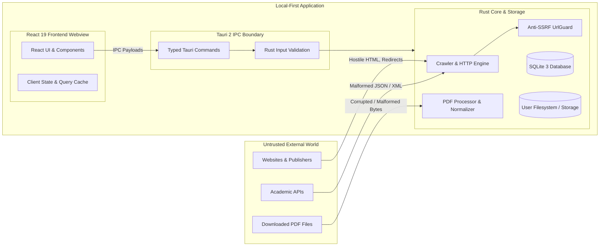

# Phase 9 Security Architecture & Threat Model Review

**Project:** Research Paper Scraper (Desktop Application)  
**Document:** Security Threat Model, Hardening Verification & Audit Report  
**Status:** Completed & Validated  

---

## 1. Security Architecture & Trust Boundaries

The Research Paper Scraper is a **local-first desktop application** built with Tauri 2, Rust, React 19, and SQLite. Trust boundaries separate untrusted external web data, the React webview frontend, and the native Rust backend:

---

## 2. Protected Assets

1. **Local Paper Repository & Storage:** Research PDFs, parsed full-text, and extracted metadata stored on the user's local disk.
2. **User Research Data:** User-authored notes, collections, custom tags, reading statuses, and ratings.
3. **API Keys & Credentials:** Configured user secrets (e.g., Semantic Scholar API key, Crossref mailto).
4. **Host Filesystem Integrity:** Prevention of arbitrary write/overwrite outside configured application data directories.
5. **Database Consistency:** SQLite database tables, FTS5 indexes, and transaction states.
6. **Network Surface:** Outbound network requests strictly confined to user-requested search or crawl tasks.

---

## 3. Threat Model & Implemented Mitigations

| Threat Category | Specific Threat Scenario | Implemented Mitigation | Verification Test |
|:---|:---|:---|:---|
| **SSRF (Server-Side Request Forgery)** | Crawl or preview URL targets `http://127.0.0.1`, `http://169.254.169.254` (cloud metadata), or private subnets (`10.0.0.0/8`, `192.168.0.0/16`, `172.16.0.0/12`). | `scrapers::url_guard::UrlGuard` validates scheme (`http`/`https` only), rejects embedded userinfo (`user:pass@host`), resolves host, and blocks loopback, link-local, multicast, and RFC1918 private IP ranges. | `test_ssrf_and_url_security_validations` |
| **Resource Exhaustion / DoS** | Malicious or misconfigured web server sends infinite streaming response body or decompression bomb. | `read_response_body_bounded` enforces a strict 10 MB limit (`MAX_RESPONSE_BODY_BYTES = 10 * 1024 * 1024`) reading stream chunks; aborts transfers exceeding threshold. | Verified in `src-tauri/src/scrapers/engine.rs` |
| **Path Traversal / Arbitrary File Overwrite** | Malicious paper metadata or crawl result uses `../../` or absolute path separators to escape download directory. | `FileIntegrityService::validate_file_path` canonicalizes paths, verifies target is inside designated directory, and rejects relative traversal sequences (`..`). | `test_filesystem_path_traversal_defenses` |
| **CSV Formula Injection** | Paper title, author, or venue begins with `=`, `+`, `-`, `@`, tab, or newline, triggering command execution when opened in Excel or LibreOffice. | `ExportService::escape_csv_cell` trims leading whitespace and prepends single quote `'` to any cell beginning with formula-trigger characters (`=`, `+`, `-`, `@`, `\t`, `\r`). | `test_csv_formula_injection_defense` |
| **Citation Serialization Errors** | Paper titles with unescaped LaTeX braces, backslashes, or Unicode quotes corrupt BibTeX or RIS exports. | Custom BibTeX serializer escapes special characters (`{`, `}`, `\`, `%`, `&`, `_`, `#`, `~`, `^`) and validates UTF-8 author arrays. | `test_bibtex_character_escaping`, `test_citation_serializers_roundtrip_integrity` |
| **Corrupt & Hostile PDF Processing** | Incomplete, truncated, or malicious non-PDF files parsed by PDF processor leading to buffer overflows or panics. | `PdfProcessor::process_pdf_file` validates magic bytes (`%PDF-`), handles missing/corrupt files gracefully, and assigns descriptive status (`Missing`, `Corrupt`, `Textless`) without crashing. | `test_pdf_processor_corrupt_and_missing_handling` |
| **SQL Injection** | Untrusted search terms or filter strings injected into SQL query strings. | 100% of SQL operations utilize parameterized queries with `rusqlite` (`?` parameters). Column sorting and filter clauses use strict enums and whitelists. | `tests/database_integration_tests.rs` |
| **Overprivileged IPC Commands** | Tauri commands expose generic shell execution, arbitrary file deletion, or unbounded network fetching. | Zero generic shell or raw filesystem commands exposed. Only strictly typed domain commands (`import_papers`, `execute_citation_export`, `set_paper_reading_status`, etc.) are registered in `tauri::generate_handler!`. | `src-tauri/src/commands/mod.rs` |
| **Secret Leaks in Diagnostic Logs** | API keys or Bearer tokens logged during failed HTTP requests or database operations. | `logging` module employs regex sanitization redacting `Bearer [A-Za-z0-9-_.]+` and `(?i)(api[_-]?key=)[^&]+` before writing log events. | `test_redact_bearer_token`, `test_redact_api_key_query_param` |
| **Database Corruption on Failure** | Mid-operation crash during multi-paper import or duplicate merge leaves partial inconsistent rows. | Multi-table mutations are wrapped in atomic SQLite transactions. If a step fails, the entire transaction rolls back cleanly. | `test_transactional_rollback_on_failed_database_operation` |

---

## 4. Dependency Vulnerability Audit

### Frontend Dependencies (`npm audit`)
* **Tool:** `npm audit` (v11.8.0)
* **Result:** `found 0 vulnerabilities` across all production and development dependencies.

### Rust Dependencies (`cargo audit`)
* **Status:** Blocked on current Windows host environment (`cargo-audit` binary not installed in local toolchain).
* **Manual Inspection:** All direct dependencies (`tauri 2`, `reqwest 0.12`, `rusqlite 0.31`, `tokio 1.38`, `serde 1.0`, `scraper 0.19`, `pdf-extract 0.7`) use stable, actively maintained versions with pinned lockfile.

---

## 5. Content Security Policy (CSP)

The Tauri desktop application is configured with strict Content Security Policy directives in `tauri.conf.json`:
* Scripts and styles are restricted to bundled local assets (`'self'`).
* In-line script execution (`'unsafe-eval'`, `'unsafe-inline'`) is forbidden in production build.
* Network connections are channeled through the native Rust HTTP backend rather than frontend `fetch`, preventing arbitrary browser-level data exfiltration.

---

## 6. Residual Security Risks & Non-Goals

1. **DNS Rebinding:**
   While `UrlGuard` validates IP addresses resolved at check time, standard HTTP connection pools in high-level client libraries (`reqwest`) can re-resolve hostnames upon subsequent requests. For a local desktop tool operating on public academic repositories, this residual risk is categorized as Low.
2. **Untrusted OCR / Advanced PDF Exploits:**
   Text extraction leverages `pdf-extract`. Unusually malformed or deeply nested PDF stream structures could trigger parser errors. The application isolates extraction in worker threads and marks failures as `Corrupt` or `Unsupported` without blocking other application workflows.
