# Phase 9 Comprehensive Test Strategy & Coverage Map

**Project:** Research Paper Scraper (Desktop Application)  
**Document:** Test Strategy, Matrix & Coverage Specification  
**Status:** Executed & Verified (Phase 9 Release Gate)  

---

## 1. Overview & Quality Objectives

The testing strategy establishes rigorous multi-tiered verification of the Research Paper Scraper across backend Rust components, SQLite persistent storage, the Tauri desktop IPC boundary, and React 19 frontend interfaces.

### Quality Invariants
1. **Zero External Flakiness:** Automated tests must never contact live external APIs (arXiv, Crossref, Semantic Scholar, etc.) or live publisher websites. All network adapters must utilize offline deterministic fixtures or mock servers.
2. **Defensive Non-Crashing Boundaries:** Corrupt files, oversized payloads, invalid URLs, and foreign key conflicts must fail gracefully with actionable error models (`AppError`) rather than panicking or terminating the process.
3. **Data Loss Prevention:** Transactional rollbacks protect database consistency during multi-entity mutations, duplicate resolution, and interrupted operations.
4. **Leak-Free Diagnostics:** Diagnostic logs must automatically redact bearer tokens, API credentials, and query secrets.

---

## 2. Test Execution Layers

```mermaid
graph TD
    A[Test Suite Architecture] --> B[Rust Unit Tests: 46]
    A --> C[Rust Integration Tests: 18]
    A --> D[Rust Security & Robustness: 7]
    A --> E[Rust Performance Benchmarks: 1]
    A --> F[React Vitest Component Tests: 36]
    
    B --> B1[Domain & Normalization]
    B --> B2[Robots & URL Guard]
    B --> B3[PDF Processor & File Integrity]
    
    C --> C1[Database Integration & FTS5]
    C --> C2[Crawl Engine Lifecycle]
    C --> C3[Academic Search Import]
    C --> C4[Processing Pipeline]
    
    D --> D1[SSRF & URL Policy]
    D --> D2[Path Traversal]
    D --> D3[Formula Injection Defense]
    D --> D4[Database Rollback]
    
    F --> F1[AppShell & Navigation]
    F --> F2[Discover & Multi-Source]
    F --> F3[Library & Reading Status]
    F --> F4[Website Scraper & Sandboxing]
```

---

## 3. Feature-to-Test Coverage Matrix

| Feature Area | Component / Service | Test File & Suite | Coverage Scope | Status |
|:---|:---|:---|:---|:---|
| **Domain Logic & Invariants** | `Paper`, `Collection`, `Note`, `Tag` | `src/test/domain-logic.test.ts` | Title trimming, validation, year bounds, status parsing | Passed (12/12) |
| **Desktop IPC Client** | `src/lib/desktop-api` | `src/test/desktop-api.test.ts` | Tauri mock invoke, fallback demo mode, error transformation | Passed (6/6) |
| **App Shell & Layout** | `AppShell.tsx`, Navigation, Sidebar | `src/test/AppShell.test.tsx` | View routing, theme toggle, drawer transitions, command palette | Passed (6/6) |
| **Academic Search Engine** | `DiscoverView.tsx`, `search_service.rs` | `src/test/academic-discovery.test.tsx`, `tests/academic_search_tests.rs` | Multi-source selection, query validation, deduplication, import | Passed (7/7) |
| **Website Scraping** | `SourcesView.tsx`, `DownloadsView.tsx`, `engine.rs` | `src/test/crawl-engine.test.tsx`, `tests/crawl_engine_tests.rs` | Profile sandbox, CSS extraction, job lifecycle, pause/resume | Passed (8/8) |
| **Processing & Duplicates** | `processing_pipeline.rs`, `deduplication.rs` | `src/test/processing-pipeline.test.tsx`, `tests/processing_pipeline_tests.rs` | Metadata normalizer, candidate scoring, transactional merge | Passed (7/7) |
| **Database & FTS5** | `paper_repo.rs`, `migrations.rs` | `tests/database_integration_tests.rs` | In-memory SQLite, migrations 0001-0004, FTS5 match queries | Passed (5/5) |
| **URL Guard & Anti-SSRF** | `scrapers::url_guard.rs` | `tests/security_and_robustness_tests.rs` | Loopback, RFC1918 private, link-local, cloud metadata IPs | Passed (1/1) |
| **Filesystem Safety** | `services::file_integrity.rs` | `tests/security_and_robustness_tests.rs` | `../` path traversal escape, absolute-path injection rejection | Passed (1/1) |
| **CSV Formula Injection** | `services::export_service.rs` | `tests/security_and_robustness_tests.rs` | Neutralizes `=`, `+`, `-`, `@`, tab, CR with whitespace prefix | Passed (1/1) |
| **Citation Serializers** | `BibTeX`, `RIS`, `CSV`, `JSON` | `tests/security_and_robustness_tests.rs` | Escaping braces, UTF-8 authors, multi-record export integrity | Passed (2/2) |
| **PDF Defenses** | `services::pdf_processor.rs` | `tests/security_and_robustness_tests.rs` | Corrupted headers, zero-byte files, missing files, non-PDF | Passed (1/1) |
| **Transactional Rollback** | SQLite Transaction Boundary | `tests/security_and_robustness_tests.rs` | Atomic rollback on duplicate DOI constraint failure | Passed (1/1) |
| **Performance Scale** | `paper_repo.rs`, `export_service.rs` | `tests/performance_benchmarks.rs` | 1,000 and 5,000 synthetic records: insert, FTS5, exports | Passed (1/1) |

---

## 4. End-to-End Smoke Test Procedure (9-Step Release Walkthrough)

For manual verification and staging smoke testing:

1. **Launch Desktop Application:**
   * Run `npm run tauri dev`. Verify that the desktop window renders cleanly with the sidebar, top header, and default Library view.
2. **Verify Shell Navigation:**
   * Navigate sequentially through **Discover**, **Library**, **Sources**, **Downloads**, and **Settings**. Confirm no console errors or blank screens.
3. **Execute Academic Discovery Search:**
   * In **Discover**, search `"neural network consensus"`. Confirm results display titles, authors, and source badges.
4. **Import Paper to Database:**
   * Select a search result and click **Import to Library**. Verify notification confirms successful import.
5. **Search & Filter Library:**
   * Switch to **Library**. Type query in library search box. Confirm instant FTS5 filtering. Apply year filter.
6. **Open Paper Details Drawer:**
   * Click the imported paper row. Confirm drawer opens showing normalized metadata, DOI, source badge, reading status, and PDF document status.
7. **Organize via Collections & Notes:**
   * Assign the paper to a collection. Add a test research note: `"Validated benchmark methodology"`. Toggle reading status to **Reading**.
8. **Export Citation:**
   * From Library actions or details drawer, export paper to **BibTeX** and **CSV**. Inspect generated file content: confirm LaTeX escaping and formula neutralization.
9. **Persistence & App Restart:**
   * Close the desktop application completely and relaunch. Navigate to Library and confirm the imported paper, note, and reading status remain intact.
