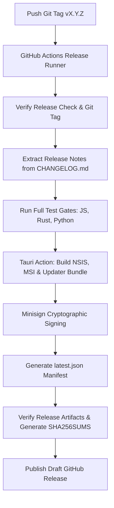

# Infinity Researcher — GitHub Actions CI/CD & Signed Updates Setup Guide

This document provides complete instructions for configuring GitHub Actions permissions, repository secrets, cryptographic signing keys, and automated release deployment for **Infinity Researcher**.

---

## 1. Repository Architecture & Metadata

- **Application Name:** Infinity Researcher
- **Author & Creator:** Sanjay
- **Publisher / Organization:** Infinity Web Technology
- **Repository Remote:** `https://github.com/sanjay-m6/Infinity-Researcher.git`
- **Release Target:** Windows x64 (NSIS `.exe` and WiX `.msi`)
- **Updater Mechanism:** Tauri v2 Updater (`@tauri-apps/plugin-updater`, `tauri-plugin-updater`)
- **Signature Algorithm:** Minisign Ed25519

---

## 2. GitHub Actions Secrets Configuration

To enable automated release bundling, binary artifact publishing, and cryptographic signing of updater packages, configure the following secrets in GitHub:

Navigate to **Settings → Secrets and variables → Actions → Repository secrets** on `https://github.com/sanjay-m6/Infinity-Researcher`:

| Secret Name | Required For | Format / Description | Security Precautions |
| :--- | :--- | :--- | :--- |
| `TAURI_SIGNING_PRIVATE_KEY` | Release Workflow (`release.yml`) | Multi-line string starting with `untrusted comment: ... secret key` generated by `tauri signer generate`. | **CRITICAL:** Never commit this key to git, never paste into issues, and never print in build logs. |
| `TAURI_SIGNING_PRIVATE_KEY_PASSWORD` | Release Workflow (`release.yml`) | The password/passphrase chosen when the private key was generated (leave empty if generated with empty password). | Masked automatically by GitHub Actions secret scrubbing. |
| `GITHUB_TOKEN` | Release Workflow (`release.yml`) | Built-in GitHub Actions token. | Automatically provided by runner; ensure workflow permissions allow write access. |

### Optional Code Signing Secrets (When Authenticode is Acquired)

| Secret Name | Purpose | Description |
| :--- | :--- | :--- |
| `WINDOWS_CERTIFICATE` | Windows SmartScreen suppression | Base64-encoded `.pfx` code-signing certificate file. |
| `WINDOWS_CERTIFICATE_PASSWORD` | Windows SmartScreen suppression | Passphrase for the `.pfx` certificate. |

> [!NOTE]
> **Tauri Minisign vs Windows Authenticode:**
> Tauri updater signing (Minisign) guarantees that the in-app auto-updater will **only** accept and install packages signed by Sanjay (Infinity Web Technology), completely independent of Microsoft Windows Authenticode. Windows Authenticode prevents Windows SmartScreen "Unknown Publisher" dialogs on initial browser download. One does not replace the other.

---

## 3. GitHub Actions Workflow Permissions

Ensure the repository allows GitHub Actions to publish releases:

1. Open **Settings → Actions → General**.
2. Scroll to **Workflow permissions**.
3. Select **Read and write permissions**.
4. Check **Allow GitHub Actions to create and approve pull requests** (optional, recommended for version bumps).
5. Click **Save**.

---

## 4. Minisign Key Pair Management

The application is configured with the following authentic Minisign Public Key embedded in `src-tauri/tauri.conf.json`:

```json
"plugins": {
  "updater": {
    "pubkey": "dW50cnVzdGVkIGNvbW1lbnQ6IG1pbmlzaWduIHB1YmxpYyBrZXk6IDgxMDEzMTc3RjEzQzg1QzEKUldUQmhUenhkekVCZ2NUSWZvUVhaWDl5R3VkaHQ3VjFrM2tHaDd5Wm5nVWRoMDVxcVQ0blJPMmYK",
    "endpoints": [
      "https://github.com/sanjay-m6/Infinity-Researcher/releases/latest/download/latest.json"
    ],
    "windows": {
      "installMode": "passive"
    }
  }
}
```

### Generating a New Key Pair (If Key Rotation Is Needed)

If key rotation is ever required:
```bash
npx tauri signer generate -w src-tauri/.tauri/infinity_researcher.key
```
1. Set the newly generated public key in `src-tauri/tauri.conf.json` under `plugins.updater.pubkey`.
2. Update the `TAURI_SIGNING_PRIVATE_KEY` secret in GitHub Repository Secrets.
3. Keep an offline, encrypted backup of the private key on secure storage.
4. Delete any local unencrypted `.key` files immediately.

---

## 5. Continuous Integration (CI) Workflow

The CI workflow `.github/workflows/ci.yml` runs on every pull request and push to `main`:

- **Security & Hygiene Audit:** `scripts/audit-secrets.mjs` scans 500+ files for leaked credentials, private keys, live API tokens, and forbidden files.
- **Version Synchronization:** `scripts/version-check.mjs` verifies that `package.json`, `tauri.conf.json`, and `Cargo.toml` agree 100% on SemVer.
- **Frontend Quality Gate:** Prettier formatting check, TypeScript typecheck (`tsc --noEmit`), ESLint check (`eslint .`), Vitest test suite (18 test files, 106 tests), and Vite production bundle compilation.
- **Backend Quality Gate:** Rust format check (`cargo fmt --check`), Clippy linter with `-D warnings`, and Rust test suite (`cargo test`, 98 tests).
- **Python Engine Quality Gate:** Pytest test suite (`pytest python-engine/tests -q`, 65 tests).

All CI action steps are pinned to verified immutable commit SHAs for supply-chain integrity.

---

## 6. Automated Release Workflow

The Release workflow `.github/workflows/release.yml` triggers automatically when an annotated git tag matching `v*` (e.g., `v0.1.0`, `v0.2.0`) is pushed to the repository:



### Key Release Artifacts Produced

1. `Infinity-Researcher_X.Y.Z_x64-setup.exe` (Standalone Windows NSIS Installer)
2. `Infinity-Researcher_X.Y.Z_x64_en-US.msi` (Native Windows Installer for enterprise deployment)
3. `Infinity-Researcher_X.Y.Z_x64.nsis.zip` (Signed Updater Archive)
4. `Infinity-Researcher_X.Y.Z_x64.nsis.zip.sig` (Minisign Cryptographic Signature)
5. `latest.json` (Updater Manifest pointing to the release assets)
6. `SHA256SUMS.txt` (Cryptographic verification checksums)
7. `RELEASE_NOTES.md` (Version notes extracted from `CHANGELOG.md`)

---

## 7. First Release & Upgrade Test Procedure

Follow this checklist to verify an end-to-end upgrade:

### Step 1: Prepare Release Notes and Version
1. Update `CHANGELOG.md` with version notes under `## [0.2.0] - YYYY-MM-DD`.
2. Run version bump:
   ```bash
   npm run version:bump minor
   ```
3. Run release validation:
   ```bash
   npm run release:check
   ```
4. Commit changes:
   ```bash
   git add .
   git commit -m "chore(release): prepare v0.2.0"
   ```

### Step 2: Push Git Tag
```bash
git tag -a v0.2.0 -m "Infinity Researcher Release v0.2.0"
git push origin main --tags
```

### Step 3: GitHub Actions Execution
1. Watch the workflow run in GitHub Actions.
2. Verify all quality gates pass and release artifacts are attached to the release.
3. Review the draft release in GitHub Releases and click **Publish Release**.

### Step 4: Verify In-App Automatic Update
1. Launch an installed copy of Infinity Researcher `v0.1.0` on a Windows machine.
2. Navigate to **Settings → Application Updates & Releases**.
3. Click **Check for Updates**.
4. Confirm:
   - Notice: "New Update Available: v0.2.0".
   - Release notes for v0.2.0 display accurately.
   - Click **Download & Install**.
   - Progress bar tracks download bytes.
   - Banner transitions to **Update Ready to Install**.
   - Click **Restart to Finish Update**.
5. After restart, verify:
   - App version displays `v0.2.0`.
   - All research papers, notes, tags, and settings are preserved intact.
