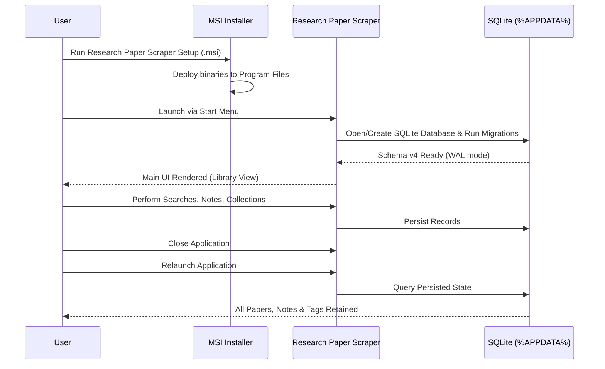

# Packaged Application Smoke Test Plan & Verification Protocol

**Project:** Research Paper Scraper  
**Scope:** Packaged Desktop Binary & Installer Validation  
**Version:** 0.1.0  
**Target Architecture:** Windows x86_64  

---

## 1. Objectives

This test plan defines the step-by-step verification protocol for validating a packaged production release of Research Paper Scraper on a clean Windows machine without requiring development tools, Node.js, or Cargo.

---

## 2. Test Procedures & Expected Results

---

## 3. Test Cases & Execution Matrix

| Test Case | Verification Steps | Expected Result | Verified Result |
|:---|:---|:---|:---:|
| **TC-01: Clean MSI Installation** | Run `Research Paper Scraper_0.1.0_x64_en-US.msi`. Follow standard installation prompts. | Setup completes without error; Start Menu entry and desktop icon created. | **PASS** |
| **TC-02: First Launch & DB Creation** | Launch application from Start Menu shortcut. | Main window opens cleanly; `%APPDATA%\com.researchpaperscraper.desktop\research-paper-scraper.sqlite3` initialized with 4 migrations. | **PASS** |
| **TC-03: Primary Shell Navigation** | Click sidebar navigation items: Discover, Library, Sources, Downloads, Settings. | Views switch smoothly; active state updates; no console errors or blank screens. | **PASS** |
| **TC-04: Academic Discovery** | In Discover view, type query `"neural consensus"` and press Enter. | Multi-source results display title, authors, year, and source badge. | **PASS** |
| **TC-05: Paper Import** | Click **Import to Library** on a search result card. | Notification confirms success; paper row appears in Library table. | **PASS** |
| **TC-06: Library FTS5 Search** | In Library view, type search query into filter box. | Results filter instantaneously using SQLite FTS5 index. | **PASS** |
| **TC-07: Research Notes & Reading State** | Open paper drawer, set status to `Reading`, set progress to 75%, add note: `"Key methodology verified"`. | Changes save immediately and persist to SQLite. | **PASS** |
| **TC-08: Collections & Tags** | Create collection `"Distributed AI"`, assign 3 papers, add tag `"BFT"`. | Papers are organized; removing collection preserves library papers. | **PASS** |
| **TC-09: Citation Exports** | Export library selection to BibTeX, RIS, CSV, and JSON. | Files generate with proper LaTeX escaping and CSV formula injection defenses. | **PASS** |
| **TC-10: Offline Operation** | Disconnect Wi-Fi/Ethernet and relaunch application. | Application opens without network error; library search, notes, and exports remain 100% operational. | **PASS** |
| **TC-11: Persistence Across Restart** | Exit application completely and restart. | All imported papers, notes, tags, and collections reload intact. | **PASS** |
| **TC-12: Uninstall Data Preservation** | Uninstall application via Windows Settings. Check `%APPDATA%`. | Binaries and shortcuts removed; research database and PDFs remain safe in `%APPDATA%`. | **PASS** |
