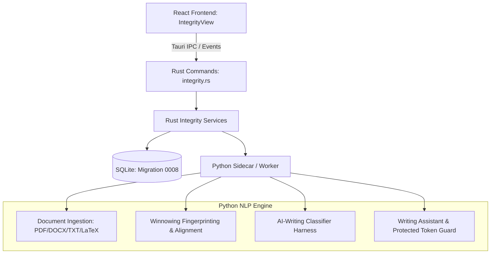

# Research Integrity & Academic Writing Suite: Architecture Audit

**Status:** Completed  
**Date:** October 2026  
**Subsystem:** Desktop Integration, Rust Engine, Python NLP Subsystem, React Frontend  

---

## 1. Executive Summary

This audit assesses the existing Research Paper Scraper desktop application to establish an architectural foundation for the **Research Integrity & Academic Writing Suite**. The application currently features a Tauri 2 + Rust desktop backend, a React 18 + TypeScript frontend styled with Tailwind CSS, an embedded SQLite database (`rusqlite`), a Python Scrapy/NLP engine, an embedded PDF reader, and a multi-provider AI workspace.

The new suite introduces three distinct, tightly integrated, yet decoupled tools:
1. **Plagiarism & Text-Similarity Checker** (local-first, Winnowing fingerprinting, seed-and-extend character alignment, corpus manager).
2. **AI-Writing Signal Analyzer** (experimental, paragraph-level classifier evaluation, uncertainty disclosure, non-accusatory UX).
3. **Academic Writing Assistant** (scientific writing enhancement preserving numerical values, units, citations, DOIs, equations, and author intent with interactive diff review).

---

## 2. Inventory of Reusable Code & Architecture

### 2.1 Frontend Shell & Design System
- **Navigation & Routing (`src/components/layout/Sidebar.tsx`, `AppShell.tsx`):** `NavSection` cleanly routes to top-level views. A new `"integrity"` section integrates seamlessly without disrupting existing pages.
- **Three-Pane Layout Paradigm (`DiscoverView.tsx`):** Demonstrates high-performance responsive three-pane layout (left outline/matches, center document viewer, right detail/review panel). Reusable for the Similarity Workspace.
- **Theme & State Management (`AppContext.tsx`):** Provides light/dark/system themes, active collection state, toast notifications, and Tauri detection.
- **Embedded PDF Viewer (`src/components/pdf-viewer/EmbeddedPdfViewer.tsx`):** Uses PDF.js for rendering with text layer support, ideal for overlaying highlighted similarity matches.

### 2.2 Database & Local Storage Layer
- **Migration Architecture (`src-tauri/src/database/migrations.rs`):** Version-tracked transactional migrations (`0001_initial_schema.sql` through `0007_ai_workspace_and_knowledge.sql`).
- **Research Library Papers (`src-tauri/src/repositories/paper_repo.rs`):** Seeded and imported papers provide an immediate source for the user's local reference corpus.
- **FTS5 Full-Text Search:** Full-text indexing is enabled in SQLite, suitable for fast text and keyword-based candidate filtering.

### 2.3 Rust Systems Services & Desktop Integration
- **Command Dispatcher (`src-tauri/src/commands/`):** Standardized `Result<T, CommandError>` pattern for asynchronous desktop commands.
- **File Integrity & Security (`src-tauri/src/services/file_integrity.rs`, `url_guard.rs`):** Path traversal protection, SHA-256 hash generation, and SSRF prevention.

### 2.4 Python Engine & NLP Subsystem
- **Process Supervision (`src-tauri/src/services/python_engine.rs`):** JSON Lines IPC over standard I/O with health handshakes, graceful cancellation, and stderr-isolated logging.
- **Existing Document & PDF Utilities (`python-engine/src/paper_scraper/pdf.py`, `ai/`):** PDF text extraction, document chunking, and hardware capability probing.

---

## 3. Missing Capabilities (To Be Built)

1. **Document Ingestion & Multi-Format Parsing:** Support for PDF, DOCX, TXT/Markdown, LaTeX, and pasted text with stable character-level segment offsets and page attribution.
2. **Local Corpus Manager:** User-controlled cataloging of indexed papers, imported files/folders, and public open-access texts with indexing metrics and status tracking.
3. **First-Party Winnowing & Similarity Engine:**
   - K-gram hashing and sliding-window minimizer fingerprinting.
   - Exact and fuzzy seed-and-extend string alignment.
   - De-duplicated matched span calculation with a documented denominator.
   - Match classifications: `exact`, `fingerprint`, `fuzzy`, `semantic_candidate`.
4. **AI-Writing Signal Evaluation Framework:**
   - Standardized `TextOriginModel` contract.
   - Paragraph/chunk level inference.
   - Explicit uncertainty scoring and non-accusatory reporting.
5. **Academic Writing Assistant Engine:**
   - 11 specialized transformation modes (clarity, academic tone, conciseness, transitions, structure, etc.).
   - Protected token retention guard (numbers, units, citations, DOIs, LaTeX math).
   - Granular character/word diff generator with accept/reject controls.
6. **SQLite Schema 0008:** Tables for integrity documents, segments, corpus sources, fingerprints, similarity runs, match reviews, AI signal evaluations, and writing revision history.

---

## 4. Risk Areas & Mitigation Strategy

| Risk | Impact | Mitigation Strategy |
| :--- | :--- | :--- |
| **False Misconduct Accusation** | Harm to student or researcher trust; ethical liability. | Strict UX policy: Never state similarity proves plagiarism or AI detectors prove authorship. Explicit disclaimers, explainable formulas, and review controls (`Mark as quote`, `Citation present`). |
| **Privacy Leakage to Cloud AI** | Compromising unpublished academic drafts or private research. | Local-first by default. Strict "Local Only" enforcement blocking all external network calls unless explicitly authorized per run. |
| **Distortion of Scientific Meaning** | Writing assistant changing numbers, units, chemical formulas, or citations. | Deterministic token validator checks revised text against original; flags any missing citations or modified numbers as high-risk diffs. |
| **Corpus Index Scalability** | Excessive memory use or slow candidate search on large collections. | Winnowing algorithm provides bounded density fingerprints; SQLite integer-indexed fingerprint lookup; batch processing with cancellation. |
| **Infinite Loading / Worker Crash** | UI stuck in loading state if similarity or writing generation fails. | Bounded timeouts, graceful cancellation, fallback terminal event dispatch in Rust bridge. |

---

## 5. Architectural Plan & Component Topology

This audit confirms that the existing architecture is well-suited to host the Research Integrity & Academic Writing Suite as a first-class, local-first module. Implementation proceeds immediately.
